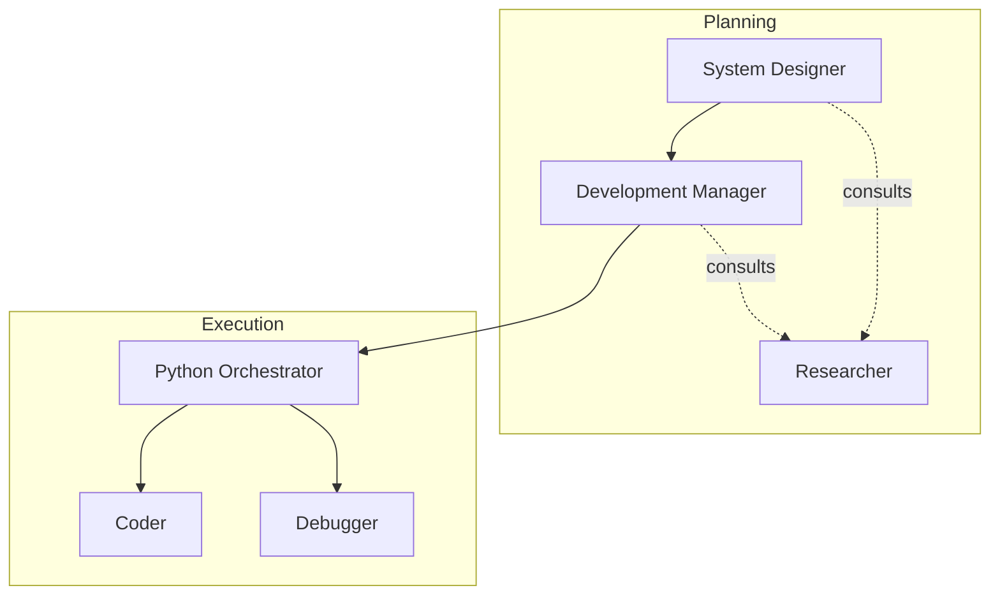

# the-gremlins

A repository of agents for vibe coding and creating more problems than existing.

> This folder holds the repository's **automation and agent library** — the
> agents, skills, hooks, and workflows used to work on this codebase. For the
> repository itself, start at the [root README](../README.md).

## Overview

This repository contains the AGENTS.md files for a set of agents, which help form a nice workflow - for both FROM SCRATCH and PATCH IT up style development. 

## The Purpose

I find that newer modes are powerful - but sometimes lack the structured workflow or structured thinking - sometimes leads to pitfalls. 
I experimented with custom agents, and adapted them to my workstyle, for end-to-end development in python and for debugging/feature introduction in large codebases. 

The workflow at the moment is 

## Work in Progress
