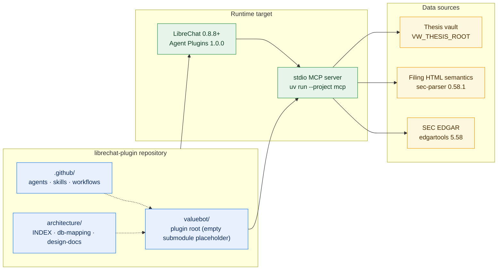

# Architecture Index — librechat-plugin

> **Last Updated:** 2026-10-27
> **Repository:** `/Users/rkarumugam/LocalFiles/Projects/librechat-plugin`
> **Purpose:** Maintain the high-level architecture map for the LibreChat plugin workspace and link every active design, data map and implementation blueprint.

---

## 1. Global system map



---

## 2. Documents

| Document | Purpose | Status |
|:---|:---|:---|
| [`architecture/INDEX.md`](./INDEX.md) | This index: global map, module map, decisions, gaps | ✅ Current |
| [`architecture/db-mapping.md`](./db-mapping.md) | Existing data landscape: `../db`, terminal/Lite state DBs, valuebot v1 contract | ✅ Current |
| [`architecture/design-docs/valuebot-v2/design.md`](./design-docs/valuebot-v2/design.md) | **Active design:** edgartools + sec-parser plugin architecture, tools, schemas, diagrams, build plan | 🚧 Proposed |
| [`architecture/design-docs/valuebot-v2/db-mapping.md`](./design-docs/valuebot-v2/db-mapping.md) | Planned v2 storage: facts mirror, artifact store, TTL cache, lifecycle | 🚧 Proposed |
| [`architecture/design-docs/valuebot-v2/implementation-plan.md`](./design-docs/valuebot-v2/implementation-plan.md) | **Active plan:** 25 tasks, reuse matrix, task flow, phase gates | ✅ Ready |
| [`architecture/design-docs/citation-redesign/design.md`](./design-docs/citation-redesign/design.md) | **Active design:** artifact-first citations, `citation_resolve` tool, validated URLs, raw-concept exports | ✅ Current |
| [`architecture/design-docs/citation-redesign/db-mapping.md`](./design-docs/citation-redesign/db-mapping.md) | Planned storage: `fundamentals/exports/`, resolver read paths, lifecycle | ✅ Current |
| [`architecture/design-docs/citation-redesign/implementation-plan.md`](./design-docs/citation-redesign/implementation-plan.md) | **Active plan:** 9 tasks, serve-from-cache resolvers, phase gates | ✅ Current |
| [`architecture/design-docs/multi-harness/design.md`](./design-docs/multi-harness/design.md) | **Active design:** run the same MCP server from Codex CLI, Claude Code, Copilot VS Code and DeepSeek `dsh`; Pi Agent and Copilot Desktop documented as unsupported/unverified. Docs-only adapters | ✅ Current |
| [`architecture/design-docs/multi-harness/implementation-plan.md`](./design-docs/multi-harness/implementation-plan.md) | **Active plan:** 10 tasks, `T1 → T2 → {T3..T7} → {T8, T9} → T10`, no new storage | ✅ Ready |

---

## 3. Current repository state

```
librechat-plugin/
├── .agent_state/                     session hook logs
├── .github/
│   ├── agents/                       25 agent definitions
│   ├── skills/                       code-abstraction, mermaid, git-skills, memory, debugging, …
│   ├── hooks/
│   └── workflows/
├── valuebot/                         empty git submodule placeholder (.git only)
└── architecture/                     ← this map
    ├── INDEX.md
    ├── db-mapping.md
    └── design-docs/
        └── valuebot-v2/
            ├── design.md
            └── db-mapping.md
```

There is **no plugin implementation** in this repository yet. The design in `design-docs/valuebot-v2/` is the blueprint for the first implementation.

---

## 4. Proposed module map (valuebot v2)

Modules are isolated by **data ownership**, not by technical layer. Each module owns one data source, one storage location, one public protocol and its own tools.

```
valuebot/
├── plugin.json                       Agent Plugins 1.0.0 manifest
├── mcp.json                          stdio server + env contract
├── README.md                         install, data contract, tools, verify
├── .env.example                      every variable with deployment values
├── docs/                             INSTALL-LIBRECHAT, ENDPOINTS
├── .python-version                   3.12
├── skills/
│   ├── grounded-citation/            citation protocol (5 source types)
│   ├── hypothesis-analysis/          claims → evidence → verdict
│   ├── ratio-analysis/               metric choice, quality states, input citations
│   ├── dcf-valuation/                assumptions, defaults vs history, sensitivity
│   └── semantic-report-reading/      section/note/table navigation
├── agent-builder-exports/            6 agent definitions + INSTALL
├── mcp/
│   ├── server.py                     composition root: build modules, tool registry, ping
│   ├── core/                         stateless platform — owns no domain data
│   │   ├── config.py                 env → roots, caps, versions
│   │   ├── contracts.py              LineItemProvider · VaultReader · reserved protocols
│   │   ├── models.py                 frozen dataclasses shared across boundaries
│   │   ├── envelope.py               response envelope + byte caps
│   │   ├── citations.py              citation factory + EDGAR URLs
│   │   ├── errors.py                 typed error codes (incl. module_unavailable)
│   │   ├── paths.py                  module_data_dir(name)
│   │   ├── logging.py                stderr-only logging
│   │   └── ttl_cache.py              per-module SQLite TTL cache
│   └── modules/
│       ├── fundamentals/             owns SEC XBRL facts, statements, line-item vocabulary
│       │   ├── api.py                LineItemProvider
│       │   ├── sources/              edgar_source.py
│       │   ├── domain/               concepts.py · statements.py
│       │   ├── store/                facts_store.py
│       │   ├── schema.sql
│       │   └── tools/                discovery · facts · statements
│       ├── analysis/                 owns metric definitions, computed values and the DCF
│       │   ├── api.py                AnalysisAPI
│       │   ├── domain/               metrics.py · engine.py · dcf.py
│       │   ├── store/                derived_cache.py
│       │   ├── schema.sql
│       │   └── tools/                ratios.py · valuation.py
│       ├── reports/                  owns filing index, filing HTML and sec-parser semantics
│       │   ├── api.py                ReportsAPI
│       │   ├── sources/              edgar_source.py · secparser_source.py
│       │   ├── domain/               profiles.py · sections.py · tables.py
│       │   ├── store/                filings_store.py · artifact_store.py
│       │   ├── schema.sql
│       │   └── tools/                filings · sections · tables
│       ├── thesis/                   owns the read-only vault index
│       │   ├── api.py                VaultAPI
│       │   └── tools/vault.py        thesis_read · thesis_annotations
│       ├── calendar/                 reserved — protocol only, no tools
│       └── price_action/             reserved — protocol only, no tools
└── tests/
    ├── unit/{fundamentals,analysis,reports,thesis}/
    ├── contract/                     import · schema · protocol · envelope · stdio isolation
    └── integration/                  offline fixtures · degradation · opt-in live probe
```

**Isolation rules (normative):**

1. A module imports `core` and third-party packages only. It never imports another `modules.*` package.
2. A module opens only its own SQLite file and artifact directory.
3. Cross-module data moves through `core.contracts` protocols and `core.models` dataclasses only.
4. Each module exports `API_VERSION`; the composition root validates before wiring.
5. A failed module is recorded as unavailable; its tools return `module_unavailable` while other modules keep serving.
6. Only one cross-module edge exists: `analysis → fundamentals` (`LineItemProvider`). `reports` and `thesis` are fully independent.
7. `calendar` and `price_action` are declared but register no tools and cannot be imported by v1 modules.

**Tool ownership:** `fundamentals` (5) · `analysis` (3) · `reports` (5) · `thesis` (2) = 15 domain tools, plus `ping` (16 registered), plus reserved `calendar_events` and `price_history`.

---

## 5. Current architectural state

| Area | State |
|:---|:---|
| Plugin manifest / MCP wiring | Not implemented; v1 reference exists in `ValueWaffleTerminal/valuebot` |
| Module isolation | Design: four implemented modules plus two reserved, one storage file each, protocol-only cross-module access |
| `fundamentals` | Design: edgartools 5.58 → SQLite fact mirror, statements, line-item contract; no filing data |
| `analysis` | Design: declarative metric catalog, pure engine, DCF with echoed assumptions and provenance, derived cache, consumes `LineItemProvider` only |
| `reports` | Design: filing index + status resolution, sec-parser 0.58.1 + 10-K item/note heuristics + custom table renderer, no cross-module dependency |
| `thesis` | Design: read-only vault + rebuildable index; no other module dependency |
| `calendar`, `price_action` | Reserved: protocol and storage plan only; no tools registered |
| Citations | Design: `sec-xbrl`, `sec-statement`, `sec-report`, `derived-analysis`, `thesis` |
| Multi-harness distribution | Implemented as docs-only adapters: `valuebot/harnesses/{claude-code,codex,copilot,deepseek,pi-agent}/INSTALL.md` + markdown persona wrappers; MCP server, skills and data stores unchanged. Pi Agent unsupported, Copilot Desktop unverified, `dsh` developer preview |
| Tests | Design only; isolation tests are part of the acceptance criteria; fixtures point at `../db` via `VW_FIXTURE_DB` |

---

## 6. Key design decisions (living)

| Decision | Rationale | Documented in |
|:---|:---|:---|
| Plugin root | `valuebot/` (approved) | — |
| Modules are split by data ownership | Each module changes, fails, stores and extracts independently | `design.md` §2.1, §2.2 |
| One SQLite file and one artifact directory per module | No shared migrations, locks, corruption or cross-module `JOIN` | `design.md` §2.10; `db-mapping.md` §3–§7 |
| Protocol-only cross-module access | Only `analysis → fundamentals`; `reports` and `thesis` stay independent | `design.md` §2.3, §2.9 |
| Import isolation enforced by tests | Prevents architecture drift on day one | `design.md` §6.4 |
| `fundamentals` owns the XBRL concept vocabulary | Analysis asks for line items, never concepts | `design.md` §2.5, §3.4 |
| `analysis` has no third-party dependency | Metrics are arithmetic; easiest module to test and extract | `design.md` §2.11 |
| Analysis values carry inputs and citations | Derived numbers stay traceable to XBRL facts | `design.md` §2.9 |
| Quality states instead of estimates | No zero substitution; `unavailable`, `not_meaningful`, `gap`, `partial` | `design.md` §2.5 |
| DCF always echoes assumptions | A parameter-free run must still show what the model assumed; policy defaults are labeled, never presented as observation | `design.md` §2.5.1, §3.5 |
| `reports` is fully independent | Filing index, download and parse are one lifecycle; no cross-module edge | `design.md` §2.6 |
| `calendar` and `price_action` are protocol stubs | Plugin shape is stable; no speculative source commitment | `design.md` §2.8 |
| SQLite fact mirror, not on-demand `EntityFacts` | Deterministic SQL; avoids 40–80 MB reparse and `fiscal_year` pitfalls | `design.md` §2.12 |
| Clear edgartools facts cache after ingest | Cache holds one company and 40–80 MB | `design.md` §2.12 |
| 10-K item heuristic is mandatory | sec-parser rejects Items 1A, 7, 7A, 8, 9+ | `design.md` §2.6 |
| Notes by heading regex, not level | 10-K notes level 0, 10-Q notes level 2 | `design.md` §2.6 |
| Custom table grid renderer | Library markdown loses colspan, omits delimiter, mutates tree | `design.md` §2.6 |
| Uniform response envelope with `module` field | One contract for every tool; failure isolation is visible | `design.md` §3.3 |
| Pin Python 3.11–3.13 | 3.14 cannot import edgartools or sec-parser | `design.md` §2.11 |
| Artifact-first citations | Citations carry an `artifact` locator; `citation_resolve` serves raw material from module stores (semantic cache, facts mirror, metric cache, vault); EDGAR URLs are validated fallbacks only — no `(index)` placeholders | `design-docs/citation-redesign/design.md` §3–§5 |
| No runtime dependency on `../db` | Live SEC + module caches; `../db` is fixture-only | `design.md` §6.5; `db-mapping.md` §12 |

---

## 7. Gaps and outstanding work

1. ❌ No plugin implementation — the `valuebot/` submodule is an empty placeholder.
2. ❌ The 10-K heuristic must be validated beyond AAPL (MSFT, a 20-F issuer, an 8-K).
3. ❌ 20-F/40-F/8-K/DEF 14A use generic semantic profiles; filing-specific coverage is future work.
4. ❌ The metric catalog is defined but not implemented; each formula needs a test. The DCF model and its default-derivation rules also need implementation and fixture tests.
5. ❌ `calendar` and `price_action` have no selected data source or verified rate limits.
6. ❌ Insider and proxy data have no module; not in v1 scope.
7. ❌ No live SEC integration test; offline fixtures exist under `../db`.
8. ❌ No UI work; LibreChat supplies the chat surface.

---

## 8. Where to look next

- **Design decisions and diagrams:** [`design-docs/valuebot-v2/design.md`](./design-docs/valuebot-v2/design.md)
- **Planned storage schema:** [`design-docs/valuebot-v2/db-mapping.md`](./design-docs/valuebot-v2/db-mapping.md)
- **Existing data locations:** [`db-mapping.md`](./db-mapping.md)
- **v1 implementation reference:** `/Users/rkarumugam/LocalFiles/Projects/ValueWaffleTerminal/valuebot/mcp`
- **Existing provider/toolbox reference:** `/Users/rkarumugam/LocalFiles/Projects/terminal-valuewaffle/server`
- **Real fixtures:** `/Users/rkarumugam/LocalFiles/Projects/db`
