# Database Mapping — librechat-plugin / ValueWaffle

> **Last Updated:** 2026-10-18
> **Scope:** All existing data storage, cache locations, formats and access methods used by the ValueWaffle projects that surround `librechat-plugin`. Includes the planned valuebot v2 storage pointer.
> **Repository root:** `/Users/rkarumugam/LocalFiles/Projects/librechat-plugin`
> **Primary data root (`../db`):** `/Users/rkarumugam/LocalFiles/Projects/db` — 1.5 GB, 6,394 files.

---

## 1. Visual data landscape

```mermaid
flowchart TB
    subgraph SEC["SEC / issuer data"]
        JSOND["debug/jsonData/{ticker}/<br/>companyFacts · submissions · concept_*<br/>leadership_submissions"]
        FILING["filing/{region}/{TICKER}/{FORM}/<br/>date_accn_doc.htm"]
        MERGED["debug/merged/{region}/{TICKER}/annual/<br/>ui_payload · toc · merged_tables.md<br/>filings/*.tables.filtered.md"]
    end

    subgraph PEOPLE["People data"]
        LEAD["leadership-debug/{ticker}/<br/>person_view · scores_report<br/>merged_board · merged_compensation"]
        LEAD2["leadership_debug/{TICKER}/<br/>per-filing + secparser_parsed.json"]
        INS["insider-debug/{ticker}/summary.json"]
    end

    subgraph REF["Reference data"]
        DIR["directory/<br/>listed companies CSV/XLSX<br/>config_files/"]
        VA["value-agent/<br/>master_list_of_stocks.csv/.xlsx"]
    end

    subgraph MACRO["Macro / market data"]
        CACHE["cache/{app}/cache.sqlite<br/>raw_cache · derived_cache"]
        CBOE["cboe/*.csv"]
        FINRA["finra/margin-statistics.xlsx"]
        XBRLEU["xbrl_eu/or-pa/combined_facts.json"]
        MACROSRC["macro-dataset-sources/<br/>WVS · UCDP · SIPRI · EM-DAT"]
        EVENTS["pipeline-events/{TICKER}/events.jsonl"]
        YFC["yfinance_cache/ (empty)"]
    end

    subgraph STATE["Application state"]
        WS["terminal-valuewaffle/db/state/<br/>workspace.sqlite3 · provider-cache.sqlite3"]
        WSL["ValueWaffleLite/db/state/<br/>workspace.sqlite3 · provider_cache.sqlite3"]
    end

    subgraph V1["valuebot v1 plugin data"]
        V1DB["VW_DB_ROOT<br/>/vw-data/db (read-only)"]
        V1C["VW_MCP_CACHE<br/>cache.sqlite (TTL)"]
        V1T["VW_THESIS_ROOT<br/>theses/{TICKER}/thesis.md"]
    end

    subgraph V2["valuebot v2 planned — one store per module"]
        V2F["modules/fundamentals/cache.sqlite<br/>companies · facts · cache_entries"]
        V2FH["edgar/<br/>shared edgartools HTTP cache"]
        V2A["modules/analysis/cache.sqlite<br/>metric_results · catalog_snapshot"]
        V2R["modules/reports/manifest.sqlite<br/>artifacts · filings_index · cache_entries"]
        V2RF["modules/reports/artifacts/{cik}/<br/>semantic.json.gz · html.gz"]
        V2T["modules/thesis/index.sqlite<br/>thesis_index · annotation_index"]
    end

    JSOND --> V1DB
    FILING --> V1DB
    MERGED --> V1DB
    LEAD --> V1DB
    INS --> V1DB
    V1DB --> V1C
    V1T --> V1C
    V2F --> V2A
    V2FH --> V2F
    V2R --> V2RF
    V2T --> V2R

    classDef sec fill:#FEF7E0,stroke:#F29900,color:#4A2A00
    classDef people fill:#E6F4EA,stroke:#1E8E3E,color:#0D3B1E
    classDef ref fill:#E8F0FE,stroke:#1A73E8,color:#0B2A5B
    classDef macro fill:#F3E8FD,stroke:#8E24AA,color:#3B0A4A
    classDef state fill:#FCE8E6,stroke:#C5221F,color:#4A0B0A
    classDef v1 fill:#F1F3F4,stroke:#5F6368,color:#202124
    classDef v2 fill:#FFF3E0,stroke:#EF6C00,color:#4A2600

    class JSOND,FILING,MERGED sec
    class LEAD,LEAD2,INS people
    class DIR,VA ref
    class CACHE,CBOE,FINRA,XBRLEU,MACROSRC,EVENTS,YFC macro
    class WS,WSL state
    class V1DB,V1C,V1T v1
    class V2F,V2FH,V2A,V2R,V2RF,V2T v2
```



**Size distribution (`../db`)**

| Directory | Size | Primary content |
|:---|---:|:---|
| `macro-dataset-sources/` | 871 MB | WVS SPSS, UCDP CSVs, SIPRI/EM-DAT XLSX |
| `cache/` | 217 MB | Macro app SQLite + one 226 MB gzip pickle |
| `filing/` | 211 MB | SEC filing HTML (US/AAPL, EU packages) |
| `directory/` | 129 MB | Listed-company reference files and parse configs |
| `debug/` | 53 MB | Company facts, submissions, merged tables, debug XLSX |
| `xbrl_eu/` | 29 MB | EU combined facts JSON |
| `leadership_debug/` | 18 MB | Per-filing leadership artefacts + secparser output |
| `leadership-debug/` | 10 MB | Merged leadership artefacts |
| `cboe/` | 1.0 MB | Put/call ratio CSVs |
| `pipeline-events/` | 124 KB | JSONL pipeline event logs |
| `insider-debug/` | 92 KB | Insider summaries |
| `value-agent/` | 24 KB | Master stock lists |
| `finra/` | 20 KB | Margin statistics XLSX |
| `fred/`, `sim-fin/`, `dbnomics/`, `yfinance_cache/` | ~0–8 KB | Empty placeholders |

---

## 2. SEC raw JSON (`../db/debug/jsonData/`)

Layout: `debug/jsonData/{ticker}/` for `aapl`, `goog`, `msft`.

| File | Size (AAPL/GOOG/MSFT) | Format | Schema |
|:---|:---|:---|:---|
| `companyFacts_<CIK>.json` | 7.3 MB / 5.9 MB / 9.3 MB | JSON | `{cik:int, entityName:str, facts:{taxonomy:{concept:{label, description, units:{unit:[{end, val, accn, fy, fp, form, filed, frame?}]}}}}}` |
| `submissions_<CIK>.json` | 292–324 KB | JSON | 24 keys: `cik` (zero-padded string), `entityType`, `sic`, `sicDescription`, `name`, `tickers`, `exchanges`, `ein`, `category`, `fiscalYearEnd`, `addresses`, `formerNames`, `filings` |
| `concept_<Tag>_<CIK>.json` | 4–32 KB | JSON | `{cik:int, taxonomy, tag, label, description, entityName, units:{unit:[{end,val,accn,fy,fp,form,filed,frame?}]}}` |
| `leadership_submissions.json` | AAPL only | JSON | Leadership filing index used by v1 `people.py` |
| `leadership_filings_index.json` | AAPL only | JSON | Filing index for proxy extraction |

**Access:** valuebot v1 `facts.py` parses `companyFacts_*.json`; `discovery.py` scans `jsonData/*/`; `filings.py` reads `submissions_*.json`. **Policy:** read-only at runtime.

---

## 3. SEC filing HTML (`../db/filing/`)

```
filing/
├── de/                                   (empty)
├── eu/or.pa/packages/<LEI>/<YYYY-MM-DD>.zip   20–38 MB each
├── ind/SAIL/                             (empty)
└── us/AAPL/
    ├── 10-K/        17 .htm (FY2009–FY2025) + "A" marker file
    ├── 10-Q/        51 .htm
    ├── DEF 14A/     5 .htm
    ├── DEFA14A/     6 .htm
    ├── DEF_14A/     5 .htm (duplicate spelling)
    └── htm/         submissions JSON + AAPL_filings_database.xlsx
```

**Naming**

| Kind | Pattern | Example |
|:---|:---|:---|
| Annual/quarterly | `<PERIOD_END>_<ACCESSION>_<primary-doc>.htm` | `2025-09-27_0000320193-25-000079_aapl-20250927.htm` |
| Proxy | `<ACCESSION>_<doc-stem>.htm` | `000130817925000008_aapl4359751-def14a.htm` |
| Merged markdown | `{TICKER}_{FORM}_{PERIOD_END}_{ACCESSION}_{doc}.tables.filtered.md` | `AAPL_10-K_2024-09-28_..._aapl-20240928.tables.filtered.md` |
| EU package | `<LEI-dir>/<YYYY-MM-DD>.zip` | `or.pa-pa_529900JI1GG6F7RKVI53/2025-12-31.zip` |

**Access:** v1 `filings.py` scans form directories with case/spelling tolerance; `providers/sec.py` downloads fresh HTML in the terminal project. **Policy:** read-only.

---

## 4. Merged tables (`../db/debug/merged/`)

Only `us/AAPL/annual/` exists (no quarterly).

| File | Size | Format | Schema |
|:---|:---|:---|:---|
| `ui_payload.json` | 1.2 MB | JSON | `{tables:[287], toc:[287], meta:{3}}` |
| `toc.json` | 28 KB | JSON | `[{id:"merged-table-1", heading, table_num}]` |
| `merged_tables.md` | 5,149 lines | Markdown | Cross-filing collation header + `## Table N` + `- Caption:` + GFM table |
| `filings/*.tables.filtered.md` | ~18 files | Markdown | `# <doc> — Tables`, `## Table N`, GFM tables |

**Access:** v1 `filings.py` uses `*.tables.filtered.md` for `filing_tables`. **Policy:** read-only. **v2:** not used; tables are re-extracted from filing HTML.

Adjacent debug artefacts: `debug/data/us/{aapl,goog,googl,msft}/` → `debug_ANN.xlsx`, `debug_QUAR.xlsx`, `interm_ANN.xlsx`, `interm_QUAR.xlsx`, `Ratios_debug.xlsx`, `debug_daily.csv`; `debug/fig/us/{aapl,goog,msft}/<date>/A_Page*.png`.

---

## 5. Leadership and proxy data (`../db/leadership-debug/`, `../db/leadership_debug/`)

### 5.1 `leadership-debug/{ticker}/`

12 filings × 5 artefacts + 6 aggregates + `gfp/`.

| File | Format | Schema |
|:---|:---|:---|
| `{accn}_{doc}_person_view.json` | JSON | Person-centric table view |
| `{accn}_{doc}_scores_report.json` | JSON | Table classification scores and flags |
| `{accn}_{doc}_unique_persons.json` | JSON | Deduplicated person names |
| `{accn}_{doc}_filtered_tables.md` | Markdown | Leadership-relevant tables |
| `{accn}_{doc}_raw_tables.md` | Markdown | All extracted tables |
| `merged_board.json` | JSON | `{symbol, directors[], merged_rows[], years[], columns[]}`; columns `Director Name, FYxxxx_role, FYxxxx_age, FYxxxx_director_since, FYxxxx_independent, FYxxxx_committees` |
| `merged_compensation.json` | JSON | `{symbol, neos[], merged_rows[], fiscal_years[], filing_years[], columns[]}`; 25 columns: `Name` + per-FY `_salary,_bonus,_stock_awards,_non_equity,_all_other,_total` |
| `aggregate_person_view.json` | JSON | Dict keyed by `person_key` (15 people): `{person_key, display_name, titles, table_count, tables[]}` |
| `aggregate_scores_report.json` | JSON | `{description, source, total_tables:537, leadership_relevant_count:32, leadership_relevant_indices[], category_counts{}, tables[]}`; each table has `id, heading, caption, ncols, nrows, is_leadership_relevant, category, rejected_reason, scores{12}, flags{15}, keep, removal_reason` |
| `aggregate_unique_persons.json` | JSON | Aggregate person list |
| `pipeline_summary.json` | JSON | `{symbol, years:int, filings:[{accession,date,form,file}], files_processed:int}` |
| `aggregate_filtered_tables.md` | Markdown | 677 lines; category summary + `## Table N` + heading/caption/scores/status/columns + GFM table |
| `aggregate_raw_tables.md` | Markdown | 5,770 lines; all tables |
| `gfp/` | JSON/Markdown/log | `identity_map.json`, `leadership_card.json`, `merged_board.json/.md`, `merged_summary_comp.json/.md`, `gfp_pipeline.log`, `debug/01_raw_tables.json`, `debug/04_classifier_summary.json` |

Ticker sizes: `aapl` 8.2 MB, `amzn` 2.1 MB, `CB` 148 KB, `MSFT` 36 KB.

### 5.2 `leadership_debug/{TICKER}/`

Lowercase-underscore variant, 18 MB for AAPL. Per-filing outputs plus `secparser/<ACCESSION>/<ACCESSION>/secparser_parsed.json`. This is the closest existing precedent for a sec-parser artifact store.

**Access:** v1 `people.py` reads `*_person_view.json`; `leadership_read`/`proxy_persons` serve it. **Policy:** read-only.

---

## 6. Insider data (`../db/insider-debug/`)

| File | Format | Schema |
|:---|:---|:---|
| `{ticker}/summary.json` | JSON | `{symbol, buys:str, sells:str, net:str, largest:str, transactions:[{date, owner, type, shares, price, value}], error:null}` |

Counts: AAPL 192 transactions, AMZN 329. Values are strings; `largest` is an em dash when absent. **Access:** v1 `people.py` `insider_read`. **Policy:** read-only.

---

## 7. Reference and directory data (`../db/directory/`, `../db/value-agent/`)

| File | Format | Schema / note |
|:---|:---|:---|
| `directory/Listed-companies-bse-1.csv` | CSV (`;` delimiter) | `Security Code;Issuer Name;Security Id;Security Name;ISIN No;Industry;Instrument;Sector Name` |
| `directory/Listed-companies-xetra_comb.xlsx` | XLSX | Sheet `Sheet 1` |
| `directory/nasdaq_screener_1713087444333.xlsx` | XLSX | Sheet `Sheet 1` |
| `directory/listed-companies-euronext.xlsx` | HTML error page | Not a valid workbook |
| `directory/listed-companies-hongkong.xlsx` | HTML error page | Not a valid workbook |
| `directory/listed-companies-europe-nasdaq.csv` | HTML error page | Not a valid CSV |
| `directory/config_files/main.xlsx`, `banking.xlsx`, `IFRS_calculation.xlsx` | XLSX | Parse/calculation configuration |
| `directory/config_files/parse_config_usgaap_xbrl.json` | JSON (99 KB) | US-GAAP XBRL parse config |
| `directory/config_files/main_*.csv` | CSV | Tag maps and calculation hierarchy |
| `directory/config_files/scale_factors.py` | Python | Scale factors used by the terminal |
| `value-agent/master_list_of_stocks.csv` | CSV | `symbol,date,is_buffett,entry_year,exit_year,data_source,notes`; line 2 is a comment banner |
| `value-agent/master_list_of_stocks.xlsx` | XLSX | Sheet `Sheet1` |

**Access:** v1 `discovery.py` falls back to `directory/*.csv` for ticker names. **Policy:** read-only.

---

## 8. Macro and market data

| Path | Size | Format | Schema / note |
|:---|:---|:---|:---|
| `cache/economic_state/cache.sqlite` | 336 KB | SQLite | `raw_cache` 40 rows, `derived_cache` 0 |
| `cache/macro_app/cache.sqlite` | 266 KB | SQLite | `raw_cache` 26, `derived_cache` 0 |
| `cache/market_enthusiasm/cache.sqlite` | 20 KB | SQLite | `raw_cache` 0, `derived_cache` 1 |
| `cache/market_enthusiasm/payload-*.pkl.gz` | 226 MB | gzip pickle | Cached market-enthusiasm payload |
| `cache/dalio_app/cache.sqlite` | 29 KB | SQLite | `raw_cache` 0, `derived_cache` 1 |
| `cboe/*.csv` | 10 files | CSV | Row 1 disclaimer, row 2 metadata, row 3 header; put/call ratios |
| `finra/margin-statistics.xlsx` | 20 KB | XLSX | Sheet `Customer Margin Balances` |
| `xbrl_eu/or-pa/combined_facts.json` | 28.9 MB | JSON | Dict keyed by date (`2022-01-01`…`2026-01-01`) |
| `macro-dataset-sources/WVS/WVS_Time_Series_1981-2022_spss_v5_0.sav` | 611 MB | SPSS | World Values Survey |
| `macro-dataset-sources/vote-view/HSall_members.csv` | 5.9 MB | CSV | 51,060 rows, 23 cols |
| `macro-dataset-sources/EM-DAT/public_emdat_2026-05-25.xlsx` | 6.2 MB | XLSX | Sheets `EM-DAT Data`, `EM-DAT Info` |
| `macro-dataset-sources/BAMLH0A0HYM2-history/*.csv` | 788 lines | CSV | `date,value` |
| `macro-dataset-sources/UCDP/*.csv` | 17 files | CSV | `GEDEvent_v25_1.csv` 239 MB |
| `macro-dataset-sources/SIPRI-Milex-data-1949-2025_v1.2.xlsx` | — | XLSX | 10 sheets |
| `pipeline-events/{TICKER}/events.jsonl` | 495 lines total | JSONL | `{timestamp, symbol, event, stage, pct, message}` |
| `yfinance_cache/` | 0 B | — | Empty |
| `fred/`, `dbnomics/`, `sim-fin/` | 0–8 KB | — | Empty placeholders |

**Access:** consumed by separate macro/market applications, not by valuebot. **Policy:** read-only from the plugin's perspective.

---

## 9. SQLite schemas

### 9.1 Macro caches (`../db/cache/*/cache.sqlite`)

```sql
CREATE TABLE raw_cache (
    id INTEGER PRIMARY KEY, metric_id TEXT NOT NULL,
    start_date TEXT NOT NULL, end_date TEXT NOT NULL,
    retrieved_at TEXT NOT NULL, source TEXT, endpoint TEXT,
    coverage_start TEXT, coverage_end TEXT, source_name TEXT,
    data_license TEXT, provenance TEXT, payload BLOB,
    payload_path TEXT, payload_format TEXT);
CREATE UNIQUE INDEX raw_cache_key ON raw_cache(metric_id, start_date, end_date);

CREATE TABLE derived_cache (
    id INTEGER PRIMARY KEY, metric_id TEXT NOT NULL,
    period_key TEXT NOT NULL, benchmark TEXT,
    normalization TEXT NOT NULL, retrieved_at TEXT NOT NULL,
    source_name TEXT, data_license TEXT, provenance TEXT,
    payload BLOB, payload_path TEXT, payload_format TEXT,
    UNIQUE(metric_id, period_key, benchmark, normalization));
```

### 9.2 Terminal workspace state (`../terminal-valuewaffle/db/state/`)

```sql
-- workspace.sqlite3 (1 row)
CREATE TABLE workspace_state (
    state_key TEXT PRIMARY KEY, payload TEXT NOT NULL, updated_at REAL NOT NULL);

-- provider-cache.sqlite3 (1 row)
CREATE TABLE cache_entries (
    namespace TEXT NOT NULL, cache_key TEXT NOT NULL,
    created_at REAL NOT NULL, expires_at REAL NOT NULL,
    payload BLOB NOT NULL, PRIMARY KEY (namespace, cache_key));
CREATE INDEX idx_cache_expiry ON cache_entries(expires_at);
```

### 9.3 Lite workspace state (`../ValueWaffleLite/db/state/`)

Same DDL as the terminal; the provider cache file is named `provider_cache.sqlite3` (underscore) instead of `provider-cache.sqlite3` (hyphen). `workspace.sqlite3` 1 row; `provider_cache.sqlite3` 3 rows.

---

## 10. valuebot v1 plugin data contract (`ValueWaffleTerminal/valuebot`)

Precedence `mcp.json env:` → `mcp/config.py` default; `${VAR}` and `${VAR:-default}` templates expand with a bounded fixpoint. Unresolved variables are recorded, never fatal.

| Variable | `mcp.json` value | Default | Meaning |
|:---|:---|:---|:---|
| `VW_DB_ROOT` | `/vw-data/db` | `${PLUGIN_DATA}/data` | Read-only data tree |
| `VW_THESIS_ROOT` | `/vw-data/theses` | `${PLUGIN_DATA}/theses` | Read-only thesis vault |
| `VW_MCP_CACHE` | `${PLUGIN_DATA}/cache.sqlite` | `${PLUGIN_DATA}/cache.sqlite` | Only writable file |
| `VW_STATEMENTS_CONFIG` | — | `${PLUGIN_ROOT}/mcp/config/statements.json` | Statement-line concept map |
| `VW_GCS_BUCKET` | `""` | `""` | Optional pull-on-miss |
| `VW_ENABLE_PRICE` | `"0"` | `"0"` | Optional price tool |

**Kinds and resolution order**

| Kind | Candidate bases |
|:---|:---|
| `jsonData` | `DB_ROOT/debug/jsonData`, `DB_ROOT/jsonData` |
| `merged` | `DB_ROOT/debug/merged[/<region>]`, `DB_ROOT/merged[/<region>]` |
| `leadership-debug` | `DB_ROOT/leadership-debug`, `DB_ROOT/debug/leadership-debug` |
| `insider` | `DB_ROOT/insider`, `DB_ROOT/insider-debug` |
| `insider-debug` | `DB_ROOT/insider-debug`, `DB_ROOT/insider` |
| `filing` | `DB_ROOT/filing/<region>`, `DB_ROOT/filing/us`, other region dirs, `DB_ROOT/filing` |

**Read paths by tool**

| Tool module | Paths |
|:---|:---|
| `discovery.py` | `debug/jsonData/*/`, `directory/*.csv`, `submissions_*.json`, `companyFacts_*.json`, merged/filing/leadership/insider availability |
| `facts.py` | `debug/jsonData/<ticker>/companyFacts_*.json` |
| `filings.py` | `submissions_*.json`, `companyFacts_*.json`, `filing/<region>/<TICKER>/<FORM>/`, `merged/**/filings/*.tables.filtered.md`, `leadership-debug/<T>/*_tables.md` |
| `people.py` | `leadership-debug/<T>/*_person_view.json`, `insider*/summary.json` |
| `thesis.py` | `THESIS_ROOT/{TICKER}/thesis.md`, `{TICKER}/.thesis/annotations/*.json` |
| `cache.py` | `config.CACHE_PATH` (`cache.sqlite`) |

**Tools:** `symbol_resolve`, `data_availability`, `facts_query`, `facts_statement`, `filing_list`, `filing_tables`, `filing_sections`, `filing_section`, `proxy_persons`, `leadership_read`, `insider_read`, `thesis_read`, `thesis_annotations`, `ping` (+ `price_summary` when enabled). **Policy:** never writes to data roots or GCS.

---

## 11. valuebot v2 planned storage

The redesign replaces the v1 read-only file tree with live SEC data plus a local cache. Full schema, lifecycle and size estimates:

- [design-docs/valuebot-v2/db-mapping.md](./design-docs/valuebot-v2/db-mapping.md)
- [design-docs/valuebot-v2/design.md](./design-docs/valuebot-v2/design.md)

Summary (per-module isolation):

| Module | Store | Location | Content |
|:---|:---|:---|:---|
| `fundamentals` | `cache.sqlite` | `${PLUGIN_DATA}/modules/fundamentals/cache.sqlite` | `companies`, `facts`, `cache_entries` |
| `fundamentals` | HTTP cache | `${PLUGIN_DATA}/edgar/` | Shared, disposable edgartools HTTP cache |
| `analysis` | `cache.sqlite` | `${PLUGIN_DATA}/modules/analysis/cache.sqlite` | `metric_results`, `catalog_snapshot`; DCF is computed on demand and not persisted |
| `reports` | `manifest.sqlite` + files | `${PLUGIN_DATA}/modules/reports/` | `filings_index`, `artifacts`, semantic JSON, raw HTML |
| `thesis` | `index.sqlite` | `${PLUGIN_DATA}/modules/thesis/index.sqlite` | `thesis_index`, `annotation_index` |
| `calendar` (reserved) | `cache.sqlite` | `${PLUGIN_DATA}/modules/calendar/` | Not created in v1 |
| `price_action` (reserved) | `cache.sqlite` | `${PLUGIN_DATA}/modules/price_action/` | Not created in v1 |
| Thesis vault | read-only source | `${VW_THESIS_ROOT}` | Unchanged, user-authored |

No module reads another module's store; cross-module data moves through `core.contracts` protocols. No runtime reads from `../db`; the existing tree remains the test fixture source.

---

## 12. Access and write policy

| Store | Reader | Writer | Mutability |
|:---|:---|:---|:---|
| `../db/debug/jsonData` | v1 facts/discovery | External downloader | Read-only for plugin |
| `../db/filing` | v1 filings | External downloader | Read-only for plugin |
| `../db/debug/merged` | v1 filings | Pipeline | Read-only for plugin |
| `../db/leadership-debug`, `leadership_debug` | v1 people | Pipeline | Read-only for plugin |
| `../db/insider-debug` | v1 people | Pipeline | Read-only for plugin |
| `../db/directory` | v1 discovery | Manual | Read-only for plugin |
| `../db/cache`, macro stores | Separate apps | Separate apps | Not used by plugin |
| Terminal/Lite `workspace.sqlite3` | Terminal UI | Terminal UI | Not used by plugin |
| Terminal/Lite `provider-cache.sqlite3` | Terminal providers | Terminal providers | Not used by plugin |
| Plugin `${PLUGIN_DATA}/modules/*/` | Owning module only | Owning module only | Writable, rebuildable cache |
| Plugin `${PLUGIN_DATA}/artifacts` | Plugin | Plugin | Writable cache |
| Thesis vault | Plugin | User | Read-only for plugin |

---

## 13. Data integrity notes

1. `debug/jsonData/*/companyFacts_*.json` is the authoritative fixture for v1 facts and for v2 offline tests. It is **not** the same file as edgartools' own local cache; both derive from SEC `companyfacts`.
2. `DEF 14A` and `DEF_14A` are duplicate directory spellings for the same form; any scanner must normalize form spellings.
3. `directory/listed-companies-euronext.xlsx`, `listed-companies-hongkong.xlsx` and `listed-companies-europe-nasdaq.csv` are HTML error pages despite their extensions. Do not parse them as data.
4. `cache/market_enthusiasm/payload-*.pkl.gz` is a 226 MB pickle; it dominates the `cache/` size and is not used by valuebot.
5. `insider-debug/summary.json` uses string values for `buys`, `sells`, `net`, `largest`; numeric parsing must be explicit.
6. `leadership-debug/aggregate_scores_report.json` is the largest leadership artefact (608 KB) and carries 12 scores + 15 flags per table; it is a filter output, not raw data.
7. The v1 provider cache and workspace state use the same schema in both terminal projects but differ in filename spelling (`provider-cache` vs `provider_cache`).
