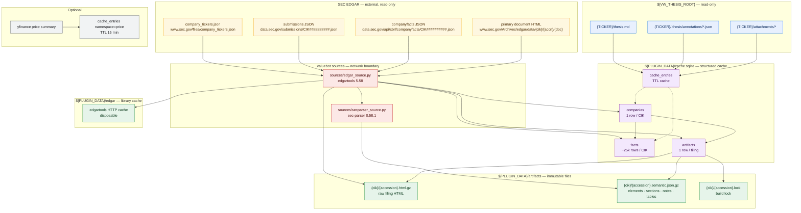

# valuebot v2 — Planned Data Mapping

> **Status:** Proposed — follows [design.md](./design.md)
> **Date:** 2026-10-18
> **Scope:** Planned storage, cache, artifact and read-only data locations for the redesigned `valuebot` plugin.
> **Note:** This file moves into [architecture/db-mapping.md](../../db-mapping.md) once the feature is implemented and validated.

---

## 1. Visual data landscape



---

## 2. Environment and roots

All roots resolve with **`mcp.json` `env:` → `config.py` default** precedence. LibreChat spawns stdio MCP servers with only the literal `env` block plus default process variables, so container-level environment variables do not reach the child process.

| Variable | `mcp.json` value | Default | Meaning |
|:---|:---|:---|:---|
| `PLUGIN_ROOT` | — | plugin directory | Read-only plugin tree |
| `PLUGIN_DATA` | `${PLUGIN_DATA}` (LibreChat) | `~/.valuebot` | Writable plugin data root |
| `EDGAR_IDENTITY` | `ValueWaffle Research research@example.com` | `""` | SEC contact identity (`Name email`); required for data tools |
| `EDGAR_LOCAL_DATA_DIR` | `${PLUGIN_DATA}/edgar` | `${PLUGIN_DATA}/edgar` | edgartools HTTP cache |
| `EDGAR_RATE_LIMIT_PER_SEC` | `5` | `5` | Request throttle |
| `EDGAR_HTTP_TIMEOUT` | `30` | `30` | Seconds |
| `VW_THESIS_ROOT` | `/vw-data/theses` | `${PLUGIN_DATA}/theses` | Read-only thesis vault |
| `VW_MCP_CACHE` | `${PLUGIN_DATA}/cache.sqlite` | `${PLUGIN_DATA}/cache.sqlite` | SQLite cache |
| `VW_ARTIFACT_ROOT` | `${PLUGIN_DATA}/artifacts` | `${PLUGIN_DATA}/artifacts` | Gzip artifacts |
| `VW_MAX_HTML_MB` | `40` | `40` | Hard cap on filing HTML |
| `VW_MAX_ARTIFACT_MB` | `512` | `512` | Artifact LRU cap |
| `VW_MAX_FACTS_COMPANIES` | `100` | `100` | Facts mirror cap |
| `VW_CACHE_MB` | `64` | `64` | TTL cache cap |
| `VW_ARTIFACT_LRU` | `2` | `2` | In-memory decompressed artifacts |
| `VW_ENABLE_PRICE` | `0` | `0` | Optional price tool |
| `UV_PROJECT_ENVIRONMENT` | `${PLUGIN_DATA}/uv-env` | — | uv runtime |
| `UV_CACHE_DIR` | `${PLUGIN_DATA}/uv-cache` | — | uv cache |

---

## 3. SQLite schema (`${PLUGIN_DATA}/cache.sqlite`)

WAL journaling, `foreign_keys=ON`, `busy_timeout=5000`, one connection per process. The TTL cache and the structured stores share the file so there is one writable artifact to back up or discard.

### 3.1 `companies`

| Column | Type | Constraints | Purpose |
|:---|:---|:---|:---|
| `cik` | INTEGER | PRIMARY KEY | SEC CIK |
| `ticker` | TEXT | NOT NULL | Primary ticker at sync time |
| `name` | TEXT | NOT NULL | Entity name |
| `exchange` | TEXT | | Primary exchange |
| `sic` | TEXT | | SIC code |
| `industry` | TEXT | | SIC description |
| `fiscal_year_end` | TEXT | | `MMDD` as reported |
| `filer_category` | TEXT | | Large accelerated / accelerated / etc. |
| `is_foreign` | INTEGER | NOT NULL DEFAULT 0 | 20-F/40-F indicator |
| `updated_at` | REAL | NOT NULL | Profile sync time |
| `facts_synced_at` | REAL | | Last facts ingest |
| `facts_access` | REAL | | LRU timestamp |
| `fact_count` | INTEGER | NOT NULL DEFAULT 0 | Rows in `facts` |
| `facts_estimated_bytes` | INTEGER | NOT NULL DEFAULT 0 | `fact_count * 200` |

**Indexes:** primary key on `cik`; index on `ticker`.

**Eviction:** when the company count exceeds `VW_MAX_FACTS_COMPANIES` (100) or `SUM(facts_estimated_bytes)` exceeds 500 MB, delete whole companies ordered by `facts_access ASC`, then `DELETE FROM facts WHERE cik=?`. Evicting whole companies keeps every remaining company internally consistent. Optionally `PRAGMA incremental_vacuum` / `VACUUM` after a batch of evictions.

### 3.2 `facts`

| Column | Type | Constraints | Purpose |
|:---|:---|:---|:---|
| `fact_key` | TEXT | PRIMARY KEY | `sha256(cik, concept, unit, period_type, period_start, period_end, accession, dimensions)[:24]` |
| `cik` | INTEGER | NOT NULL REFERENCES companies(cik) ON DELETE CASCADE | Issuer |
| `concept` | TEXT | NOT NULL | Local concept name, e.g. `RevenueFromContractWithCustomerExcludingAssessedTax` |
| `taxonomy` | TEXT | NOT NULL | `us-gaap`, `dei`, `ifrs-full`, … |
| `label` | TEXT | | Human label from the fact |
| `unit` | TEXT | NOT NULL | `USD`, `shares`, `USD/shares`, … |
| `value` | TEXT | | Raw value as reported |
| `numeric_value` | REAL | | Parsed number when possible |
| `period_type` | TEXT | NOT NULL | `instant` or `duration` |
| `period_start` | TEXT | | ISO date for duration facts |
| `period_end` | TEXT | NOT NULL | ISO date |
| `duration_days` | INTEGER | | Computed at ingest |
| `fiscal_year` | INTEGER | | As reported by the filing |
| `fiscal_period` | TEXT | | `FY`, `Q1`…`Q4` |
| `form_type` | TEXT | | `10-K`, `10-Q`, … |
| `accession` | TEXT | | Filing accession |
| `filing_date` | TEXT | | ISO date |
| `is_audited` | INTEGER | | 0/1/null |
| `is_restated` | INTEGER | | 0/1/null |
| `data_quality` | TEXT | | edgartools quality flag |
| `confidence_score` | REAL | | edgartools confidence |
| `dimensions_json` | TEXT | | Serialized dimensions when present |

**Indexes**

```sql
CREATE INDEX idx_facts_concept ON facts(cik, concept, period_end);
CREATE INDEX idx_facts_period  ON facts(cik, period_end, period_type);
CREATE INDEX idx_facts_fy      ON facts(cik, fiscal_year, fiscal_period);
CREATE INDEX idx_facts_form    ON facts(cik, form_type, filing_date);
```

**Canonical queries**

```sql
-- Annual series: robust to 52/53-week fiscal years; one row per period_end,
-- preferring the latest filing (restatements/comparatives collapse into it).
WITH annual AS (
  SELECT period_end, fiscal_year, fiscal_period, duration_days, numeric_value,
         form_type, accession, filing_date,
         ROW_NUMBER() OVER (
           PARTITION BY period_end
           ORDER BY filing_date DESC, (form_type = '10-K') DESC
         ) AS rn
  FROM facts
  WHERE cik = ? AND concept = ? AND unit = ?
    AND period_type = 'duration' AND duration_days BETWEEN 350 AND 380
)
SELECT period_end, fiscal_year, fiscal_period, duration_days, numeric_value,
       form_type, accession, filing_date
FROM annual
WHERE rn = 1
ORDER BY period_end DESC
LIMIT ?;

-- Provenance
-- Step 1: load the CIK's annual and instant facts once (~25k rows) and index
--         them in Python by (concept, period_end).
SELECT concept, period_end, numeric_value, accession, form_type, filing_date
FROM facts
WHERE cik = ? AND (
      (period_type = 'duration' AND duration_days BETWEEN 350 AND 380)
   OR period_type = 'instant'
);

-- Step 2: resolve one period_end per statement label from anchor concepts
--         (Assets / Revenues / CFO) by matching numeric_value, then attach
--         each row to the earliest 10-K fact for (concept, period_end).
--         Never join on fiscal_year: it is the filing year, not the period year.
```

> **Critical:** `fiscal_year` on a fact is the fiscal year of the **filing** that tagged it. A FY2025 10-K tags its FY2024 comparative with `fiscal_year=2025`. Statement provenance, annual series and period filters therefore use `period_end` and `duration_days`, never `fiscal_year`.

```sql
-- Optional: filing-year metadata for display only
SELECT concept, fiscal_year, fiscal_period, accession, filing_date
FROM facts
WHERE cik = ? AND accession = ?;
```

### 3.3 `artifacts`

| Column | Type | Constraints | Purpose |
|:---|:---|:---|:---|
| `accession` | TEXT | PRIMARY KEY | Filing accession |
| `cik` | INTEGER | NOT NULL | Issuer |
| `form` | TEXT | NOT NULL | `10-K`, `10-Q`, … |
| `filed` | TEXT | | ISO date |
| `period_of_report` | TEXT | | ISO date |
| `primary_document` | TEXT | | SEC document filename |
| `source_url` | TEXT | | SEC Archives URL |
| `profile` | TEXT | NOT NULL | `10-K`, `10-Q`, `8-K`, `proxy`, `generic` |
| `parser_version` | TEXT | NOT NULL | sec-parser version |
| `rules_version` | TEXT | NOT NULL | `domain.sections.SECTION_RULES_VERSION` |
| `schema_version` | INTEGER | NOT NULL | Artifact JSON schema |
| `html_sha256` | TEXT | | Raw HTML hash |
| `html_bytes` | INTEGER | | Raw HTML size |
| `artifact_bytes` | INTEGER | | Gzip artifact size |
| `element_count` | INTEGER | | Element count |
| `section_count` | INTEGER | | Section count |
| `note_count` | INTEGER | | Note count |
| `table_count` | INTEGER | | Table count |
| `warnings_json` | TEXT | | Deduplicated warnings |
| `status` | TEXT | NOT NULL | `ready`, `failed`, `building` |
| `error` | TEXT | | Failure message |
| `built_at` | REAL | NOT NULL | Build time |
| `last_access` | REAL | NOT NULL | LRU timestamp |

**Indexes**

```sql
CREATE INDEX idx_artifacts_cik ON artifacts(cik, filed DESC);
CREATE INDEX idx_artifacts_lru ON artifacts(last_access);
CREATE INDEX idx_artifacts_status ON artifacts(status);
```

**Invalidation:** an artifact is valid only when all of `schema_version`, `parser_version`, `rules_version` and `profile` match the current constants and both files exist. Otherwise it is rebuilt and the old files are replaced atomically.

**Eviction:** sum `artifact_bytes + html_bytes`; when over `VW_MAX_ARTIFACT_MB`, delete rows and files in `last_access ASC` order until under the cap. Never evict an artifact with `status='building'` unless it is older than 30 minutes (stale lock).

### 3.4 `cache_entries`

| Column | Type | Constraints | Purpose |
|:---|:---|:---|:---|
| `namespace` | TEXT | NOT NULL | `symbols`, `profile`, `statements`, `price`, … |
| `cache_key` | TEXT | NOT NULL | Deterministic key including request dimensions |
| `created_at` | REAL | NOT NULL | Insert time |
| `expires_at` | REAL | NOT NULL | TTL |
| `last_access` | REAL | NOT NULL | LRU |
| `bytes` | INTEGER | NOT NULL | Payload size |
| `payload` | BLOB | NOT NULL | JSON or pickle-free serialization |

**Primary key:** `(namespace, cache_key)`. **Index:** `expires_at`, `last_access`.

**TTLs**

| Namespace | TTL |
|:---|:---|
| `symbols` | 24 h |
| `company` | 12 h |
| `facts` | 12 h (mirror sync marker only; facts live in `facts`) |
| `statements` | 24 h |
| `filings` | 12 h |
| `price` | 15 min |
| `thesis` | 5 min (mtime-keyed) |

**Cap:** `VW_CACHE_MB` (default 64 MB); LRU eviction after insert. A corrupt database file is deleted and recreated; a cache must never take a tool down.

---

## 4. Artifact files (`${PLUGIN_DATA}/artifacts/{cik}/{accession}.semantic.json.gz`)

### 4.1 Envelope

```json
{
  "schema": 1,
  "accession": "0000320193-25-000079",
  "cik": 320193,
  "form": "10-K",
  "filed": "2025-10-31",
  "period_of_report": "2025-09-27",
  "primary_document": "aapl-20250927.htm",
  "source_url": "https://www.sec.gov/Archives/edgar/data/320193/000032019325000079/aapl-20250927.htm",
  "profile": "10-K",
  "parser_version": "0.58.1",
  "rules_version": "1",
  "html_sha256": "…",
  "html_bytes": 1520208,
  "warnings": [],
  "coverage": {
    "parser_top_sections": 8,
    "heuristic_items": 16,
    "expected_items": 16,
    "missing_items": [],
    "notes_found": 13,
    "degraded": false
  },
  "sections": [],
  "elements": [],
  "tables": []
}
```

### 4.2 `sections[]`

```json
{
  "id": "part2-item8",
  "parent_id": "part2",
  "kind": "item",
  "title": "Item 8. Financial Statements and Supplementary Data",
  "section_type": null,
  "level": 0,
  "start": 230,
  "end": 410,
  "char_count": 84210,
  "table_ids": ["t14", "t15"],
  "note_number": null
}
```

### 4.3 `elements[]`

```json
{"type": "TextElement", "level": 0, "text": "…", "section_id": "part2-item7", "table_id": null}
```

HTML source is **not stored**. Tables are stored as grids; all prose is stored as plain text. This keeps the artifact small and removes any HTML-rendering surface.

### 4.4 `tables[]`

```json
{
  "id": "t14",
  "section_id": "part2-item8",
  "index": 14,
  "caption": "Consolidated Statements of Operations",
  "header_rows": 2,
  "grid": [["", "September 27, 2025", "September 28, 2024"], ["", "$", "$"]]
}
```

Markdown is generated on demand by `domain/tables.py`; it is not stored.

### 4.5 Size estimates (observed AAPL filings)

| Component | 10-K FY2025 | 10-Q Q2 FY2026 |
|:---|:---|:---|
| Raw HTML | 1,520,208 B (gzip ~250–400 KB) | 999,810 B (gzip ~180–300 KB) |
| Elements JSON | 221,741 B | 91,822 B |
| Elements gzip | 54,107 B | 23,781 B |
| Table grids (estimated) | 150–300 KB JSON → 50–100 KB gzip | 80–150 KB → 30–50 KB gzip |
| Semantic artifact (gzip) | ~120–200 KB | ~60–100 KB |
| Raw HTML (gzip) | ~250–400 KB | ~180–300 KB |
| **Per filing total** | **~0.4–0.6 MB** | **~0.25–0.4 MB** |

500 cached filings ≈ 200–300 MB, within the 512 MB default cap.

---

## 5. Read-only thesis vault (`${VW_THESIS_ROOT}`)

| Path | Format | Access |
|:---|:---|:---|
| `{TICKER}/thesis.md` | Markdown + YAML front matter | `tools/thesis.py` read-only; 8 KB pages |
| `{TICKER}/attachments/*` | Arbitrary files | Listed only; never opened by v1 |
| `{TICKER}/.thesis/annotations/*.json` | JSON `{mtime, annotations[]}` | Read-only; 200-doc cap |

Security: ticker regex `^[A-Za-z0-9.\-]{1,10}$`; relative paths normalized; any path resolving outside the ticker directory is rejected before opening.

---

## 6. edgartools cache (`${PLUGIN_DATA}/edgar`)

| Path | Format | Owner | Policy |
|:---|:---|:---|:---|
| `companyfacts/CIK##########.json` | JSON | edgartools local mode | Optional; only used when `EDGAR_USE_LOCAL_DATA=1` |
| Hishel HTTP cache | Binary | edgartools | Disposable; never source of truth |
| `_tcache`, `submissions/` | Mixed | edgartools | Disposable |

Policy: the plugin never reads these files directly. They are kept inside `${PLUGIN_DATA}` so a container restart or plugin uninstall removes them cleanly.

---

## 7. Lifecycle

### 7.1 Facts ingest

```
facts_query / facts_timeseries / statement_get
  → companies.facts_synced_at fresh?
      yes → query facts
      no  → edgar_source.company_facts(symbol)
              → iterate FinancialFact (public __iter__)
              → normalize taxonomy/concept/duration_days/fact_key
              → UPSERT facts in one transaction
              → UPDATE companies.fact_count / facts_synced_at / facts_access
              → edgar.clear_company_facts_cache()
              → drop EntityFacts reference
              → evict_lru(companies)
              → query facts
```

- One company at a time.
- `INSERT OR REPLACE` on `fact_key` makes re-sync idempotent.
- Use `executemany` in one transaction; `PRAGMA synchronous=NORMAL` is sufficient for a rebuildable cache.
- A failed sync leaves the previous company rows intact until the transaction commits.
- `company_profile(refresh=true)` forces `facts_synced_at = NULL` for that CIK and clears the company/metadata TTL entries.

### 7.2 Artifact build

```
filing_sections / filing_section / filing_search / filing_table
  → resolve accession (explicit or latest form)
  → artifacts row valid and both files exist?
      yes → update last_access; load
      no  → acquire artifacts/{cik}/{accession}.lock (fcntl.flock, blocking with timeout)
              → re-check manifest (another process may have built it)
              → filing.html() → size check
              → write raw HTML gzip atomically
              → sec_parser.parse(html) with warnings captured
              → domain/sections.build_sections(elements, form)
              → domain/tables.extract_grid() for each TableElement
              → serialize artifact JSON → gzip atomically
              → UPSERT artifacts status='ready'
              → evict_lru(artifacts)
              → release lock
```

- Build failure writes `status='failed'` with `error` and keeps the HTML file for retry; it does not delete a previously valid artifact until the new one is ready.
- A stale lock older than 30 minutes may be broken by the next builder.
- Warm reads decompress the artifact into an in-process LRU (`VW_ARTIFACT_LRU=2`); section and table slices never mutate it.

### 7.3 Read paths

| Tool | Reads | Writes |
|:---|:---|:---|
| `symbol_resolve` | `cache_entries[symbols]`, ticker map | `cache_entries[symbols]` |
| `company_profile` | `companies`, `artifacts`, `cache_entries[company]` | `companies`, `cache_entries[company]` |
| `facts_query` / `facts_timeseries` | `companies`, `facts` | `facts`, `companies` on sync |
| `statement_get` | `facts`, `cache_entries[statements]`, edgartools | `cache_entries[statements]` |
| `filing_list` | `cache_entries[filings]`, edgartools | `cache_entries[filings]` |
| `filing_sections` / `filing_section` / `filing_search` / `filing_table` | `artifacts`, artifact files | `artifacts`, artifact files |
| `thesis_read` / `thesis_annotations` | thesis vault | `cache_entries[thesis]` only |
| `price_summary` | yfinance | `cache_entries[price]` only |
| `ping` | config, `companies`, `artifacts`, `cache_entries` counts | none |

No tool writes to `${VW_THESIS_ROOT}`, SEC, or the plugin tree.

---

## 8. Access methods

| Consumer | Method | Notes |
|:---|:---|:---|
| `store/db.py` | `sqlite3.connect(path, isolation_level=None)` + `PRAGMA journal_mode=WAL` | One connection per process; `busy_timeout=5000` |
| `store/facts_store.py` | Parameterized SQL only | No ORM, no dynamic SQL |
| `store/artifact_store.py` | `gzip.open` + `json.load` / `json.dump`; `os.replace` for atomicity | Validate `accession`/`cik` before path construction |
| `cache.py` | `SqliteTtlCache` over `cache_entries` | LRU + TTL; corrupt DB recreated |
| `sources/edgar_source.py` | edgartools public API | Lazy import; identity set once per process |
| `sources/secparser_source.py` | `sec_parser.Edgar10QParser` | Lazy import; warnings captured |
| `domain/*` | Pure functions | No I/O, no globals |

---

## 9. Security and integrity controls

| Surface | Control |
|:---|:---|
| Artifact path | `cik` digits only; `accession` matches `^\d{10}-\d{2}-\d{6}$`; `accession.replace('-', '')` for filename |
| Thesis path | Ticker regex; `PurePosixPath` normalization; final path must be under `{THESIS_ROOT}/{TICKER}` |
| SQL | Parameterized statements; no user value interpolated |
| HTML | Never returned to the LLM; text and GFM only |
| JSON artifact | Schema version checked; unknown schema rebuilt |
| Concurrency | WAL + per-accession `flock`; atomic rename |
| Corruption | TTL cache recreated; artifacts rebuilt from SEC; facts re-synced |
| Secrets | No API keys; identity is a contact string; never logged |
| Stdout | All logs to stderr; no `print()` in `mcp/` |

---

## 10. Migration from v1

| v1 artifact | v2 treatment |
|:---|:---|
| `VW_DB_ROOT/debug/jsonData/companyFacts_*.json` | Not read at runtime; equivalent data comes from `Company.get_facts()` |
| `VW_DB_ROOT/debug/merged/**/*.tables.filtered.md` | Not read; tables are extracted from filing HTML by `domain/tables.py` |
| `VW_DB_ROOT/filing/**/*.htm` | Not read; filing HTML comes from `filing.html()` |
| `VW_DB_ROOT/leadership-debug/`, `insider-debug/` | No v1 equivalent tool in v2; extension points in `design.md` §6.8 |
| `VW_THESIS_ROOT/**` | Unchanged, read-only |
| `VW_MCP_CACHE` (`cache.sqlite`) | Schema replaced; the old file can be deleted or left unused |
| GCS pull-on-miss | Not used in v2; no `VW_GCS_BUCKET` |

**No data migration is required.** v2 is a new data layer; the existing `../db` tree remains the test fixture source and the thesis vault remains the user's source of truth.

---

## 11. Operational checks

| Check | Command / signal |
|:---|:---|
| DB integrity | `PRAGMA integrity_check` on boot (log only) |
| Cache size | `SELECT SUM(bytes) FROM cache_entries`; evict above cap |
| Facts footprint | `SELECT SUM(facts_estimated_bytes) FROM companies`; evict above cap |
| Artifact footprint | `SELECT SUM(artifact_bytes + html_bytes) FROM artifacts`; evict above cap |
| Stale builds | `SELECT * FROM artifacts WHERE status='building' AND built_at < ?` |
| Identity | `ping` returns `identity_configured` without exposing the value |
| Versions | `ping` returns `edgartools`, `sec-parser`, `mcp`, `schema`, `rules_version` |
| Degraded parsing | `filing_sections` returns `coverage.degraded` and `warnings` |
| Last access | `artifacts.last_access` updated on each read; used by LRU |
