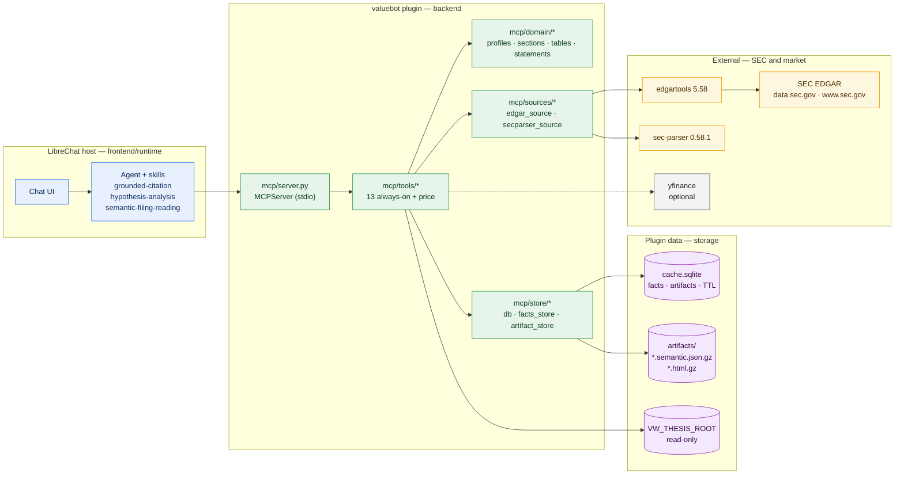
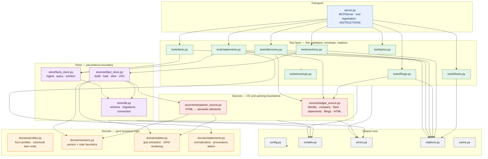
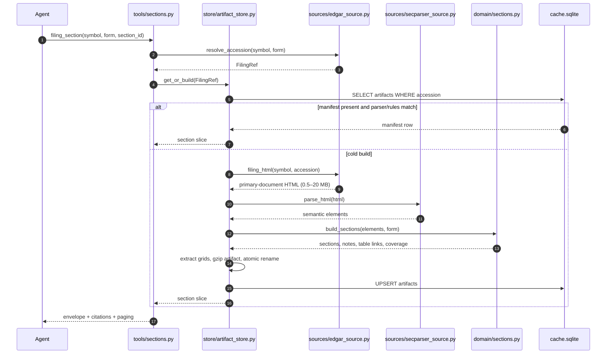
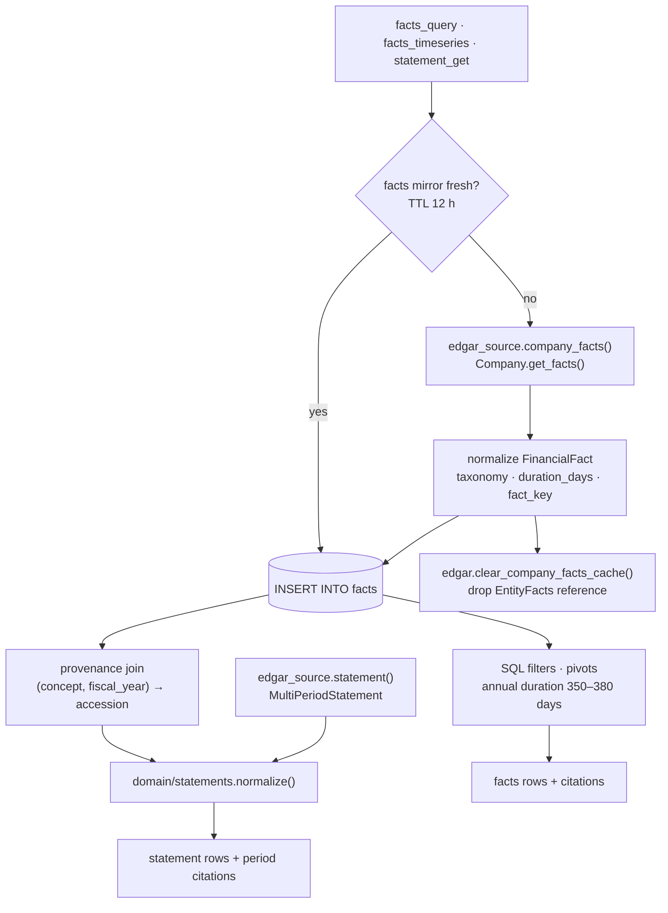
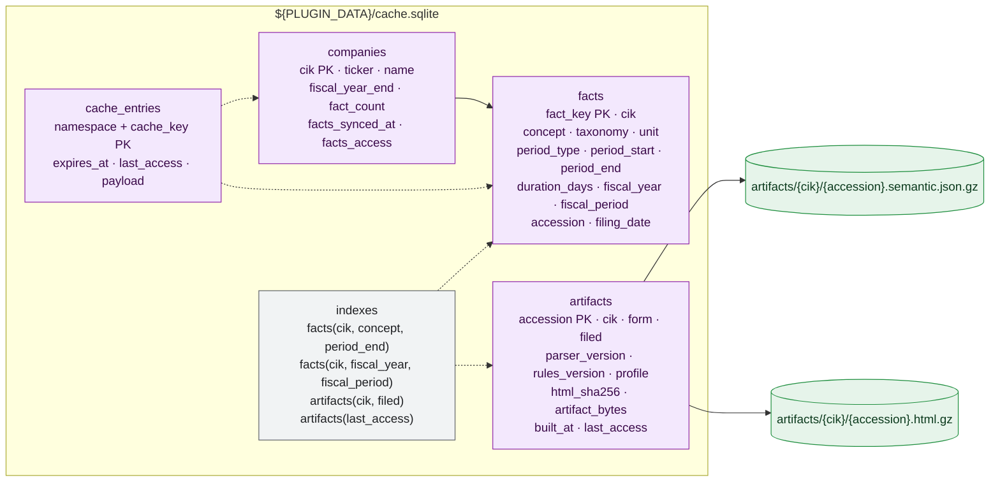
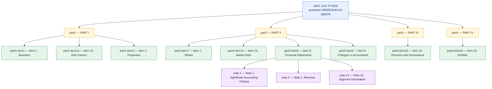
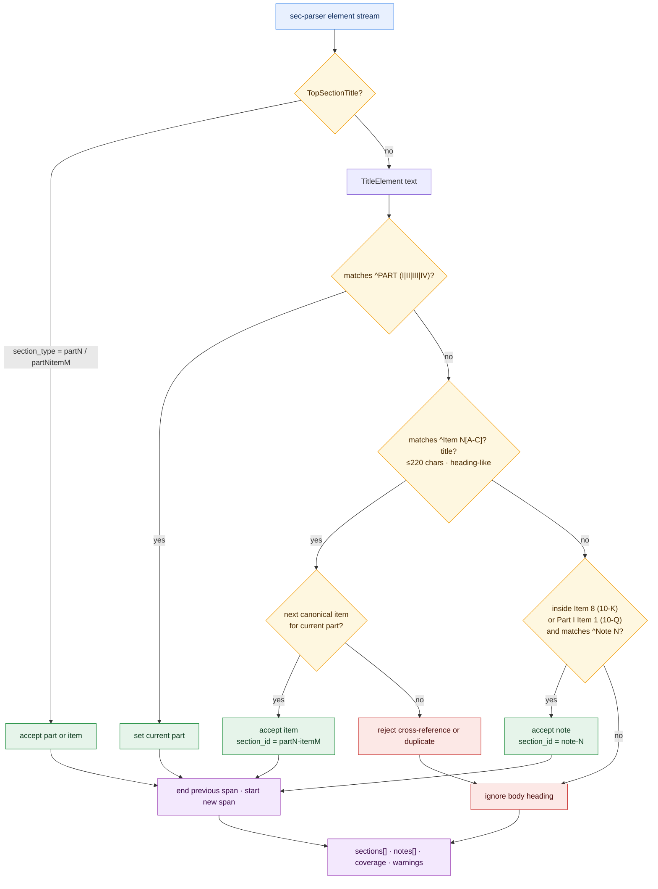

# valuebot v2 — edgartools + sec-parser Design

> **Status:** Proposed (awaiting approval)
> **Date:** 2026-10-18
> **Owner:** System Designer
> **Target repository:** `/Users/rkarumugam/LocalFiles/Projects/librechat-plugin`
> **Target plugin root:** `valuebot/` (replaces the empty submodule placeholder)
> **Supersedes:** the file-reading data layer of `/Users/rkarumugam/LocalFiles/Projects/ValueWaffleTerminal/valuebot`
> **Companion documents:** [db-mapping.md](./db-mapping.md) · [architecture/db-mapping.md](../../db-mapping.md) · [architecture/INDEX.md](../../INDEX.md)

---

## 1. Design Summary

valuebot v2 is a LibreChat Agent Plugin (Agent Plugins 1.0.0) that bundles three skills and a stdio MCP server. It replaces v1's pre-downloaded file reader with two live, read-only sources: **edgartools 5.58** for XBRL facts, annual statements, company metadata and filing HTML; and **sec-parser 0.58.1** for semantic filing structure (parts, items, notes, paragraphs, tables). The MCP server exposes 13 always-on tools plus an optional price tool. A per-CIK SQLite fact mirror (~25k rows for AAPL) makes facts queries and annual time series deterministic and tolerant of transient SEC outages. A compressed per-filing artifact store caches the semantic section tree, note index and table grids. A provenance join attaches EDGAR accessions to statement periods so every number is citable. Section detection combines sec-parser's `TopSectionTitle` output for 10-Q with a canonical 10-K item heuristic, because sec-parser rejects several 10-K item types. Tables are re-rendered from source HTML with a custom grid extractor, because sec-parser's table markdown loses colspan structure and mutates the parse tree. All writes stay under `${PLUGIN_DATA}`; the thesis vault remains read-only. No LibreChat fork, no running terminal server, no local data pipeline, and no Docker required for the plugin itself.

---

## 2. Design Rationale & Tradeoffs

### 2.1 Scope and source split

The plugin has exactly two content sources and one optional market source:

| Domain | Single source of truth | Why this source |
|:---|:---|:---|
| Numeric facts, annual statements, company metadata, filing list, filing HTML | `edgartools` | Already authenticates to SEC, applies fair-access rate limits, resolves CIK/ticker, returns `FinancialFact`, `MultiPeriodStatement`, `Statement`, `EntityFilings`, and primary-document HTML. |
| Semantic reports, items, notes, paragraphs, tables | `sec-parser` | Produces typed semantic elements (`TopSectionTitle`, `TitleElement`, `TextElement`, `TableElement`, `TableOfContentsElement`) from filing HTML, with source HTML per element. |
| Investment thesis and annotations | Local thesis vault | User-authored, read-only, unchanged from v1. |
| Price summary (optional) | `yfinance` | Kept only for parity; disabled by default. |

There is no overlap: edgartools retrieves the filing HTML, sec-parser structures it. The plugin never re-parses XBRL with sec-parser and never extracts narrative text with edgartools' `TenK` section API. This keeps one authority per data type and prevents two competing section models.

**Assumptions:**

- The deployment has a real SEC contact identity (`Name email@domain.com`).
- The plugin runs on LibreChat 0.8.8+ with `uv` and Python 3.11–3.13 (3.12 preferred).
- Target filings are modern HTML filings (roughly 2001+). Pre-2001 paper/text filings and PDF-only filings are out of scope for the semantic tools; they return `parser_failed` or `filing_not_found` rather than a partial index.
- The thesis vault may be absent or empty; thesis tools return `ok` with a note.
- `../db` is available only as a test fixture source, not as a runtime dependency.

### 2.2 Verified library behaviour and design responses

Every decision below was checked against the installed libraries (edgartools 5.58.0, sec-parser 0.58.1) and real AAPL filings in `../db/filing/us/AAPL`.

| Verified finding | Evidence | Design response |
|:---|:---|:---|
| `Company.get_facts()` returns `EntityFacts` with 24,852 facts for AAPL (505 concepts); 7.6 MB source JSON; parse ~0.1 s; in-memory object reported at 40–80 MB | Offline parse of `companyFacts_0000320193.json` | Mirror facts into SQLite, then call `edgar.clear_company_facts_cache()` and drop the object. Never hold two companies' facts. |
| Annual statements (`Company.income_statement/balance_sheet/cashflow_statement`) return `MultiPeriodStatement`; periods are newest-first (`FY 2025`, `FY 2024`, …); `to_flat_list()` provides `concept, label, depth, parent, is_total, confidence` and `None` (not `NaN`) values | Offline probe | Normalize from `to_flat_list()`, not from the DataFrame, to preserve hierarchy and clean nulls. |
| Statements carry **no provenance**: no accession, form or filed date in `MultiPeriodStatement`, `to_dict()`, or `to_flat_list()` | Source inspection + runtime probe | Resolve a period end per label, then join each row to the facts mirror by value and `period_end`; attach one citation per period. This is mandatory, not optional. |
| `EntityFacts.query().by_fiscal_year(2025)` filters the **filing's** fiscal year and therefore returns comparative columns from other years; `FinancialFact.fiscal_year` carries the same filing-year meaning | Runtime probe | Do **not** use `EntityFacts.query()` or `time_series()` for filtering. Query the SQL mirror on `period_end` and `duration_days`. Treat `fiscal_year` as filing metadata only; never use it to match a statement period. |
| sec-parser classifies only 8 `TopSectionTitle`s in a 10-K; `part1item1a`, `part2item7`, `part2item7a`, `part2item8`, `part2item9`, `part3*`, `part1item15/16` are rejected with `InvalidTopSectionIn10Q` warnings and appear as level-0 `TitleElement`s | Parse of AAPL FY2025 10-K | Build the 10-K item index with a canonical `Item N` heuristic on `TitleElement`, using `TopSectionTitle` only where it is reliable (Parts I/II and Items 1–6). |
| sec-parser classifies all 13 top sections of an AAPL 10-Q correctly (Part I Items 1–4, Part II Items 1–6) | Parse of AAPL Q2 FY2026 10-Q | Prefer `TopSectionTitle` for 10-Q; run the same heuristic only to fill gaps. |
| Notes are detectable by heading text, independent of level: 13 notes in the 10-K (level 0) and 10 in the 10-Q (level 2), regex `^Note\s+\d+` | Runtime probe | Detect notes inside Item 8 (10-K) or Part I Item 1 (10-Q) by regex, not by `level`. |
| sec-parser parse is fast: 0.29–0.45 s for a 1.5 MB 10-K, 0.16–0.37 s for a 1.0 MB 10-Q; 460 elements; JSON `{type, level, text}` is 222 KB → 54 KB gzip | Runtime probe | Parse cost is acceptable online, but artifacts are still cached to avoid re-download and to keep section reads < 100 ms. |
| `TableElement.table_to_markdown()` emits no GFM delimiter row, pads every `colspan` into blank cells (79% empty cells), concatenates some cell text, and **mutates the underlying bs4 tree** (192 `<td>` → 540 `<td>` with `NaN` padding) | Runtime probe on 47 tables | Never call `table_to_markdown()`. Read `html_tag.get_source_code()` **first**, parse with BeautifulSoup, expand `colspan`/`rowspan`, trim empty rows/columns, and render GFM with a delimiter row. |
| A custom extractor produces correct grids for 47/47 tables, matches sec-parser's row count after dropping empty rows, and runs in 0.18 s for all tables | Runtime probe | Use the custom renderer in `domain/tables.py`; store grids, not pre-rendered markdown. |
| Python 3.14 cannot import either library; system Python 3.12 can | Import probe | Pin `requires-python = ">=3.11,<3.14"` and `.python-version = 3.12`. |
| `Filing.html()` returns the **primary document** only (1.5 MB 10-K, 1.0 MB 10-Q), not the full submission | Source inspection + file sizes | Use `filing.html()` as the parser input. Cap HTML at 40 MB. |
| edgartools defaults to 9 requests/second, 30 s timeout, 5 quick retries with exponential backoff; `get_identity()` prompts interactively when unset | Source inspection | Set identity from `EDGAR_IDENTITY`; never call `get_identity()`. Lower the rate to 5 req/s. Let edgartools retry; map 429 to a typed error. |

### 2.3 Fact mirror versus on-demand queries

`edgartools` is an excellent fetcher but a poor query engine for an LLM tool surface: its in-memory facts object is 40–80 MB, its cache holds one company, and its query semantics for fiscal years are surprising (see §2.2). The plugin therefore persists a **cache**, not a permanent dataset:

- One row per `(cik, concept, unit, period, accession)`; ~25k rows for AAPL.
- SQL filters are explicit and testable: `period_type`, `period_end`, `fiscal_year`, `fiscal_period`, `duration_days`, `form_type`, `unit`.
- Annual series use `period_type='duration' AND duration_days BETWEEN 350 AND 380`, which tolerates 52/53-week fiscal years.
- The mirror is evicted **by whole company** (LRU) so facts never become internally inconsistent.
- Default cap: 100 companies (~400–600 MB). This is a cache, not a warehouse.
- `fiscal_year` is retained only as filing metadata. Tools return an unambiguous `period_label` (`FY ending 2025-09-27` or `As of 2025-09-27`), and all matching uses `period_end`.

Tradeoff: +3–6 MB per company and an ingest step (~1 s) versus a 7.6 MB download, 40–80 MB memory spike, and non-deterministic filters on every cold query. The cache wins for a conversational agent that asks several related questions per session.

### 2.4 Annual statement strategy

Two bases are exposed through one tool:

| Basis | edgartools call | Strength | Limitation |
|:---|:---|:---|:---|
| `company` (default) | `Company.income_statement(periods, period='annual')` / `balance_sheet` / `cashflow_statement` | Multi-period, canonical, consistent labels, 4–20 periods, fast | Loses as-reported presentation detail; no provenance in the object |
| `filing` | `filing.obj().financials.income_statement()` etc. → `Statement.to_dataframe()` | Exactly as reported in one filing; includes XBRL presentation hierarchy | 2–3 periods only; requires a filing download |

The provenance join for the `company` basis is deterministic. It **cannot** use `fiscal_year` because that field is the filing year, not the period year (a FY2025 10-K tags its FY2024 comparative with `fiscal_year=2025`). The join therefore anchors on the value and the period end:

1. **Resolve one `period_end` per statement label.** Use anchor concepts in priority order:
   - `balance`: `Assets`, `LiabilitiesAndStockholdersEquity`, `StockholdersEquity`
   - `income`: `Revenues`, `RevenueFromContractWithCustomerExcludingAssessedTax`, `NetIncomeLoss`
   - `cashflow`: `NetCashProvidedByUsedInOperatingActivities`, `CashAndCashEquivalentsPeriodIncreaseDecrease`

   For each anchor present in the statement, find annual facts (`duration` 350–380 days for income/cashflow, `instant` for balance) whose `numeric_value` equals the statement value within a tolerance of `max(1.0, 5e-7 * |value|)`. Among matches, choose the `period_end` closest to the label year end. If no anchor matches, use the modal `period_end` across all rows in that period whose values match, then fall back to `period_end_source="inferred"` from the latest 10-K `period_of_report`.

2. **Resolve an accession per row.** Load the CIK's annual/instant facts once (about 25k rows), index them by `(concept, period_end)`, and for each row:
   - prefer the fact whose `numeric_value` matches the row value;
   - then the earliest `filing_date` with `form_type='10-K'`;
   - then the period anchor's accession.

3. Return one citation per period: `{period, period_end, accession, form, filed, url}` plus a `provenance` map for rows that resolve to a different accession than the period anchor.

Rows whose concept cannot be joined remain numeric but carry the period-level citation and `provenance: "statement"` rather than `"fact"`. The agent must not claim row-level accession precision in that case; the citation skill requires the tool-issued period citation.

### 2.5 Semantic section, note and table model

The artifact is a flat, indexed representation, not a live object tree:

```
Artifact
├── ref: accession · cik · form · filed · period_of_report · source_url
├── elements[]: { type, level, text, section_id, table_id? }   # document order
├── sections[]: { id, parent_id, kind, title, section_type, start, end, char_count, table_ids }
└── tables[]:   { id, section_id, index, caption, grid[][], header_rows }
```

Why flat: section reads must be O(1), byte-capped and independent of tree traversal; the LLM never needs the whole tree. `TreeBuilder` is not stored for the same reason — `sections[].parent_id` carries the hierarchy the tools expose.

**Section prose** is the ordered concatenation of `TextElement` and `SupplementaryText` inside the span. The heading itself and `TableElement`s are excluded from prose; tables are returned as separate summaries and fetched with `filing_table`.

**Section IDs are stable and human-readable:**

- `part2-item7`, `part1-item1a`, `part3-item10`, `part4-item15` for 10-K/10-Q items.
- `note-1` … `note-13` for notes.
- `title-<slug>-<ordinal>` for generic documents.
- `part1`, `part2`, … for part headings.

**10-K item heuristic (required, not optional):**

1. Walk elements in document order.
2. Accept `TopSectionTitle` when its `section_type` is `partN` or `partNitemM`.
3. Accept a `TopSectionTitle`/`TitleElement` whose text matches `(?i)^PART\s+(I|II|III|IV)\b` and set the current part.
4. Accept a `TitleElement` whose text matches `(?i)^Item\s+(\d{1,2}[A-C]?)\.?\s*(?:[—–:-]\s*)?(.+)$` when:
   - the heading is at most 220 characters,
   - it is the next canonical item (or a later item) for the current part,
   - it is not inside a `TableOfContentsElement`,
   - it is not a cross-reference (no leading "see", "refer to", "pursuant to").
5. Canonical order: Part I `1, 1A, 1B, 1C, 2, 3, 4`; Part II `5, 6, 7, 7A, 8, 9, 9A, 9B, 9C`; Part III `10–14`; Part IV `15, 16`.
6. A section span ends at the next accepted part/item heading.
7. Notes are accepted only inside Item 8 (10-K) or Part I Item 1 (10-Q), matching `(?i)^Note\s+(\d{1,2})\b`; a note span ends at the next note heading or the end of its parent item. Duplicate note numbers are rejected after the first accepted occurrence. If no `TitleElement` notes are found, a short `TextElement` (≤200 chars) matching the same regex is accepted as a last resort.
8. Record `coverage = {parser_top_sections, heuristic_items, expected_items, missing_items, notes_found, degraded}` and surface it in every `filing_sections` response. `degraded` is true when `accepted_items < expected_items`, or when the form is 10-K/10-Q and `notes_found == 0`; it is **not** based on `parser_top_sections` alone, because a complete heuristic index is not degradation.

The parser warnings (`InvalidTopSectionIn10Q`) are captured and deduplicated into `artifact.warnings`, but they are not user-facing errors. `degraded=true` is the signal that the agent should verify a section with `filing_search`.

**10-Q:** `TopSectionTitle` is complete; the heuristic is a gap-filler. **20-F/40-F/8-K/DEF 14A:** generic profile (`kind="title"`), no item guarantee. This is explicit scope, not silent failure.

### 2.6 Table strategy

Observed defects make `TableElement.table_to_markdown()` unusable as the primary renderer. The design uses `domain/tables.py`:

1. Read `table_element.html_tag.get_source_code(pretty=False)` **before any other table call** (the source is cached; calling markdown later mutates the tree).
2. Skip `TableOfContentsElement`; it is navigation, not a financial table. If a `TableElement` wrapper contains more than one `<table>`, use the first and record a warning.
3. Parse the first `<table>` with BeautifulSoup + lxml.
4. Build a grid with `colspan`/`rowspan` expansion (value in the anchor cell, blanks in spanned cells); ignore rows whose nearest table ancestor is not the selected table.
5. Trim fully empty leading/trailing rows and columns.
6. Normalize whitespace, `\u00a0`, `$`, `%`, parentheses and dashes.
7. Detect `header_rows`: leading rows before the first numeric cell, capped at 3, minimum 1.
8. Render GFM on demand with a `| --- |` delimiter row, escaped pipes, no newlines or control characters inside cells, and a fixed column slice.
9. Caps: 5,000 cells, 60 columns, 500 characters per cell; truncated grids set `truncated=true`.

Tradeoff: we depend on `html_tag.get_source_code()` (public API) and BeautifulSoup (already a sec-parser dependency). We gain correct cell boundaries, a valid GFM table, no tree mutation, and 2.4× faster rendering. We lose any sec-parser-specific table heuristics; those were not correct for SEC filings anyway.

### 2.7 Storage and caching tiers

| Data | Tier | Why |
|:---|:---|:---|
| Facts, companies, artifact manifest, TTL entries | SQLite (`cache.sqlite`, WAL) | Structured, queryable, transactional, single-file, already proven by v1 and the terminal projects |
| Semantic artifacts | gzip JSON next to the manifest | Large, immutable, read whole-then-slice; SQLite BLOBs would bloat the DB |
| Raw filing HTML | gzip file | Enables re-parse after a rules/version bump without another SEC request; LRU-evictable |
| Thesis vault | Read-only markdown/JSON | User-authored; never copied or mutated |
| Price snapshots | SQLite TTL cache | Small, short-lived |
| Config | Environment + Python constants | No statement mapping table is required; edgartools supplies canonical labels. Secrets stay out of files. |

**TTLs:** ticker map 24 h; company metadata/submissions 12 h; facts 12 h; company statements 24 h; filing artifacts immutable (LRU only); price 15 min.

**Cache keys** include the source, symbol, statement, basis, period count, form/accession and paging dimensions, so changing any request dimension cannot reuse the wrong payload.

**Footprint:** facts ~3–6 MB/company; artifacts ~150–300 KB/filing + raw HTML ~250–500 KB; 500 filings ≈ 200–400 MB. Defaults: 100 companies, 512 MB artifacts, 64 MB TTL cache.

**Reuse from v1 (reuse-first):** the plugin scaffold (`plugin.json`, `mcp.json`, skills folder, agent exports), `config.py`'s `${VAR}` / `${VAR:-default}` expansion, `SqliteTtlCache`, the citation key/dedupe/EDGAR URL builder, the thesis vault reader with path-traversal checks, the optional price provider, and the byte-cap/paging response patterns. Replace only the file-reading data tools and the data-root contract. This keeps the plugin shape familiar while removing the local pipeline dependency.

### 2.8 Dependency rationale

All libraries are open source.

| Library | Version | Role | Why chosen | Rejected alternative |
|:---|:---|:---|:---|:---|
| `edgartools` | `>=5.58,<6` | SEC identity, company/filing resolution, XBRL facts, annual statements, primary-document HTML | One library covers the entire numeric and transport surface; built-in retries, rate limits, filings, statement normalization, and XBRL facts | `sec-downloader` + custom XBRL parsing: duplicates transport and normalization; two auth paths |
| `sec-parser` | `>=0.58.1,<0.59` | Semantic HTML structure | Typed semantic elements, source HTML per element, fast, no ML/model dependency | edgartools `TenK.sections` (coarse, no element-level notes/tables); `unstructured`/`pdfplumber` (heavy, PDF-first); custom regex (fragile) |
| `mcp` | `>=2.2.0` | stdio MCP transport | Required by LibreChat Agent Plugins; proven in v1 | None |
| `beautifulsoup4` | `>=4.14,<5` | Table grid extraction | Already a sec-parser dependency; robust malformed-HTML handling | `lxml.html` direct (less forgiving); regex (incorrect for nested cells) |
| `lxml` | transitive (`>=5.2.2,<6`) | BeautifulSoup backend | Fast, bundled with sec-parser | `html.parser` (slower, less correct on SEC HTML) |
| `pandas` | transitive | edgartools statement/DataFrame return type | Not imported directly; only `to_flat_list()`/`to_dataframe()` outputs are consumed | Avoiding pandas is impossible while using edgartools |
| `yfinance` + `tzdata` | optional | Price summary | Parity with v1; isolated extra | Removing price entirely (acceptable if not needed) |

No direct HTTP client dependency: edgartools owns the only ingestion path. `sec-downloader` appears transitively through sec-parser but is not imported or used. No PDF tooling: SEC HTML only in v2.

### 2.9 Network, identity and rate limits

- `EDGAR_IDENTITY` must be set in `mcp.json` as `"Name email@domain.com"`. LibreChat does **not** forward container environment variables to stdio MCP servers; the value must be in the MCP `env` block. A value containing `example.com`, `user@example.com`, or an empty name/email is treated as unconfigured, mirroring v1's `SecIdentityStore` placeholder rejection.
- The server never calls `edgar.get_identity()` because it prompts interactively and would hang the stdio channel. `settings.set_identity()` is called lazily on the first data call and only once per process.
- `EDGAR_LOCAL_DATA_DIR=${PLUGIN_DATA}/edgar` keeps edgartools' own HTTP cache inside plugin data.
- `EDGAR_RATE_LIMIT_PER_SEC=5` (below edgartools' 9/s default and SEC's ~10/s fair-access guidance).
- `EDGAR_HTTP_TIMEOUT=30`.
- Artifact builds are single-flight per accession (`fcntl.flock` on a lock file). No parallel fan-out across tickers.
- 429/`TooManyRequestsError` maps to `edgar_rate_limited` with `retry_after_s`; network failures map to `edgar_unavailable` and are retryable.
- Heavy imports (`edgar`, `sec_parser`, `bs4`) are lazy inside the source modules so `ping` and configuration diagnostics stay fast and the server boots even if a dependency is missing.
- **Cold start:** `uv` must resolve and install a larger dependency set than v1 (edgartools, pandas, lxml, sec-parser). First spawn can take 60–120 s; later spawns reuse `${PLUGIN_DATA}/uv-env`. Prime the environment during deployment (`UV_PROJECT_ENVIRONMENT=${PLUGIN_DATA}/uv-env uv sync --project mcp`) to avoid a first-call timeout.

### 2.10 Failure handling and security

| Risk | Control |
|:---|:---|
| Path traversal (thesis, artifact paths) | Ticker regex `^[A-Za-z0-9.\-]{1,10}$`; accession regex `^\d{10}-\d{2}-\d{6}$`; CIK digits only; resolve and verify the final path is inside the configured root |
| SQL injection | Parameterized queries only; no string interpolation of user values |
| Oversized payload / DoS | HTML cap 40 MB; response caps 2–8 KB; table caps; element/section caps; search query 2–120 chars |
| Malformed filing HTML | Catch parser exceptions, return `parser_failed` with warnings; keep the raw HTML cache for retry |
| SEC rate limiting | 5 req/s, single-flight, TTL caches, no cross-ticker fan-out |
| Secret leakage | Identity is a contact string, not a key; never log it; no API keys required |
| Stdout corruption | All logging to stderr; no `print()` anywhere in `mcp/` |
| Cache corruption | TTL cache discards a corrupt SQLite file and recreates it; facts/artifacts can be rebuilt from SEC |
| Stale data | TTLs + `company_profile(refresh=true)`; artifacts are immutable per accession |

### 2.11 Open decisions and defaults

| Decision | Default in this design | Alternative |
|:---|:---|:---|
| Plugin root and name | `valuebot/`, plugin name `valuebot`, version `0.2.0` | New folder `valuebot-edgar/` if the empty submodule must be preserved |
| Optional price tool | Disabled (`VW_ENABLE_PRICE=0`) | Enable with the `price` extra |
| 20-F/40-F/8-K/DEF 14A semantic coverage | Generic title profile in v1 | Filing-specific heuristics in v2 |
| Insider/proxy tools | Not in v1; provider extension points documented | Add `insider_transactions` and `proxy_persons` in v2 |
| Thesis vault | Kept and unchanged | Remove if thesis work moves elsewhere |
| UI | None; LibreChat supplies the chat surface | A custom UI is out of scope; no `UI Layouter` delegation required |

---

## 3. Data & Interface Matrix

### 3.1 Data Mapping Protocol

| Data Element / Field | Module Owner | Source / Ingestion Vector | Format / Schema | Rate Limits, Sizing & Tier Constraints |
|:---|:---|:---|:---|:---|
| **Ticker → CIK map** | `mcp/tools/discovery.py` | `edgar.get_company_tickers()` → SEC `https://www.sec.gov/files/company_tickers.json` (library-managed) | JSON `{cik: {ticker, title}}` → in-memory dict + `cache_entries[symbols]` blob | ~12k rows, ~1 MB; 1 request per 24 h; one JSON blob in the TTL cache; 24 h TTL |
| **Company profile** | `mcp/tools/discovery.py` | `Company(symbol)` + `company.get_filings()` → `https://data.sec.gov/submissions/CIK##########.json` | `EntityFiling` metadata → `companies` row + response JSON | 0.3–1 MB; 1 request/company/12 h; 12 h TTL; 6 KB response cap |
| **XBRL company facts** | `mcp/store/facts_store.py` (ingest via `sources/edgar_source.py`) | `Company.get_facts()` → `https://data.sec.gov/api/xbrl/companyfacts/CIK##########.json` | 7–10 MB source JSON → 20–30k rows in `facts` | 1 request/company/12 h; 40–80 MB transient RAM; clear cache after ingest; 100-company LRU |
| **Fact row** | `mcp/store/facts_store.py` | Normalized `FinancialFact` | `fact_key, cik, concept, taxonomy, label, unit, value, numeric_value, period_type, period_start, period_end, period_label (derived), duration_days, fiscal_year (filing metadata), fiscal_period, form_type, accession, filing_date, is_audited, is_restated, data_quality, confidence_score, dimensions_json` | ~180–250 B/row; ~25k rows/company; PK `fact_key`; indexes `(cik, concept, period_end)`, `(cik, fiscal_year, fiscal_period)`, `(cik, period_end, period_type)` |
| **Annual income statement** | `mcp/domain/statements.py` | `Company.income_statement(periods, period='annual')` → `MultiPeriodStatement.to_flat_list()` | Normalized JSON `{periods[], rows[]{concept,label,depth,parent,is_total,unit,values{}}}` | Derived from facts; 10–20 ms; 24 h TTL; default 4 periods, max 20; 8 KB response cap |
| **Annual balance sheet** | `mcp/domain/statements.py` | `Company.balance_sheet(periods, period='annual')` | Same normalized shape | Same as income |
| **Annual cash-flow statement** | `mcp/domain/statements.py` | `Company.cashflow_statement(periods, period='annual')` | Same normalized shape | Same as income |
| **Filing-basis statement** | `mcp/domain/statements.py` | `filing.obj().financials.<income / balance / cashflow>()` → `Statement.to_dataframe()` | DataFrame columns `concept,label,standard_concept,<periods>,level,parent_*` → normalized JSON | 1 filing XBRL parse; 50–200 ms; cached with artifact; 2–3 periods; 8 KB cap |
| **Statement provenance** | `mcp/store/facts_store.py` + `mcp/domain/statements.py` | Anchor `period_end` by value, then join annual facts on `(cik, concept, period_end)`; never use `fiscal_year` | `{period: {period_end, accession, form, filed, url}}` | One annual-facts load per statement (~25k rows, <50 ms); ≤20 periods; citations capped at 20 |
| **Filing list** | `mcp/tools/filings.py` | `Company.get_filings()` then `EntityFilings.filter(form=[...], date=...)`; `date` range syntax `start:end`, `:end`, `start:` | `EntityFilings` → JSON rows `{accession, form, filed, period, primary_document, is_xbrl, parseable, parsed, url}` | Submissions JSON 0.3–1 MB; 12 h TTL; 6 KB cap; 100 rows/page |
| **Filing primary HTML** | `mcp/sources/edgar_source.py` | `filing.html()` → `https://www.sec.gov/Archives/edgar/data/{cik}/{accn_nodash}/{primary_document}` | HTML text 0.5–20 MB | 1 request/filing; 40 MB hard cap; gzip raw cache 0.25–5 MB; no TTL (immutable) |
| **Semantic element stream** | `mcp/sources/secparser_source.py` | `sec_parser.Edgar10QParser().parse(html)` | `list[AbstractSemanticElement]`; stored as `{type, level, text, section_id, table_id?}` | 0.2–0.5 s for 1.5 MB; 200–1,000 elements; 50–250 KB gzip |
| **Section index** | `mcp/domain/sections.py` | `TopSectionTitle` + `TitleElement` heuristics; `SECTION_RULES_VERSION=1` | `sections[]` JSON (see §3.2) | 8–30 sections + 10–15 notes; <6 KB response; `coverage.degraded` flag |
| **Note index** | `mcp/domain/sections.py` | `TitleElement` regex `(?i)^Note\s+\d+\b` inside Item 8 / Part I Item 1 | `sections[]` with `kind="note"`, `note_number` | 10–13 notes verified on AAPL 10-K/10-Q; <4 KB response |
| **Table grid** | `mcp/domain/tables.py` | `TableElement.html_tag.get_source_code()` → BeautifulSoup | `grid[][]` strings, `header_rows`, `caption`, `section_id`, `index` | 47 tables/10-K; max 44 rows, 42 cols observed; caps 5,000 cells / 60 cols / 500 chars per cell |
| **Table markdown** | `mcp/domain/tables.py` | `render_markdown(grid, header_rows, columns, row_offset, max_rows)` | GFM text with delimiter row | 8 KB page cap; default 40 rows × 12 cols; paging metadata |
| **Full-text hit** | `mcp/tools/sections.py` | Linear scan of artifact `elements[].text` and `tables[].grid` | `hits[]{kind, section_id, title, snippet, element_index?, table_id?}` | 2–120 char query; 20 hits max; 8 KB cap |
| **Thesis markdown** | `mcp/tools/thesis.py` | Local `{VW_THESIS_ROOT}/{TICKER}/thesis.md` | Markdown + YAML front matter | Read-only; 8 KB cap; missing vault returns `ok` with note |
| **Thesis annotations** | `mcp/tools/thesis.py` | Local `{TICKER}/.thesis/annotations/*.json` | JSON `{mtime, annotations[]}` | Read-only; max 200 docs; 8 KB cap |
| **Price summary (optional)** | `mcp/tools/price.py` | `yfinance.Ticker.history` | DataFrame → JSON summary | Disabled by default; 15 min TTL; no caching of real-time ticks beyond the TTL |
| **TTL cache entry** | `mcp/cache.py` | `target`/`source` payloads | `cache_entries` row: `namespace, cache_key, created_at, expires_at, last_access, bytes, payload` | 64 MB cap; LRU eviction; corrupt DB recreated |
| **Artifact manifest** | `mcp/store/artifact_store.py` | Build result | `artifacts` row: `accession, cik, form, filed, period_of_report, primary_document, source_url, parser_version, rules_version, profile, html_sha256, html_bytes, artifact_bytes, element_count, section_count, note_count, table_count, warnings_json, status, built_at, last_access, error` | 1 row/filing; immutable; LRU by `last_access`; 512 MB artifact cap |
| **Raw HTML artifact** | `mcp/store/artifact_store.py` | `filing.html()` | `artifacts/{cik}/{accession}.html.gz` | 0.25–5 MB/filing; LRU; atomic write |
| **Semantic artifact** | `mcp/store/artifact_store.py` | `sources/secparser_source.py` + `domain/*` | `artifacts/{cik}/{accession}.semantic.json.gz` | 50–300 KB/filing; schema/parser/rules versioned; atomic write |
| **Build lock** | `mcp/store/artifact_store.py` | `fcntl.flock` | `artifacts/{cik}/{accession}.lock` | Transient; prevents duplicate builds across processes |
| **edgartools HTTP cache** | `mcp/sources/edgar_source.py` | `EDGAR_LOCAL_DATA_DIR=${PLUGIN_DATA}/edgar` | Hishel file cache managed by edgartools | Bounded by edgartools; disposable; never source of truth |

### 3.2 Internal state schemas

**`sections[]` record**

| Field | Type | Meaning |
|:---|:---|:---|
| `id` | string | Stable ID: `part2-item7`, `note-1`, `title-...` |
| `parent_id` | string \| null | Part for an item; item for a note |
| `kind` | enum | `part`, `item`, `note`, `title`, `document` |
| `title` | string | Heading text, truncated to 240 chars |
| `section_type` | string \| null | sec-parser `section_type.identifier` when available |
| `level` | int | Source heading level (informational only) |
| `start`, `end` | int | Element index range `[start, end)` |
| `char_count` | int | Sum of element text lengths |
| `table_ids` | string[] | Tables whose element index is inside the span |
| `note_number` | int \| null | Parsed note number |

**`artifacts` response metadata**

| Field | Type | Meaning |
|:---|:---|:---|
| `resolved` | object | `{symbol, cik, accession, form, filed, period_of_report, source_url}` |
| `profile` | string | `10-K`, `10-Q`, `8-K`, `proxy`, `generic` |
| `coverage` | object | `{parser_top_sections, heuristic_items, expected_items, missing_items, notes_found, degraded}` |
| `cached` | bool | Artifact was loaded, not built |
| `parse_ms` | int | Last build parse time |
| `warnings` | string[] | Deduplicated parser/rule warnings |

### 3.3 Tool interface matrix

| Tool | Arguments | Primary source | Returns | Cap |
|:---|:---|:---|:---|:---|
| `symbol_resolve` | `query, limit=10` | edgartools ticker map | `matches[]{symbol,name,cik,exchange}` | 6 KB |
| `company_profile` | `symbol, refresh=false` | edgartools + local manifest | CIK, name, SIC, FYE, filer category, latest filings, cache state, routing hints | 6 KB |
| `facts_query` | `symbol, concepts?, search?, forms?, start?, end?, unit?, annual_only?, dedupe=true, limit=20, offset=0` | SQL `facts` | `rows[]{concept, taxonomy, label, value, numeric, unit, period_start, period_end, period_label, duration_days, fiscal_year, fiscal_period, form, accession, filed}`, facets | 6 KB |
| `facts_timeseries` | `symbol, concept, annual_only=true, start?, end?, limit=20` | SQL `facts` | `points[]{period_end, period_label, duration_days, value, form, accession, filed}`, derived summary | 6 KB |
| `statement_get` | `symbol, statement, basis="company", periods=4, form="10-K", accession?, offset=0, limit=40` | edgartools + SQL provenance | normalized statement rows, periods, unit, citations | 8 KB |
| `filing_list` | `symbol, forms?, start?, end?, limit=50, offset=0` | edgartools | filings with `parsed`/`parseable` flags | 6 KB |
| `filing_sections` | `accession?, symbol?, form="10-K", kind="all", include_tables=false, offset=0, limit=40` | artifact store | sections/notes, coverage, resolved filing | 6 KB |
| `filing_section` | `accession?, symbol?, form="10-K", section_id, offset=0, limit_chars=8000` | artifact store | section text, table summaries, paging | 8 KB |
| `filing_search` | `accession?, symbol?, form="10-K", query, limit=20` | artifact store | hits grouped by section; `kind="text"` or `kind="table"`, with snippets/table IDs | 8 KB |
| `filing_table` | `accession?, symbol?, form="10-K", table_id, columns?, row_offset=0, max_rows=40` | artifact store | GFM table, header, dimensions, paging | 8 KB |
| `thesis_read` | `symbol, offset=0, limit=8000` | thesis vault | front matter, body, attachments | 8 KB |
| `thesis_annotations` | `symbol, doc?` | thesis vault | annotation documents | 8 KB |
| `ping` | — | config + store | versions, identity status, paths, cache/artifact counts | 2 KB |
| `price_summary` (optional) | `symbol, period="1y"` | yfinance | price summary | 6 KB |

**Tool semantics that must be stated in every docstring:**

- `start` / `end` filter **`period_end`**, not filing date. Filing-date filtering belongs to `filing_list`.
- `forms` filters the form that tagged the fact (`form_type`), not the form being viewed.
- `fiscal_year` is filing metadata; `period_label` is the unambiguous period label.
- `facts_query` defaults to `dedupe=true`, returning one row per `(concept, unit, period_end)` from the latest filing; `dedupe=false` exposes every filing-tagged fact, including comparatives and restatements.
- `facts_timeseries` always dedupes by `period_end` and prefers the latest `filing_date`; statement provenance prefers the earliest 10-K for the original as-reported value.
- `basis="company"` returns canonical multi-period rows; `basis="filing"` returns as-reported rows from one accession.
- `kind` in `filing_sections` accepts `items`, `notes`, `all`; `all` is the default.
- `include_tables` adds table summaries to `filing_sections`; full content requires `filing_table`.

### 3.4 Response envelope

Every tool returns one of two shapes:

```json
{
  "ok": true,
  "tool": "filing_section",
  "symbol": "AAPL",
  "cik": 320193,
  "data": {},
  "citations": [],
  "paging": {"offset": 0, "limit": 8000, "next_offset": null, "truncated": false},
  "meta": {"source": "sec-parser", "cached": true, "elapsed_ms": 12, "bytes": 5342, "warnings": []}
}
```

```json
{
  "ok": false,
  "tool": "filing_section",
  "error": {
    "code": "section_not_found",
    "message": "No section 'part2-item7a' in accession 0000320193-25-000079",
    "hint": "Call filing_sections to list valid section IDs.",
    "retryable": false,
    "retry_after_s": null
  },
  "meta": {"elapsed_ms": 8}
}
```

**Error codes:** `identity_not_configured`, `symbol_not_found`, `company_not_found`, `filing_not_found`, `section_not_found`, `table_not_found`, `statement_unavailable`, `invalid_argument`, `edgar_unavailable`, `edgar_rate_limited`, `artifact_too_large`, `parser_failed`, `cache_unavailable`, `internal_error`.

The envelope is uniform by design. v1's tool-specific shapes are not preserved because this is a new plugin data layer and the skills must teach one contract.

---

## 4. Abstraction & Data Flow Diagrams

### 4.1 System context



### 4.2 Module and dependency map



### 4.3 Cold and warm `filing_section` path



### 4.4 Facts and statements data flow



### 4.5 Storage schema and file layout



### 4.6 Target 10-K section model



### 4.7 Section and note heuristic decision flow



---

## 5. Feasibility Review

| Check | Result | Mitigation / decision |
|:---|:---|:---|
| edgartools API names and signatures | Verified against 5.58.0 source (`Company`, `Filing`, `EntityFacts`, `MultiPeriodStatement`, `Statement`, `configure_http`, `set_identity`) | Pin `>=5.58,<6`; adapter isolates any 5.x rename |
| SEC endpoints and URLs | Verified: companyfacts, submissions, Archives primary document; edgartools constructs them | Never hand-build URLs except citation links; use filing properties |
| sec-parser 10-K coverage | Incomplete: only 8 top sections; Items 1A/7/7A/8/9+ rejected | Mandatory 10-K heuristic (§2.5); `coverage.degraded` signal; test against AAPL/MSFT 10-K |
| sec-parser 10-Q coverage | Complete for AAPL Q2 FY2026 (13 top sections) | Prefer parser types; heuristic fills gaps |
| Notes detection | 13 notes (10-K) and 10 notes (10-Q) found by regex, independent of level | Regex + parent-item constraint; report `notes_found` |
| Table rendering | Library markdown malformed (79% empty cells, no delimiter, mutates tree) | Custom grid renderer; never call `table_to_markdown()` |
| Statement provenance | Not provided by edgartools | Join to facts mirror; period-level citations |
| Fact query semantics | `by_fiscal_year` filters filing year, not period year | SQL mirror; no `EntityFacts.query()` |
| Memory | EntityFacts 40–80 MB, cache size 1 | Ingest then clear cache; one company at a time |
| HTML size | 1.5 MB 10-K / 1.0 MB 10-Q observed; 20-F can be larger | 40 MB cap; `artifact_too_large` error |
| Parse latency | 0.29–0.45 s for 1.5 MB | No timeout needed; report `parse_ms` |
| Python compatibility | 3.14 fails; 3.12 works | `requires-python >=3.11,<3.14`; `.python-version 3.12` |
| Rate limits | edgartools default 9/s; SEC fair access ~10/s | Set 5/s; single-flight; TTL caches |
| LibreChat env forwarding | Container env is not forwarded to stdio MCP | Identity and all roots live in `mcp.json` `env` |
| Storage footprint | Facts ~3–6 MB/company; artifacts ~0.4–0.8 MB/filing | Caps: 100 companies, 512 MB artifacts, 64 MB cache |
| Thesis path traversal | v1 already validates relative paths | Reuse the validation; artifact paths use regex-validated CIK/accession |
| SQL injection | No dynamic SQL needed | Parameterized queries only |
| UI | LibreChat supplies chat, agent picker, citations | No UI work; no UI Layouter delegation |

---

## 6. Next Steps

### 6.1 Target layout

```
librechat-plugin/
├── architecture/
│   ├── INDEX.md
│   ├── db-mapping.md
│   └── design-docs/valuebot-v2/
│       ├── design.md
│       └── db-mapping.md
└── valuebot/                          ← plugin root (replace empty submodule)
    ├── plugin.json
    ├── mcp.json
    ├── README.md
    ├── .env.example
    ├── librechat.example.yaml
    ├── endpoints.example.yaml
    ├── docs/
    │   ├── INSTALL-LIBRECHAT.md
    │   └── ENDPOINTS.md
    ├── pyproject.toml                 ← if a root project is desired
    ├── .python-version                ← 3.12
    ├── skills/
    │   ├── grounded-citation/SKILL.md
    │   ├── hypothesis-analysis/SKILL.md
    │   └── semantic-filing-reading/SKILL.md
    ├── agent-builder-exports/
    │   ├── INSTALL.md
    │   ├── vw-orchestrator.json
    │   ├── vw-fundamentals-analyst.json
    │   ├── vw-reports-analyst.json
    │   ├── vw-thesis-analyst.json
    │   ├── vw-market-analyst.json
    │   └── vw-citation-auditor.json
    ├── mcp/
    │   ├── pyproject.toml
    │   ├── server.py
    │   ├── config.py
    │   ├── errors.py
    │   ├── models.py
    │   ├── citations.py
    │   ├── cache.py
    │   ├── store/
    │   │   ├── db.py
    │   │   ├── facts_store.py
    │   │   └── artifact_store.py
    │   ├── sources/
    │   │   ├── edgar_source.py
    │   │   └── secparser_source.py
    │   ├── domain/
    │   │   ├── profiles.py
    │   │   ├── sections.py
    │   │   ├── tables.py
    │   │   └── statements.py
    │   └── tools/
    │       ├── envelope.py
    │       ├── discovery.py
    │       ├── facts.py
    │       ├── statements.py
    │       ├── filings.py
    │       ├── sections.py
    │       ├── thesis.py
    │       └── price.py
    └── tests/
        ├── conftest.py
        ├── unit/
        ├── contract/
        └── integration/
```

**Manifest essentials:**

- `plugin.json`: name `valuebot`, version `0.2.0`, description naming edgartools facts, annual statements, sec-parser semantics and grounded citations; license MIT; keywords `finance`, `sec-filings`, `xbrl`, `citations`, `research`.
- `mcp.json`: one server `vw-mcp` with `type: "stdio"`, `command: "uv"`, `args: ["run", "--project", "${PLUGIN_ROOT}/mcp", "server.py"]`, `cwd: "${PLUGIN_ROOT}/mcp"`, and an `env` block containing `EDGAR_IDENTITY`, `EDGAR_LOCAL_DATA_DIR`, `EDGAR_RATE_LIMIT_PER_SEC`, `EDGAR_HTTP_TIMEOUT`, `VW_THESIS_ROOT`, `VW_MCP_CACHE`, `VW_ARTIFACT_ROOT`, `VW_MAX_HTML_MB`, `VW_MAX_ARTIFACT_MB`, `VW_MAX_FACTS_COMPANIES`, `VW_CACHE_MB`, `VW_ARTIFACT_LRU`, `VW_ENABLE_PRICE`, `UV_PROJECT_ENVIRONMENT`, `UV_CACHE_DIR`.
- `mcp/pyproject.toml`: `requires-python = ">=3.11,<3.14"`; dependencies `mcp>=2.2.0`, `edgartools>=5.58,<6`, `sec-parser>=0.58.1,<0.59`, `beautifulsoup4>=4.14,<5`; optional `price` extra `yfinance>=1.5.0`, `tzdata>=2024.1`.
- `.python-version`: `3.12`.

### 6.2 Module contracts

Implement these public surfaces exactly; internal helpers stay private.

**`config.py`**

```python
PLUGIN_ROOT: Path
PLUGIN_DATA: Path
THESIS_ROOT: Path
CACHE_PATH: Path
ARTIFACT_ROOT: Path
EDGAR_DATA_DIR: Path
EDGAR_IDENTITY: str          # "" when unset
EDGAR_RATE_LIMIT_PER_SEC: int  # default 5
EDGAR_HTTP_TIMEOUT_S: float    # default 30
ENABLE_PRICE: bool
MAX_HTML_MB: int
MAX_ARTIFACT_MB: int
MAX_FACTS_COMPANIES: int
CACHE_MAX_MB: int
ARTIFACT_LRU: int

def refresh() -> dict[str, object]
def describe() -> dict[str, object]
def require_identity() -> str
```

**`errors.py`**

```python
class ValuebotError(Exception):
    code: str
    retryable: bool
    hint: str | None
    retry_after_s: float | None

class IdentityNotConfigured(ValuebotError): ...
class SymbolNotFound(ValuebotError): ...
class FilingNotFound(ValuebotError): ...
class SectionNotFound(ValuebotError): ...
class TableNotFound(ValuebotError): ...
class StatementUnavailable(ValuebotError): ...
class EdgarUnavailable(ValuebotError): ...
class EdgarRateLimited(ValuebotError): ...
class ArtifactTooLarge(ValuebotError): ...
class ParserFailed(ValuebotError): ...
class CacheUnavailable(ValuebotError): ...
```

**`models.py`** — frozen dataclasses only, no I/O:

```python
FilingRef(symbol, cik, accession, form, filed, period_of_report, primary_document, source_url, html_url)
CompanyProfile(symbol, cik, name, tickers, exchange, sic, industry, fiscal_year_end, filer_category, is_foreign)
FactRow(...)
StatementRow(concept, label, depth, parent, is_total, unit, values)
NormalizedStatement(statement, label, basis, unit, periods, rows, coverage, period_ends)
Section(id, parent_id, kind, title, section_type, level, start, end, char_count, table_ids, note_number)
Element(type, level, text, section_id, table_id)
Table(id, section_id, index, caption, grid, header_rows)
Artifact(ref, profile, elements, sections, tables, warnings, coverage, parser_version, rules_version)
SectionSlice(section, text, offset, next_offset, tables)
TableSlice(table, markdown, columns, paging)
```

**`store/db.py`**

```python
SCHEMA_VERSION = 1
def connect(path: Path) -> sqlite3.Connection   # WAL, foreign_keys, busy_timeout
def migrate(conn: sqlite3.Connection) -> None
def size_bytes(conn: sqlite3.Connection) -> int
```

**`store/facts_store.py`**

```python
def sync_company(conn, cik: int, facts: Iterable[FinancialFact], *, fetched_at: float) -> int
def query(conn, cik: int, *, concepts, search, forms, start, end, unit, annual_only, dedupe=True, limit, offset) -> tuple[list[dict], int]
def timeseries(conn, cik: int, concept: str, *, annual_only, start, end, limit) -> list[dict]
def annual_facts_index(conn, cik: int) -> dict[tuple[str, str], list[dict]]
def provenance(index, normalized: NormalizedStatement) -> dict[str, dict]
def evict_lru(conn, max_companies: int) -> int
def clear_company(conn, cik: int) -> None
```

**`store/artifact_store.py`**

```python
ARTIFACT_SCHEMA_VERSION = 1
def get_or_build(conn, ref: FilingRef, builder: Callable[[], Artifact]) -> tuple[Artifact, dict]
def load(conn, ref: FilingRef) -> Artifact | None
def read_section(artifact: Artifact, section_id: str, offset: int, limit: int) -> SectionSlice
def read_table(artifact: Artifact, table_id: str, *, columns, row_offset, max_rows) -> TableSlice
def evict_lru(conn, max_bytes: int) -> int
def invalidate(conn, accession: str) -> None
```

**`sources/edgar_source.py`**

```python
class EdgarSource(Protocol):
    def identity_status(self) -> dict
    def resolve(self, query: str, limit: int) -> list[dict]
    def company_profile(self, symbol: str) -> CompanyProfile
    def company_facts(self, symbol: str) -> Iterable[FinancialFact]
    def statement(self, symbol: str, statement: str, periods: int) -> MultiPeriodStatement
    def filing_statement(self, symbol: str, accession: str | None, statement: str) -> Statement
    def filings(self, symbol: str, *, forms, start, end, limit, offset) -> list[FilingRef]
    def latest_filing(self, symbol: str, form: str) -> FilingRef | None
    def filing_html(self, symbol: str, accession: str) -> tuple[str, FilingRef]

class NetworkEdgarSource(EdgarSource): ...       # edgartools, lazy imports
class FixtureEdgarSource(EdgarSource): ...       # tests only, reads ../db
```

Implementation notes for this module:

- `config.refresh()` must write non-secret EDGAR defaults (`EDGAR_RATE_LIMIT_PER_SEC`, `EDGAR_HTTP_TIMEOUT`, `EDGAR_LOCAL_DATA_DIR`) into `os.environ` **before** the first lazy `import edgar`; edgartools reads the rate limit and timeout at module load.
- `filings()` must use `Company.get_filings()` followed by `EntityFilings.filter(form=forms, date=range)`. A list of forms is not reliably accepted by every `Company.get_filings` overload.
- `filing_statement()` must treat `filing.obj() is None` and `obj.financials is None` as `StatementUnavailable`; not every form or issuer exposes XBRL financials.
- `statement()` must treat a `None` return from `Company.*_statement()` as `StatementUnavailable`, not as an empty statement.
- `filing_html()` must treat an empty or `None` `filing.html()` result as `FilingNotFound` and never pass an empty string to sec-parser.

**`sources/secparser_source.py`**

```python
PARSER_VERSION: str          # sec_parser.__version__
def parse_html(html: str) -> tuple[list[AbstractSemanticElement], list[str]]  # elements, warnings
def build_artifact(elements, ref: FilingRef, profile: str) -> Artifact
```

**`domain/profiles.py`**

```python
PROFILES = {
    "10-K": "10-K", "10-K/A": "10-K",
    "10-Q": "10-Q", "10-Q/A": "10-Q",
    "8-K": "8-K", "8-K/A": "8-K",
    "20-F": "generic", "40-F": "generic",
    "DEF 14A": "proxy", "DEF14A": "proxy", "DEFA14A": "proxy",
}
EXPECTED_ITEMS = {
    "10-K": {"part1": ["1", "1A", "1B", "1C", "2", "3", "4"],
             "part2": ["5", "6", "7", "7A", "8", "9", "9A", "9B", "9C"],
             "part3": ["10", "11", "12", "13", "14"],
             "part4": ["15", "16"]},
    "10-Q": {"part1": ["1", "2", "3", "4"],
             "part2": ["1", "1A", "2", "3", "4", "5", "6"]},
}
def profile_for(form: str) -> str
def is_semantic_form(form: str) -> bool
```

**`domain/sections.py`**

```python
SECTION_RULES_VERSION = "1"
def build_sections(elements, form: str) -> tuple[list[Section], dict, list[str]]
def detect_note(title: str) -> int | None
```

**`domain/tables.py`**

```python
MAX_TABLE_CELLS = 5000
MAX_TABLE_COLS = 60
MAX_CELL_CHARS = 500
def extract_grid(html_tag) -> tuple[list[list[str]], int]
def render_markdown(grid, header_rows, *, columns=None, row_offset=0, max_rows=40) -> str
def caption_for(elements, index: int) -> str
```

**`domain/statements.py`**

```python
STATEMENTS = {"income": "income_statement", "balance": "balance_sheet", "cashflow": "cashflow_statement"}
def normalize_company(stmt: MultiPeriodStatement, statement: str) -> NormalizedStatement
def normalize_filing(stmt, statement: str, ref: FilingRef) -> NormalizedStatement
def resolve_period_ends(statement: NormalizedStatement, annual_index: dict) -> dict[str, dict]
def attach_provenance(statement: NormalizedStatement, period_citations: dict) -> NormalizedStatement
def infer_unit(concept: str) -> str
```

**`tools/envelope.py`**

```python
def ok(tool: str, data: dict, *, symbol=None, cik=None, citations=None, paging=None, meta=None, cap: int) -> dict
def error(tool: str, exc: ValuebotError, *, symbol=None, cik=None) -> dict
def page(rows, offset: int, limit: int) -> tuple[list, dict]
def validate_symbol(symbol: str) -> str
def validate_accession(accession: str) -> str
```

### 6.3 Build order and acceptance criteria

| Phase | Work | Acceptance |
|:---|:---|:---|
| **0 — Scaffold** | Start from the v1 plugin scaffold (manifest, `mcp.json`, skills, agent exports, test harness). Replace `mcp/tools` and add the new layers. `plugin.json`, `mcp.json`, `mcp/pyproject.toml`, `.python-version`, `config.py`, `errors.py`, `models.py`, `citations.py`, `store/db.py`, `cache.py`, `server.py` with `ping` only | Server boots; no stdout except JSON-RPC; `ping` returns versions, paths, identity status; no heavy imports at boot |
| **1 — Discovery + facts** | `edgar_source` resolve/profile/facts; `facts_store` sync/query/timeseries/evict; `tools/discovery.py`, `tools/facts.py` | `symbol_resolve("app")` → AAPL; `company_profile("AAPL")` shows CIK 320193; `facts_query` returns cited rows; `facts_timeseries` returns 6 newest-first annual points; memory drops after ingest |
| **2 — Statements** | `domain/statements.py`; `edgar_source.statement`/`filing_statement`; `tools/statements.py`; provenance join | Income/balance/cashflow for 4 periods match AAPL FY2025 known values; every period has an accession citation; `basis="filing"` returns as-reported rows |
| **3 — Semantic filings** | `secparser_source`, `domain/profiles.py`, `domain/sections.py`, `domain/tables.py`, `artifact_store`, `tools/filings.py`, `tools/sections.py` | 10-K coverage includes Items 1A, 7, 7A, 8; 13 notes; 47 tables render with delimiter rows; 10-Q coverage includes all Part I/II items; warm section read <100 ms |
| **4 — Skills and agents** | Three skills, six agent exports, README/INSTALL/env examples | Citation skill covers five source types; agent allowlists match `TOOL_NAMES`; skills attached to every agent |
| **5 — Validation** | Unit, contract, integration, live probe, performance, security | See §6.4 |

### 6.4 Test plan

| Layer | Tests | Fixtures |
|:---|:---|:---|
| Unit — sections | 10-K item order/coverage; 10-Q TopSectionTitle; note spans; cross-reference rejection; PART fallback; generic profile | `../db/filing/us/AAPL/10-K/2025-09-27_...htm`, newest 10-Q, `MSFT` 10-K if available |
| Unit — tables | colspan/rowspan expansion; empty row/column trimming; header detection; delimiter row; column slice; 42-column table; mutation guard (`get_source_code()` before render) | Same HTML files |
| Unit — statements | Period order; `None` values; depth/parent; unit inference; provenance join; as-reported basis | `../db/debug/jsonData/aapl/companyFacts_0000320193.json` via `EntityFactsParser` |
| Unit — facts store | Ingest row count; concept normalization; annual duration filter; fiscal-year semantics; LRU eviction by company | Same JSON |
| Unit — citations | Stable keys; dedupe; EDGAR URL; period/section/table fields; 20-cap | Synthetic |
| Contract — envelopes | Every tool returns `ok` or typed error; byte caps; paging; no exceptions escape | Mock source/store |
| Contract — stdio | `server.py` writes only JSON-RPC to stdout; logging on stderr | Subprocess |
| Integration — offline | End-to-end tools using `FixtureEdgarSource` + local HTML/JSON; no network | `VW_FIXTURE_DB=/Users/rkarumugam/LocalFiles/Projects/db` |
| Integration — live | One ticker, one 10-K, one 10-Q, one statement; opt-in env flag | SEC network + real identity |
| Performance | Artifact build <5 s (network excluded); warm section <100 ms; facts query <50 ms; statement <100 ms | Local fixtures |
| Security | Path traversal, SQL params, symbol/accession regex, oversize HTML, oversized table, query length, stdout leakage | Synthetic |

Fixtures must reference the existing `../db` tree through `VW_FIXTURE_DB`; do not copy 1.5 MB SEC files into the repository.

### 6.5 Implementation guardrails

1. **Never print to stdout.** stdout is the JSON-RPC channel. Use `logging` to stderr, and configure `loguru` (a sec-parser dependency) to a stderr sink only. Never add a stdout sink.
2. **Lazy-import** `edgar`, `sec_parser`, `bs4` inside `sources/` so boot and `ping` are independent of heavy dependencies.
3. **Never call `edgar.get_identity()`.** It prompts interactively and will hang the server.
4. **Never call `TableElement.table_to_markdown()`.** Read `get_source_code()` first; use the custom renderer.
5. **Never call any `.render()` method** (`Statement.render`, `MultiPeriodStatement.render`, `StitchedStatement.render`). They print rich tables to stdout or return terminal-oriented output.
6. **Never use `EntityFacts.query()` or `time_series()` for filtering.** Use the SQL mirror.
7. **Never hold more than one company's facts.** Ingest, clear the edgartools cache, drop the object.
8. **All writes under `${PLUGIN_DATA}`.** Thesis vault is read-only. No writes to `../db`, SEC, or the plugin tree.
9. **Atomic artifact writes.** Write to `.tmp`, `fsync`, `os.replace`; hold a per-accession file lock and release it in `finally`.
10. **Uniform envelope and byte caps.** Truncate lists, not JSON syntax; set `paging.truncated`.
11. **Pin versions.** `edgartools>=5.58,<6`, `sec-parser>=0.58.1,<0.59`, Python `>=3.11,<3.14`.
12. **Do not commit SEC data, identity strings, caches, or artifacts.**
13. **Surface degradation.** `coverage.degraded=true` must be visible; never silently present a partial 10-K index.

### 6.6 Skills and agent allowlists

| Agent | Tools |
|:---|:---|
| `vw-orchestrator` | all always-on tools + `price_summary` if enabled |
| `vw-fundamentals-analyst` | `symbol_resolve`, `company_profile`, `facts_query`, `facts_timeseries`, `statement_get`, `filing_list` |
| `vw-reports-analyst` | `company_profile`, `filing_list`, `filing_sections`, `filing_section`, `filing_search`, `filing_table` |
| `vw-thesis-analyst` | `symbol_resolve`, `facts_query`, `facts_timeseries`, `statement_get`, `filing_section`, `thesis_read`, `thesis_annotations` |
| `vw-market-analyst` | `symbol_resolve`, `company_profile`, `filing_list`, `price_summary` (only when enabled) |
| `vw-citation-auditor` | `company_profile`, `filing_list`, `filing_sections`, `filing_section`, `facts_query`, `statement_get` (verification only) |

**Skills:**

- `grounded-citation` — extend source types to `edgar-xbrl`, `edgar-statement`, `sec-parser`, `thesis`, `price`; keep the drop rule and footer.
- `hypothesis-analysis` — update tool order: `facts_query` → `facts_timeseries` → `statement_get` → `filing_sections` → `filing_section`/`filing_search` → `filing_table`; keep the two-call circuit breaker.
- `semantic-filing-reading` (new) — teach section IDs, `kind="notes"`, coverage degradation, and table paging; require section citations.

### 6.7 Non-goals

- No custom UI; LibreChat supplies chat, agent selection and citation rendering.
- No PDF extraction; HTML filings only.
- No pre-2001 paper/text filings; no PDF-only filings.
- No portfolio, screening or price analytics beyond the optional summary.
- No insider/proxy tools in v1; extension points only.
- No cross-filing full-text search; search is within one cached artifact.
- No XBRL note/disclosure extraction via edgartools in v1.
- No local `../db` dependency at runtime; it remains a fixture source for tests.

### 6.8 Extension points

| Extension | Contract | When |
|:---|:---|:---|
| Alternative section provider | `SectionProvider.build(elements, form) -> sections` | If 20-F/40-F/8-K coverage proves insufficient, adapt `TenK`/`TenQ`/`EightK` sections behind the same model |
| Insider transactions | `InsiderProvider.transactions(symbol, limit) -> rows` | v2; use Form 4 filings via edgartools |
| Proxy/leadership | `ProxyProvider.persons(symbol) -> rows` | v2; parse DEF 14A tables with the same table renderer |
| XBRL notes | `NotesProvider.list(symbol, accession)` | If semantic note headings miss structured notes |
| GCS/offline bundle | `ArtifactSource` implementation | Air-gapped deployments; pre-seed `artifacts/` |

---

## 7. Appendix

- Existing data landscape: [architecture/db-mapping.md](../../db-mapping.md)
- Planned v2 storage and lifecycle: [db-mapping.md](./db-mapping.md)
- Architecture index: [architecture/INDEX.md](../../INDEX.md)
- Reference implementations inspected:
  - [`/Users/rkarumugam/LocalFiles/Projects/ValueWaffleTerminal/valuebot/mcp`](../../../../ValueWaffleTerminal/valuebot/mcp) — v1 tool, cache, citation and thesis patterns
  - [`/Users/rkarumugam/LocalFiles/Projects/terminal-valuewaffle/server`](../../../../terminal-valuewaffle/server) — provider/toolbox/renderer layering, edgartools and sec-parser adapters
  - [`/Users/rkarumugam/LocalFiles/Projects/ValueWaffleLite/server-mwe`](../../../../ValueWaffleLite/server-mwe) — lightweight provider contracts and TTL cache
  - [`/Users/rkarumugam/LocalFiles/Projects/db`](../../../../db) — real SEC HTML, company facts, merged tables, leadership and insider fixtures
