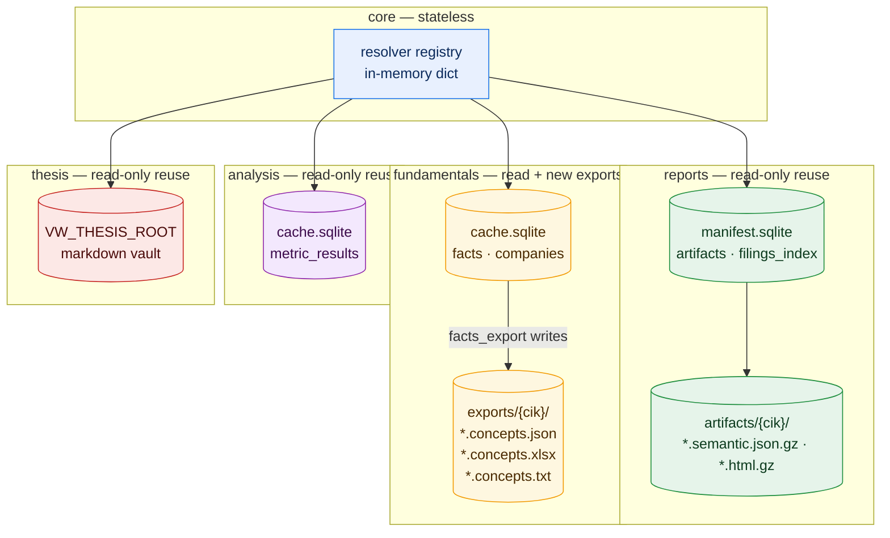

# Citation Redesign — Planned Data Mapping

> **Status:** Proposed — follows [design.md](./design.md)
> **Date:** 2026-10-21
> **Scope:** Storage, formats and access methods introduced by the citation redesign. Existing stores (facts mirror, semantic artifacts, metric cache, vault) are **reused read-only**; the only new writable surface is the fundamentals export directory.
> **Ownership rule:** each resolver reads only its own module's store. The `citation_resolve` registry is in-memory and owns no data.
> **Note:** this file moves into [`architecture/db-mapping.md`](../../db-mapping.md) once the implementation is validated.

---

## 1. Visual data landscape (citation resolution)

---

## 2. New writable storage — `modules/fundamentals/exports/`

The only new directory in this design. Everything in it is **derived data**: rebuildable from the facts mirror at any time, never a source of truth.

| Path | Format | Schema | Writer | Reader | Size / cap |
|:---|:---|:---|:---|:---|:---|
| `exports/{cik}/{accession}.concepts.json` | JSON (UTF-8) | SEC companyfacts shape: `{cik, entityName, facts: {taxonomy: {concept: {label, description, units: {unit: [{end, val, accn, fy, fp, form, filed, start?}]}}}}}` | `facts_export(format="json")` | `citation_resolve` (inline, paged) + user | 0.2–2 MB/accession typical; 7 MB full-company worst case; **32 MB per-export cap** |
| `exports/{cik}/{accession}.concepts.xlsx` | XLSX (`openpyxl`) | Sheet `facts`; columns `concept, taxonomy, unit, value, period_start, period_end, fiscal_year, fiscal_period, form, filed, accession` | `facts_export(format="xlsx")` | user opens in Excel; resolver returns path + inline TSV preview | ≤500,000 rows (Excel hard limit 1,048,576); ~0.3–1.5 MB |
| `exports/{cik}/{accession}.concepts.txt` | TSV (UTF-8) | Same 12 columns, tab-delimited, header row | `facts_export(format="txt")` | `citation_resolve` (inline, paged) | same row caps |

**Write policy:** atomic (`<file>.tmp` → `os.replace`), mirrors `reports/store/artifact_store.py::_atomic_write`. Files carry the accession in the name, so concurrent exports for different filings never collide; same-target re-export replaces atomically.
**Eviction:** piggybacks on the existing company LRU (`facts_store.evict_lru`); a `MAX_EXPORTS_MB = 64` module cap removes the least-recently-accessed `exports/{cik}/` folder alongside its company.
**Config:** `FUNDAMENTALS_EXPORTS` (default `${PLUGIN_DATA}/modules/fundamentals/exports`), `MAX_EXPORTS_MB`.

## 3. Read paths used by resolvers (no new tables, no new files)

| Resolver | Store | Objects read | Access method |
|:---|:---|:---|:---|
| `reports.resolve` | `manifest.sqlite` | `artifacts` row (existence, `cik`) | `artifact_store.manifest()` |
| `reports.resolve` | `artifacts/{cik}/` | `{accession}.semantic.json.gz` | `artifact_store.load()` + in-memory LRU (`ReportsService._cache`) |
| `reports.resolve` | `artifacts/{cik}/` | `{accession}.html.gz` (raw-html kind) | `gzip.open` streaming slice |
| `fundamentals.resolve` | `cache.sqlite` | `facts` rows `WHERE cik=? AND accession=?` | `facts_store` accession-dump helper (new, read-only) |
| `fundamentals.resolve` | `exports/{cik}/` | `.concepts.xlsx` (path only) | `Path` existence check; preview from mirror |
| `analysis.resolve` | `cache.sqlite` | `metric_results` row by `(metric_id, period_end, fingerprint)` | existing derived-cache read |
| `thesis.resolve` | `VW_THESIS_ROOT` | vault markdown file | existing vault reader (`thesis_read` mechanics) |

**Resolution is build-free:** if a resolver's store row is missing (`artifact.status == "not_cached"`), it raises `ArtifactNotCached` — it never downloads, parses or syncs. The agent is directed to the build path (`report_section`, `facts_query`, `ratio_compute`, `thesis_read`).

**Serve-from-cache ladder (reports):** the resolver reuses the same in-memory semantic object the reports tools use — `ReportsService._cache` (LRU) first, then `semantic.json.gz` on disk — via a new load-only `artifact_peek()`; it never invokes `artifact()`'s build path. No new caching layer is introduced anywhere: every resolver reads a store that already exists, except the `fundamentals/exports/` files which exist solely so XLSX has a real file to open in Excel.

## 4. In-memory state

| Object | Owner | Lifetime | Content |
|:---|:---|:---|:---|
| resolver registry | `core/citations.py` | process lifetime | `dict[str, CitationResolver]` — one entry per available module, wired by `server.py` |
| citation dicts | envelope payloads | per response | ≤20 per response, deduped by `key` (identity now includes artifact locator) |
| `ReportsService._cache` | `reports` | LRU (`ARTIFACT_LRU`) | already exists; resolver reuse only |

## 5. Lifecycle and migration

1. Old citations (URL-only) remain valid: resolver returns `artifact_status: "not_cached"` + the citation's own validated URL.
2. `thesis://` pseudo-URLs are dropped on the next tool call generation — nothing stored references them.
3. Exports are deleted before company eviction (step 2 of the eviction cascade) so no orphan files outlive their facts.
4. When implementation is validated: this file merges into `architecture/db-mapping.md` (new `§10` section) and the citation contract rows in `valuebot-v2/design.md` §3.6 are marked superseded by `citation-redesign/design.md`.
