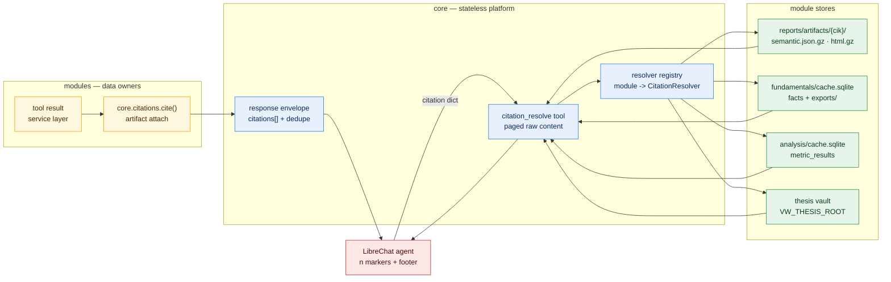
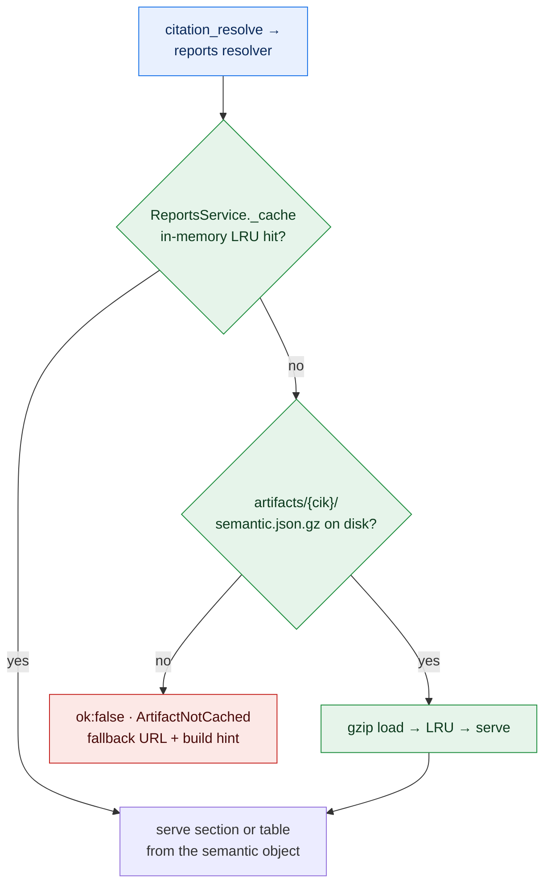
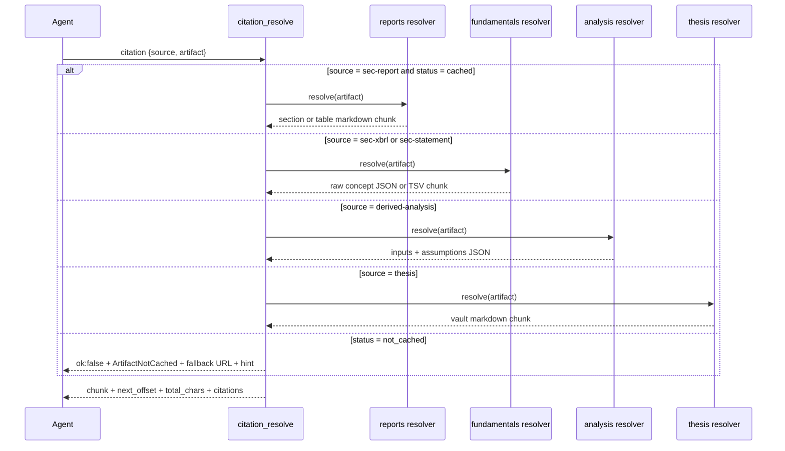
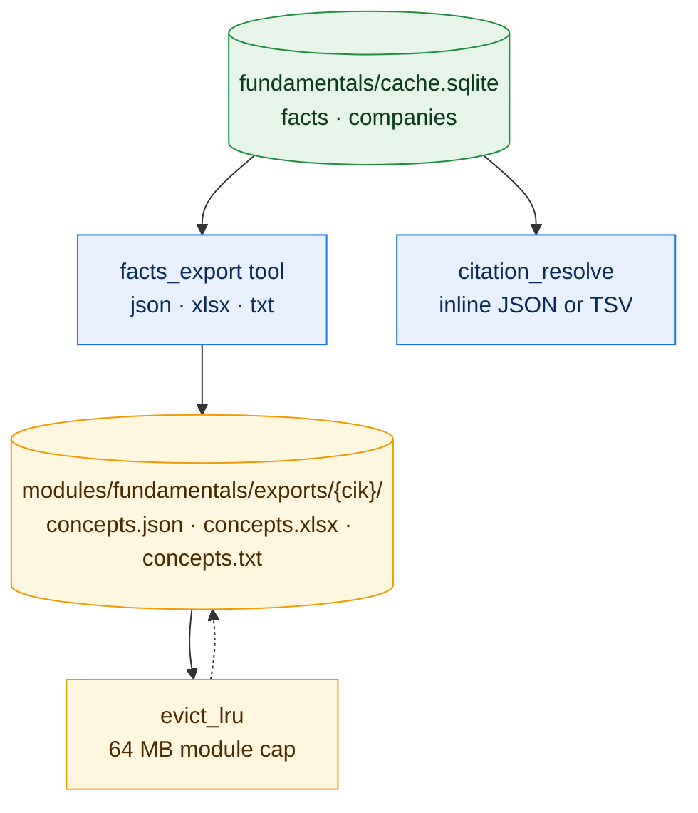

# Citation Redesign — Artifact-First Resolution

> **Status:** Implemented — validated by the offline test suite
> **Date:** 2026-10-21
> **Scope:** Replace URL-only citations with artifact-first citations. Report citations resolve from the local semantic cache; XBRL fact citations resolve to raw concept files (JSON / XLSX / TXT); every other module follows the same resolver pattern.
> **Repo root:** `/Users/rkarumugam/LocalFiles/Projects/librechat-plugin`

---

## 1. Design Summary

Citations stop being external URLs and become **locators for local raw material**. Every citation gains an `artifact` block (`module`, `kind`, locators, `format`, `status`) describing where the underlying raw data lives. A new core tool, `citation_resolve`, accepts any tool-issued citation and returns the raw content inline — paged, byte-capped, and read from module-owned stores only, never from the network.

- **Reports:** `sec-report` citations point into `reports/artifacts/{cik}/{accession}.semantic.json.gz` and `.html.gz`. Resolving a section, table, or raw HTML slice reads the semantic cache; the EDGAR link becomes a validated fallback only.
- **Fundamentals:** `sec-xbrl` citations resolve to raw concept dumps from the facts mirror, rendered as SEC-companyfacts-shaped JSON, XLSX, or TSV. A new `facts_export` tool materializes files under `fundamentals/exports/`; the resolver serves the same payloads inline.
- **Analysis / thesis:** `derived-analysis` citations resolve to the input/assumption bundle behind a metric; `thesis` citations resolve to vault file content.
- **URL hygiene:** `edgar_url()` never emits placeholder documents again; `(index)` is removed, document names are validated, and index/company-level fallbacks are guaranteed live pages.

Zero new network surface, zero new SQLite tables, and module isolation is preserved: each module implements a `CitationResolver` protocol and reads only its own store.

## 2. Root causes (evidence)

| Symptom | Cause | Evidence |
|:---|:---|:---|
| Report citations open dead EDGAR links | `reports/sources/edgar_source.py` builds `edgar_url(cik, accession, primary_document or "(index)")`. When `primaryDocument` is empty in submissions JSON, the URL contains the literal string `(index)` → 404. Valid-looking docs can also be stale/renamed. | `edgar_source.py` lines 143, 178, 207; `citations.edgar_url` |
| Citations ignore the semantic cache | `_filing_citation` in `reports/tools/__init__.py` only attaches `url=source_url`; the artifact manifest (`report_available`) exists but is never referenced by the citation. | `reports/tools/__init__.py` `_filing_citation` |
| XBRL fact citations open nothing raw | `fundamentals/service.py` `_fact_citation` passes cik+accession so `cite()` auto-builds an archive directory page URL — a listing, not raw concepts. No JSON/XLSX/TXT export exists. | `fundamentals/service.py` `_fact_citation`; `facts_store.provenance_for` |
| Derived and thesis citations are inconsistent | `derived-analysis` inherits the XBRL problem via `derived_from[]`; `thesis` emits a non-openable pseudo-scheme `thesis://TICKER/section`. | `thesis/service.py` `_thesis_citation` |

## 3. Design Rationale & Tradeoffs

### 3.1 Artifact-first resolution via a core tool (chosen)

LibreChat renders citations as footnotes; the MCP server is stdio-only. Serving a real "click to open file" experience would require an HTTP server inside the plugin.

- **Chosen:** `citation_resolve(citation, offset, limit)` — the agent calls it to open the raw source inline (JSON / Markdown / TSV text). Works in every deployment topology, paged and capped, zero network.
- **Adopted (opt-in):** a loopback artifact viewer, `core/artifact_viewer.py`, serving resolved artifacts at `/a` on `127.0.0.1`. It starts only when `VW_ARTIFACT_HTTP_PORT` is non-zero (default `0` = disabled) and a failed bind simply leaves it off. Every request must carry the per-process random token embedded in the citation URL (`t=…`) because the thesis vault is private. It resolves through the same registry as `citation_resolve` — it can never surface material the tools would not, never builds artifacts and never touches the network. `citations.viewer_url(artifact)` returns `None` while the viewer is disabled, so citations fall back to a dataset URL or to no `url` at all.
- **Still rejected:** a public or always-on HTTP server. Loopback-only binding, the token requirement and the Docker caveat below keep it out of every remote topology unless the operator opts in.
- **Compromise:** for real spreadsheet files (XLSX) the tool materializes them on disk and returns the absolute path plus an inline text preview. Local users open them directly; remote users still get the preview content.

> **Docker caveat:** the viewer binds to loopback inside the container. A browser on the LibreChat host cannot reach it unless the port is published (`-p 8765:8765`) *and* `VW_ARTIFACT_HTTP_PORT` is set to a value the client can reach. Otherwise leave it at `0` and rely on `citation_resolve`.

### 3.2 Validated fallback URLs, never fabricated ones

- `edgar_url()` gains `kind="doc" | "index" | "company"`. `kind="doc"` only emits a URL when the document name matches `^[A-Za-z0-9._-]+\.(htm|html|xml)$`, otherwise returns `None`. The literal `(index)` fallback is removed.
- `kind="index"` produces `https://www.sec.gov/Archives/edgar/data/{cik}/{accn}/`, which exists for every accession on file. `kind="company"` produces the live browse-edgar query page.
- The citation's `url` field is retained (backward compatibility with the existing footer format) but is now always a validated URL or absent. `artifact` is the primary resolution path.
- `cite()` no longer auto-generates a URL from `cik`/`accession`. The caller passes a `viewer_url()`, `sec_fact_url()` or `sec_companyfacts_url()` link, or omits `url` entirely.

### 3.3 One resolver protocol, four implementations — cache reuse, not new caching

`core/citations.py` hosts a pure in-memory registry `module → CitationResolver`. Each module implements `CitationResolver.resolve(artifact, offset, limit)` reading only its own store. This satisfies the code-abstraction triggers (cross-module utility, minimal interface, pure logic vs I/O boundary) without a shared data layer.

**Resolution always serves the existing cache/semantic object.** For reports, the resolver returns the section or table sliced from the *same* in-memory semantic object the reports tools already use (`ReportsService._cache` LRU first, then `artifacts/{cik}/{accession}.semantic.json.gz` on disk). There is no second cache beside the semantic store, and resolve never rebuilds.

Per-module cache status — no new caching mechanisms are introduced:

| Module | Store the resolver reads | Already cached today? | New caching needed? |
|:---|:---|:---|:---|
| `reports` | in-memory LRU → `semantic.json.gz` / `html.gz` → `manifest.sqlite` | ✅ yes (tools use it today) | None — resolver reuses it |
| `fundamentals` | `cache.sqlite` facts mirror | ✅ yes (populated by `facts_query`) | None — plus `exports/` only for XLSX files |
| `analysis` | `cache.sqlite` `metric_results` | ✅ yes (populated by `ratio_compute`) | None |
| `thesis` | vault files under `VW_THESIS_ROOT` | ✅ n/a — local file read, no cache required | None |

Resolvers are **read-only and never trigger artifact builds** — a not-cached citation returns `artifact_status: "not_cached"` plus the validated fallback URL and a hint to run the domain tool first (e.g., `report_section`). Implementation note: `ReportsService` gains a load-only `artifact_peek()` variant of `artifact()` (memory → disk → raise), because the resolver must never invoke the build path.

### 3.4 Export vs inline

- JSON and TXT raw concepts are served inline by the resolver (streamed from SQLite, chunked, capped).
- XLSX is materialized to `exports/` (binary format cannot be inlined usefully) with an LRU cap of 64 MB per module, evicted alongside company eviction. Exports are derived data — always rebuildable, never a source of truth.
- AAPL full companyfacts JSON is ~7 MB; per-accession subsets are 0.2–2 MB. A 32 MB per-export cap and 500k row Excel cap (Excel hard limit 1,048,576) prevent runaway files.

### 3.5 Dependency rationale

| Library | License | Chosen because | Rejected alternative |
|:---|:---|:---|:---|
| `openpyxl` (new) | MIT | Read+write XLSX, allows round-trip tests, pure Python, already the de-facto standard in the sibling terminal project | `xlsxwriter` (write-only, BSD) — cannot re-open exports in tests; `pandas` — heavy, C-extensions, overkill for a tabular dump |
| stdlib `json`, `csv`, `gzip` | PSF | JSON/TXT exports and artifact reads | — |

No other new dependencies. Resolution adds zero SEC network calls, so rate limits (EDGAR 10 req/s) are untouched.

## 4. Citation schema v2

```json
{
  "key": "a1b2c3d4e5f60718",
  "label": "AAPL 10-K FY2025, Item 7",
  "source": "sec-report",
  "accession": "0000320193-25-000079",
  "form": "10-K",
  "filed": "2025-10-31",
  "period": "FY2025",
  "section": "part2-item7",
  "url": "http://127.0.0.1:8765/a?t=…&module=reports&kind=semantic-section&cik=320193&accession=0000320193-25-000079&section_id=part2-item7",
  "original_url": "https://www.sec.gov/Archives/edgar/data/320193/000032019325000079/",
  "artifact": {
    "module": "reports",
    "kind": "semantic-section",
    "cik": 320193,
    "accession": "0000320193-25-000079",
    "section_id": "part2-item7",
    "format": "md",
    "status": "cached"
  }
}
```

### Artifact kinds by module

| `artifact.module` | `artifact.kind` | `artifact.format` | Resolver reads | Result |
|:---|:---|:---|:---|:---|
| `reports` | `semantic-section` | `md` | `semantic.json.gz` + `section_rules.section_text` | section text, paged |
| `reports` | `semantic-table` | `md` | `semantic.json.gz` + `table_rules.render_markdown` | GFM table, row-paged |
| `reports` | `raw-html` | `html` | `html.gz` | raw HTML slice, char-paged |
| `fundamentals` | `facts-json` | `json` | `cache.sqlite` `facts` table, accession-filtered | SEC-companyfacts-shaped JSON |
| `fundamentals` | `facts-xlsx` | `xlsx` | mirror → `exports/{cik}/{accession}.concepts.xlsx` | file path + inline TSV preview |
| `fundamentals` | `facts-txt` | `txt` | mirror, accession-filtered | TSV rows, paged |
| `analysis` | `derived-inputs` | `json` | `cache.sqlite` `metric_results` row | inputs + assumptions + formula |
| `thesis` | `vault-doc` | `md` | vault file (existing `thesis_read` mechanics) | vault content, paged |

- `status: "cached"` — raw material is available locally, resolver will succeed without network.
- `status: "not_cached"` — resolver returns the validated fallback URL and a build hint.
- `key` identity now includes the serialized artifact locator (module, kind, cik, accession, section_id/table_id/metric_id) so distinct raw sources never collide during dedupe.

### URL policy

`cite()` no longer auto-generates a `url`: it emits `url` only when the caller
passes one explicitly. Callers use `citations.viewer_url(artifact)` first and
fall back to an honest dataset URL; `cik` alone contributes no link.

| Source | Raw material | Primary `url` | Secondary |
|:---|:---|:---|:---|
| `sec-xbrl`, `sec-statement` | SEC XBRL companyfacts dataset | `viewer_url(artifact)`, else `sec_companyfacts_url(cik)` (`https://data.sec.gov/api/xbrl/companyfacts/CIK##########.json`) | `artifact` → `citation_resolve` |
| `sec-report` | cached filing HTML / semantic cache | `viewer_url(artifact)` at the exact section/table | `original_url` = SEC filing HTML (provenance only); `artifact` → `citation_resolve` |
| `derived-analysis` | `cache.sqlite` `metric_results` | `viewer_url(artifact)` | `artifact` → `citation_resolve` |
| `thesis` | vault markdown | `viewer_url(artifact)` | `artifact` → `citation_resolve` |

- A fact citation never links to a filing page: its source is the companyfacts
  dataset, not a document in an accession directory.
- A report citation's link is the local semantic viewer; `original_url` keeps
  the EDGAR HTML for provenance and is never the printed citation link.
- When `viewer_url()` returns `None` and no dataset URL applies (`thesis`),
  the citation carries no `url` and the artifact is opened with
  `citation_resolve`.
- `sec_fact_url(cik, taxonomy, concept)` is available for single-concept
  citations (companyconcept endpoint); `edgar_url()` remains for filing
  provenance, not as an alias for the data source.

## 5. Tool and protocol contracts

### 5.1 `citation_resolve` (new core tool)

```
citation_resolve(
    citation: dict,          # the full tool-issued citation dict
    offset: int = 0,         # character offset
    limit_chars: int = 8000  # 1000..12000
) -> dict
```

Response envelope (module `core`):

```json
{
  "ok": true, "module": "core", "tool": "citation_resolve",
  "data": {
    "artifact_status": "cached",
    "kind": "semantic-section",
    "format": "md",
    "chunk": "…",
    "next_offset": 8000,
    "total_chars": 41200,
    "path": null,
    "preview": null,
    "hint": null
  },
  "citations": [ { "…the same citation…" } ],
  "paging": { "offset": 0, "next_offset": 8000, "truncated": true }
}
```

Errors use existing typed codes: `InvalidArgument` (malformed citation), `CitationUnresolvable` (unknown module/kind), `ArtifactNotCached` (resolver returns `ok:false` with `artifact_status: "not_cached"` and a hint).

### 5.2 `CitationResolver` protocol (`core/contracts.py`)

```python
@runtime_checkable
class CitationResolver(Protocol):
    api_version: int

    def resolve(self, artifact: dict, *, offset: int = 0,
                limit: int = 8000) -> dict:
        """Return {kind, format, chunk, next_offset, total_chars, path?} or
        raise ArtifactNotCached. Must not build artifacts or touch the network."""
```

Registry in `core/citations.py`: `register_resolver(module: str, resolver)`, `resolve_citation(citation, offset, limit) -> dict`. The composition root (`server.py`) wires one resolver per available module; failed modules are simply not registered, so `citation_resolve` degrades gracefully.

### 5.3 `facts_export` (new fundamentals tool)

```
facts_export(
    symbol: str,
    accession: str | None = None,   # default: latest 10-K accession with facts
    concepts: list[str] | None = None,
    format: str = "json",           # json | xlsx | txt
    unit: str | None = None
) -> dict
```

Writes `modules/fundamentals/exports/{cik}/{accession}.concepts.{ext}` atomically (`.tmp` + `os.replace`, same pattern as `artifact_store._atomic_write`), returns `{path, format, bytes, fact_count, concept_count, preview, truncated, citations}`. JSON export mirrors the SEC companyfacts shape (`{cik, entityName, facts: {taxonomy: {concept: {label, description, units: {unit: [rows]}}}}}`); TXT/XLSX use columns `concept, taxonomy, unit, value, period_start, period_end, fiscal_year, fiscal_period, form, filed`.

### 5.4 Changed call sites

| File | Change |
|:---|:---|
| `mcp/core/citations.py` | `edgar_url(kind=…)` with document validation; `(index)` removed; `artifact` field support in `cite()`; identity includes artifact locator; resolver registry + `resolve_citation` |
| `mcp/core/contracts.py` | new `CitationResolver` protocol |
| `mcp/core/errors.py` | new typed codes `CitationUnresolvable`, `ArtifactNotCached` |
| `mcp/server.py` | register `citation_resolve` core tool; wire module resolvers into the registry |
| `mcp/modules/reports/tools/__init__.py` | `_filing_citation` attaches `artifact` (status from `artifact_store.manifest`) and validated `url` |
| `mcp/modules/reports/service.py` | new `resolve(artifact, offset, limit)` method (section / table / raw-html) |
| `mcp/modules/fundamentals/tools/__init__.py` | new `facts_export` tool registration |
| `mcp/modules/fundamentals/service.py` | `_fact_citation` / `provenance_for` attach `facts-json` artifact; new `export()` and `resolve()` methods |
| `mcp/modules/fundamentals/store/facts_store.py` | accession-filtered row dump helpers |
| `mcp/modules/analysis/service.py` + `tools/__init__.py` | attach `derived-inputs` artifact to `derived-analysis` citations; new `resolve()` |
| `mcp/modules/thesis/service.py` | `_thesis_citation` drops `thesis://` pseudo-URL, emits `vault-doc` artifact; new `resolve()` |
| `mcp/core/config.py` | `FUNDAMENTALS_EXPORTS`, `MAX_EXPORTS_MB` (64) |
| `skills/grounded-citation/SKILL.md` | v2: artifact-first footer, `citation_resolve` workflow, updated banned-behaviour list |

## 6. Data & Interface Matrix

| Data Element / Field | Module Owner | Source / Ingestion Vector | Format / Schema | Rate Limits, Sizing & Tier Constraints |
| :--- | :--- | :--- | :--- | :--- |
| Citation dict v2 + `artifact` block | `core` (`citations.py`) | Built by module tool responses; consumed by `citation_resolve` and the grounded-citation skill | JSON in envelope `citations[]`; `artifact{module, kind, cik, accession, section_id, table_id, metric_id, symbol, format, status}` | ≤20 citations/response; each ~300–700 B; dedupe by key |
| Resolver registry | `core` (in-memory) | `server.py` wiring at composition time | `dict[str, CitationResolver]` | 4 entries (one per module); stateless, no persistence |
| `semantic-section` slice | `reports` | `artifacts/{cik}/{accession}.semantic.json.gz` (read-only, existing store) | gzip JSON, `schema_version` 1; `section_rules.section_text` + `chunk_text` | 50–300 KB/filing; resolve <50 ms warm; **zero network**; chunks ≤12 KB |
| `semantic-table` slice | `reports` | same artifact | `table_rules.render_markdown` GFM grid | row-paged (`row_offset`/`max_rows`); ≤12 KB/chunk |
| `raw-html` slice | `reports` | `artifacts/{cik}/{accession}.html.gz` | gzip HTML, char-paged | 0.25–5 MB/filing; 512 MB artifact LRU already in place |
| Raw concept JSON export | `fundamentals` | SQLite `facts` mirror (`WHERE accession = ?`) → `exports/{cik}/{accession}.concepts.json` | SEC companyfacts shape | Per-accession 0.2–2 MB (full company ~7 MB); 32 MB/export cap; 64 MB/module LRU |
| Raw concept XLSX export | `fundamentals` | same mirror → `.concepts.xlsx` via `openpyxl` | Sheet `facts`; 12 columns | ≤500,000 rows (Excel hard limit 1,048,576); ~0.3–1.5 MB/file |
| Raw concept TXT export | `fundamentals` | same mirror → `.concepts.txt` | TSV, header row | Same row caps; inline-friendly |
| `derived-inputs` bundle | `analysis` | `cache.sqlite` `metric_results` row (metric_id + period_end) | JSON `{metric_id, formula, formula_version, inputs[], assumptions[], quality}` | 2–4 KB; TTL 24 h + facts-fingerprint invalidation already in place |
| `vault-doc` content | `thesis` | `VW_THESIS_ROOT` file read (existing `thesis_read`) | Markdown, char-paged | 8 KB chunks; read-only |
| Validated EDGAR fallback URL | `core` (`citations.py`) | Computed; no I/O | string | `doc` mode requires `^[A-Za-z0-9._-]+\.(htm|html|xml)$`; `index` mode always exists; `company` mode = browse-edgar query page |

## 7. Abstraction & Data Flow Diagrams

### 7.1 Citation lifecycle



### 7.2 Reports resolution ladder — serve from cache



### 7.3 `citation_resolve` dispatch



### 7.4 Export storage (fundamentals)



## 8. Feasibility Review

- **Resolver paths verified against current code:** `artifact_store.load/manifest` exist; `section_rules.section_text`, `table_rules.render_markdown`, `chunk_text` are reusable as-is. The `facts` table has `accession`, `concept`, `unit`, `value`, `period_*`, `form_type`, `filing_date` columns — sufficient for the companyfacts-shaped dump. `metric_results` stores inputs; thesis reading exists.
- **Network budget:** resolution is 100% local. EDGAR rate limits (10 req/s) are untouched; fallback URLs are passive links.
- **Envelope:** artifact dicts are small; `cap_bytes`/`_shrink` need no changes. `MAX_CITATIONS = 20` unchanged.
- **Backward compatibility:** `cite()` signature unchanged (additive `artifact` kwarg); `edgar_url()` positional signature unchanged (additive `kind` kwarg). Old `url`-only citations still resolve: the resolver falls back to `not_cached` + the citation's own URL.
- **Risks:** XLSX requires the new `openpyxl` dependency (MIT, pure Python); large accession dumps must be paged (cap enforced in resolver and export).

## 9. Next Steps

Implementation order for the coder agent (no cross-module work may start before step 1):

1. **`core/citations.py` v2** — `edgar_url(..., kind=)` with document regex validation, `(index)` removed; `cite(..., artifact=)`; identity includes artifact locator; `register_resolver` / `resolve_citation` registry. Keep old signatures (facade rule).
2. **`core/contracts.py` + `core/errors.py`** — `CitationResolver` protocol; `CitationUnresolvable`, `ArtifactNotCached` codes.
3. **`server.py`** — register `citation_resolve` core tool; wire one resolver per available module; stub resolver returns `module_unavailable`.
4. **`reports`** — `_filing_citation` artifact attach (status from `artifact_store.manifest`); add load-only `ReportsService.artifact_peek()` (memory LRU → disk gz → raise, never build) and `ReportsService.resolve()` for `semantic-section` / `semantic-table` / `raw-html` on top of it; `edgar_source.py` call sites move to validated `kind` URLs.
5. **`fundamentals`** — `facts_export` tool; `service.export()` + `service.resolve()`; `facts_store` accession-dump helpers; `config.FUNDAMENTALS_EXPORTS` / `MAX_EXPORTS_MB`; `_fact_citation` and `provenance_for` attach `facts-json` artifacts.
6. **`analysis`** — attach `derived-inputs` artifact on `derived-analysis` citations; `AnalysisService.resolve()` reads the `metric_results` row.
7. **`thesis`** — `_thesis_citation` emits `vault-doc` artifact (drop `thesis://`); `ThesisService.resolve()` reuses the vault reader.
8. **Skills** — rewrite `grounded-citation/SKILL.md` for v2: artifact-first footers, `citation_resolve` workflow, drop-claim rule unchanged, banned list gains "never write a URL the tool did not return; when `artifact.status == "cached"`, open sources with `citation_resolve`".
9. **Tests** — unit: URL builder modes and rejection of `(index)`; artifact identity/dedupe; registry dispatch. Unit per module: resolver output against fixtures (semantic gz, facts mirror, metric_results, vault). Contract: resolver protocol wiring and store isolation. Integration (offline): `citation_resolve` on a cached AAPL artifact returns Item 7 text with zero network; `facts_export` JSON round-trips against the SEC companyfacts shape.
10. **Docs** — update `docs/users/03-tools-reference.md` with `citation_resolve` and `facts_export`; update `architecture/db-mapping.md` after validation.

## 10. Appendix

- [db-mapping.md](./db-mapping.md) — planned storage mapping for the citation redesign (exports directory, resolver read paths, lifecycle). Moves into `architecture/db-mapping.md` once the implementation is validated.
- **[implementation-plan.md](./implementation-plan.md)** — executed plan (T1–T9), task flow and verification gates.
- Supersedes the citation contract rows in [valuebot-v2/design.md](../valuebot-v2/design.md) §3.6 (citation record) — v2 spec is updated by this document.
