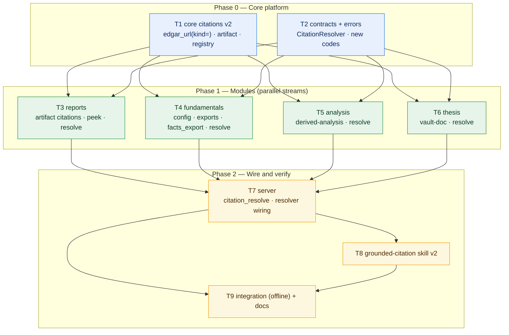

# Citation Redesign — Implementation Plan

> **Status:** Implemented — all 9 tasks complete, 144 tests passing
> **Date:** 2026-10-21
> **Design:** [design.md](./design.md)
> **Storage:** [db-mapping.md](./db-mapping.md)
> **Target:** `/Users/rkarumugam/LocalFiles/Projects/librechat-plugin/valuebot/`
> **Strategy:** extend the existing citation factory in place (facade rule — old signatures stay valid), reuse existing stores read-only, and add exactly one new writable surface (`fundamentals/exports/`).

---

## 1. Objective

Fix citations end to end:

1. A `sec-report` citation opens raw content from the semantic cache (in-memory LRU → `semantic.json.gz`), never a dead EDGAR link.
2. A `sec-xbrl` / `sec-statement` citation opens raw concept data as JSON, XLSX or TXT.
3. Every other module (`analysis`, `thesis`) follows the same artifact-first resolver pattern.
4. `edgar_url()` never fabricates URLs again — `(index)` placeholders are gone; all URLs are validated or absent.

Deliverables: citation schema v2 with `artifact` blocks, the `citation_resolve` core tool, four module resolvers behind the `CitationResolver` protocol, the `facts_export` tool, a rewritten `grounded-citation` skill, and offline tests proving resolution is 100% network-free.

## 2. Design amendments (agreed during planning)

| # | Amendment | Reason |
|:---|:---|:---|
| A1 | New artifact kind `semantic-index` for filing-level citations (`filing_list`, filing headers without a `section_id`) | A filing-level citation must resolve to something useful: the filing's section summary (id, kind, title, char_count, table count). Added to design §4 kinds table by Task T3. |
| A2 | Resolvable `derived-inputs` applies to `ratio_compute` results only; DCF keeps citing underlying facts | DCF runs are deliberately not persisted (design §2.9); there is no store row to resolve from. |
| A3 | `facts-xlsx` resolver never builds the file — it returns `ArtifactNotCached` with hint "run `facts_export` format=xlsx" when missing | Resolvers are read-only by contract; building is the export tool's job. |

## 3. Task summary

| Task | Area | Depends on | Phase |
|:---|:---|:---|:---|
| T1 | `core/citations.py` v2 + unit tests | — | 0 |
| T2 | `core/contracts.py` + `core/errors.py` | — | 0 |
| T3 | `reports` — artifact citations + load-only peek + resolver | T1, T2 | 1 |
| T4 | `fundamentals` — config, exports, `facts_export`, resolver | T1, T2 | 1 |
| T5 | `analysis` — `derived-analysis` citations + resolver | T1, T2 | 1 |
| T6 | `thesis` — `vault-doc` citations + resolver | T1, T2 | 1 |
| T7 | `server.py` — `citation_resolve` tool + resolver registry wiring | T1–T6 | 1 |
| T8 | `grounded-citation` skill v2 | T1–T7 | 2 |
| T9 | Integration tests + user docs | T7, T8 | 2 |

---

## 4. Task details

### T1 — Core citation factory v2

**Files:** `valuebot/mcp/core/citations.py`, `valuebot/tests/unit/core/test_citations.py`

**Technical requirements**

- `edgar_url(cik, accession, document=None, *, kind="index")`:
  - `kind="doc"`: emit `https://www.sec.gov/Archives/edgar/data/{cik}/{accn}/{doc}` only when the document matches `^[A-Za-z0-9._-]+\.(htm|html|xml)$`; otherwise return `None`.
  - `kind="index"`: emit the accession directory page `…/data/{cik}/{accn}/` (exists for every filed accession). This becomes the default and the `(index)` string is **removed everywhere**.
  - `kind="company"`: emit `https://www.sec.gov/cgi-bin/browse-edgar?action=getcompany&CIK={cik:010d}&type=10-K&dateb=&owner=include&count=40`.
  - Keep positional signature backward-compatible; existing zero-padding / double-slash normalization stays.
- `cite(..., artifact: dict | None = None)`: embed the artifact dict under `"artifact"`; canonical fields unchanged. Extra fields must not collide with canonical keys.
- `_identity(...)`: include the sorted-serialized artifact locator in the hash payload so citations with different artifacts never dedupe together.
- `_key_for(citation)`: unchanged fallback behavior.
- New in-memory registry: `RESOLVERS: dict[str, CitationResolver]` (type imported lazily via `TYPE_CHECKING` to avoid a cycle), `register_resolver(module: str, resolver) -> None`, `resolve_citation(citation: dict, *, offset: int = 0, limit: int = 8000) -> dict`.
  - `resolve_citation` reads `citation["artifact"]`; missing artifact or unknown module/kind → `CitationUnresolvable` with hint. Resolver raising `ArtifactNotCached` propagates. Result passthrough: `{kind, format, chunk, next_offset, total_chars, path?, preview?, hint?}`.
  - Keep the module pure: registry is stateful but no I/O.
- Update `tests/unit/core/test_citations.py`:
  - Existing `(index)` assertions become index-directory URLs.
  - New: doc-mode validation (accepts `aapl-20250927.htm`, rejects `(index)`, `..`, `report.html` → None), company-mode shape, `cite(..., artifact=…)` embedding, artifact-sensitive dedupe, registry dispatch with a fake resolver, `CitationUnresolvable` paths.

**Dependencies:** none.

**Expected output:** citations carry artifact blocks; `edgar_url` never emits a placeholder; unit tests green (`pytest tests/unit/core/test_citations.py`).

---

### T2 — Resolver protocol and typed errors

**Files:** `valuebot/mcp/core/contracts.py`, `valuebot/mcp/core/errors.py`, `valuebot/tests/contract/`

**Technical requirements**

- `contracts.py`: add
  ```python
  @runtime_checkable
  class CitationResolver(Protocol):
      api_version: int
      def resolve(self, artifact: dict, *, offset: int = 0,
                  limit: int = 8000) -> dict: ...
  ```
  Docstring: resolvers must not build artifacts, write stores or touch the network.
- `errors.py`: add `CitationUnresolvable(ValuebotError)` with `code = "citation_unresolvable"` (non-retryable) and `ArtifactNotCached(ValuebotError)` with `code = "artifact_not_cached"` (non-retryable; `hint` carries the build path, e.g. "run `report_section` or `filing_list` first"). Update `__all__`.
- Contract test (in `tests/contract/`): each module service exposing a resolver satisfies the protocol at runtime (`isinstance(service, CitationResolver)`); resolvers import no other `modules.*` package (extend the existing import-isolation checks).

**Dependencies:** none (can run in parallel with T1; both merge before T3).

**Expected output:** protocol and error codes available for T3–T7; contract tests green.

---

### T3 — Reports: artifact citations + serve-from-cache resolver

**Files:** `valuebot/mcp/modules/reports/tools/__init__.py`, `valuebot/mcp/modules/reports/service.py`, `valuebot/mcp/modules/reports/sources/edgar_source.py`, `valuebot/tests/unit/reports/`

**Technical requirements**

- `reports/sources/edgar_source.py`: replace all three `edgar_url(..., document or "(index)")` call sites (lines ~143, ~178, ~207) with: valid `primary_document` → `edgar_url(cik, accession, doc, kind="doc")`; else → `edgar_url(cik, accession, kind="index")`.
- `reports/tools/__init__.py` — `_filing_citation(filing, section, label, artifact)`:
  - `section_id` present → `artifact {module:"reports", kind:"semantic-section", cik, accession, section_id, format:"md", status:"cached"}`.
  - `table_id` present (report_table) → `kind:"semantic-table"`.
  - Filing-level citations (filing_list, report_search hits without section) → `kind:"semantic-index"`.
  - Status for `filing_list` rows comes from the row's existing `report_available` flag (`"cached"` / `"not_cached"`); every other tool has just loaded the artifact → `"cached"`.
  - `url` is always the validated `source_url` (rebuilt with the T1 rules).
- `reports/service.py`:
  - `artifact_peek(accession) -> dict`: in-memory LRU (`_cached`) → `artifact_store.load(...)` → raise `ArtifactNotCached`. Never calls `artifact()`, never builds.
  - `resolve(artifact, *, offset=0, limit=8000) -> dict`:
    - `semantic-section`: peek → locate section by `section_id` → `section_rules.section_text` → `chunk_text` → chunk payload.
    - `semantic-table`: peek → locate table → `table_rules.render_markdown` (full grid, then chunk).
    - `semantic-index`: peek → section summary list (id, kind, title, char_count, table count) → chunk.
    - `raw-html`: stream the `html.gz` file (gzip) and `chunk_text` the slice; do not load the whole artifact.
  - Raise `SectionNotFound` / `TableNotFound` on unknown IDs (existing codes) so the tool can hint.
- Unit tests (fixture semantic artifact, offline): section resolve serves Item 7 text in chunks with correct `next_offset`; table resolve renders GFM; `semantic-index` lists sections; `artifact_peek` raises `ArtifactNotCached` when the manifest/file is missing; `_filing_citation` attaches the right kind per call site.
- Add the `semantic-index` row to the design §4 kinds table (amendment A1).

**Dependencies:** T1, T2.

**Expected output:** every reports tool response carries resolvable artifact citations; warm resolution <50 ms, zero network; unit tests green.

---

### T4 — Fundamentals: raw-concept exports + resolver

**Files:** `valuebot/mcp/modules/fundamentals/service.py`, `…/fundamentals/store/facts_store.py`, `…/fundamentals/tools/__init__.py`, `valuebot/mcp/core/config.py`, `valuebot/requirements.txt`, `valuebot/tests/unit/fundamentals/`

**Technical requirements**

- `requirements.txt`: add `openpyxl>=3.1,<4` (MIT).
- `core/config.py`: add `FUNDAMENTALS_EXPORTS: Path` (default `${PLUGIN_DATA}/modules/fundamentals/exports`, env `VW_FUNDAMENTALS_EXPORTS`) and `MAX_EXPORTS_MB: int = 64`; resolve in `refresh()`; extend `__all__` and `describe()`.
- `facts_store.py`: add read-only helpers
  - `dump_accession(conn, cik, accession, *, concepts=None, unit=None, limit=MAX_ROWS) -> list[dict]` — rows `{concept, taxonomy, label, unit, value, period_start, period_end, fiscal_year, fiscal_period, form, filed}` from the `facts` table;
  - `entity_name(conn, cik) -> str`;
  - `latest_fact_accession(conn, cik) -> str | None` (latest 10-K accession that has facts).
- `fundamentals/service.py`:
  - `export(symbol, accession=None, concepts=None, format="json", unit=None) -> dict`:
    - default accession = `latest_fact_accession`;
    - JSON → SEC companyfacts shape `{cik, entityName, facts: {taxonomy: {concept: {label, description, units: {unit: [rows]}}}}}`; TXT/XLSX → the 12-column tabular form (XLSX via `openpyxl`, sheet `facts`, ≤500,000 rows);
    - atomic write (`.tmp` → `os.replace`) to `exports/{cik}/{accession}.concepts.{ext}`; enforce the 32 MB per-export cap and module LRU (`MAX_EXPORTS_MB`);
    - return `{path, format, bytes, fact_count, concept_count, preview, truncated, citations}` with a `facts-json` artifact citation.
  - `resolve(artifact, *, offset=0, limit=8000) -> dict`:
    - `facts-json` / `facts-txt`: build the payload from the mirror (or read the existing export file) and chunk;
    - `facts-xlsx`: if the export file exists → `{path}` + inline TSV preview; else raise `ArtifactNotCached` with hint "run `facts_export` format=xlsx" (amendment A3).
- `_fact_citation` and `provenance_for`: attach `artifact {module:"fundamentals", kind:"facts-json", cik, accession, format:"json", status:"cached"}`; keep the validated EDGAR index URL.
- `fundamentals/tools/__init__.py`: register `facts_export(symbol, accession=None, concepts=None, format="json", unit=None)` with format validation (`json|xlsx|txt`), envelope caps, and citation collection.
- Unit tests: companyfacts-shape round-trip against a fixture mirror; TXT/XLSX columns; XLSX re-opens via `openpyxl` (round-trip); row/size caps; `latest_fact_accession`; resolver chunking; `ArtifactNotCached` for missing XLSX.

**Dependencies:** T1, T2.

**Expected output:** `facts_export` produces JSON/XLSX/TXT raw-concept files; `citation_resolve` serves the same content inline; unit tests green.

---

### T5 — Analysis: resolvable derived citations

**Files:** `valuebot/mcp/modules/analysis/service.py`, `…/analysis/tools/__init__.py`, `valuebot/tests/unit/analysis/`

**Technical requirements**

- `analysis/tools/__init__.py`:
  - Build one `derived-analysis` citation per `ratio_compute` result: `label = "{metric label}, {period_end}"`, `source="derived-analysis"`, `derived_from[]` = the result's input citations, `artifact = {module:"analysis", kind:"derived-inputs", metric_id, period_end, balance_basis, facts_version, cik, format:"json", status:"cached"}`.
  - Response `citations[]` = derived citations + input `sec-xbrl` citations (existing `_collect_citations` output), deduped by the envelope (≤20 cap unchanged).
  - DCF: unchanged — keep citing underlying fact citations only (amendment A2).
- `analysis/service.py`:
  - `resolve(artifact, *, offset=0, limit=8000) -> dict`: reconstruct the cache key via `self._key(artifact["cik"], artifact["metric_id"], artifact["period_end"], artifact["balance_basis"], <version from catalog>, artifact["facts_version"])`, `self._cache.get(key)`; miss → `ArtifactNotCached` with hint "run `ratio_compute` first"; hit → serialize the stored payload (inputs, formula, formula_version, quality) as JSON and chunk.
- Unit tests: derived citation shape; `resolve` returns the persisted metric payload; miss raises `ArtifactNotCached`.

**Dependencies:** T1, T2.

**Expected output:** `derived-analysis` citations open the input/assumption bundle behind a metric; unit tests green.

---

### T6 — Thesis: vault-doc citations + resolver

**Files:** `valuebot/mcp/modules/thesis/service.py`, `valuebot/tests/unit/thesis/`

**Technical requirements**

- `_thesis_citation(symbol, section)`: drop the `thesis://` pseudo-URL; emit `source="thesis"`, `section=section`, `artifact = {module:"thesis", kind:"vault-doc", symbol, file, format:"md", status:"cached"}`; no `url` field (validated EDGAR URLs do not apply to vault files).
- Add module-level `resolve(artifact, *, offset=0, limit=8000) -> dict` (the thesis module is wired as a service object, not a class — see T7): validate the file stays inside the ticker vault (`_within` / `_safe_relative` checks, reuse existing code), read via `_read_text`, chunk with the existing `_page_text` mechanics; missing file → `ArtifactNotCached` with hint "run `thesis_read`".
- Unit tests: citation shape has no `thesis://`; resolver pages `thesis.md`; path traversal rejected.

**Dependencies:** T1, T2.

**Expected output:** thesis citations resolve to vault markdown inline; unit tests green.

---

### T7 — Server: `citation_resolve` core tool + registry wiring

**Files:** `valuebot/mcp/server.py`, `valuebot/tests/contract/`

**Technical requirements**

- `server.py`:
  - New `CORE_TOOLS = ("ping", "citation_resolve")`; ping's `tools` payload becomes `list(TOOL_NAMES) + list(CORE_TOOLS)`.
  - Register `@mcp.tool() def citation_resolve(citation: dict, offset: int = 0, limit_chars: int = 8000) -> dict`: clamp `limit_chars` to 1000–12000, call `core.citations.resolve_citation(citation, offset, limit_chars)`, wrap the chunk payload in the standard envelope (`module="core"`, `tool="citation_resolve"`, paging with `next_offset`, the echo citation itself in `citations[]`, cap 12288); `ValuebotError` → `failure`, unexpected → `InternalError`.
  - `register_resolvers(states)`: after `register_tools`, for each available module state call `citations.register_resolver(name, instance)` — `fundamentals`, `reports`, `analysis` services and the `thesis` service module all expose `resolve(...)`; unavailable modules are simply not registered (`CitationUnresolvable` covers them).
  - Add `"facts_export"` to the `fundamentals` tuple in `MODULE_TOOLS` (stub + ping listing).
- Contract tests: `citation_resolve` registered; resolver registry contains exactly the available modules; a citation for an unavailable module returns `citation_unresolvable`, not a crash.

**Dependencies:** T1–T6.

**Expected output:** `citation_resolve` serves cached artifacts for all four modules and degrades gracefully; contract tests green.

---

### T8 — `grounded-citation` skill v2

**Files:** `valuebot/skills/grounded-citation/SKILL.md`

**Technical requirements** — rewrite the skill around artifact-first resolution:

- New "Source types" table: add `artifact.kind` per source (`semantic-section`, `semantic-table`, `semantic-index`, `raw-html`, `facts-json`, `facts-xlsx`, `facts-txt`, `derived-inputs`, `vault-doc`).
- New "Opening a citation" section: when `artifact.status == "cached"`, open the source with `citation_resolve` (pass the whole citation dict, page with `offset`); only when `status == "not_cached"` may the agent rely on the `url` field or direct the user to run the domain tool.
- Footer format update: keep `[n]` markers and the reference footer; each footer line states how the source opens ("opened via `citation_resolve`" vs link); when XLSX, show the returned file path.
- Keep unchanged: marker protocol, derived-values rule, drop-never-soften rule.
- Banned behaviour additions: never write a URL the tool did not return; never shorten/rewrite URLs; never open an EDGAR link while `artifact.status == "cached"`; never present an XLSX path that `facts_export` did not return.

**Dependencies:** T1–T7 (final tool contracts).

**Expected output:** skill matches the implemented tool contracts; citation-auditor agents can validate footers mechanically.

---

### T9 — Offline integration + docs

**Files:** `valuebot/tests/integration/test_offline_pipeline.py` (extend), `valuebot/docs/users/03-tools-reference.md`

**Technical requirements**

- Integration (offline, fixtures only, zero network):
  1. Build/load a fixture AAPL 10-K artifact → call `report_section` → take its citation → `citation_resolve` returns Item 7 text; assert zero HTTP calls (monkeypatched/guarded sources).
  2. `facts_export(format="json")` on fixture facts → file round-trips against the SEC companyfacts shape → `citation_resolve` on a `facts-json` citation returns matching rows.
  3. `facts_export(format="xlsx")` → file exists → `citation_resolve` on `facts-xlsx` returns the path and TSV preview.
  4. `ratio_compute` → derived citation → `citation_resolve` returns the persisted inputs.
  5. `thesis_read` citation → resolver returns the same paged content.
  6. Not-cached path: a fabricated accession citation → `artifact_not_cached` with a build hint.
- `docs/users/03-tools-reference.md`: add `citation_resolve` (schema, kinds table, paging, error codes) and `facts_export` (formats, caps, eviction) sections.
- Mark the citation contract rows in `architecture/design-docs/valuebot-v2/design.md` §3.6 as superseded by `citation-redesign/design.md`; when validated, merge `citation-redesign/db-mapping.md` into `architecture/db-mapping.md` and update `architecture/INDEX.md` statuses.

**Dependencies:** T7, T8.

**Expected output:** full offline suite green; user docs cover both new tools; architecture docs consistent.

---

## 5. Task flow graph



**Parallelism:** T3–T6 are independent streams once T1+T2 land. T7 is the merge point; T8 and T9 close the phase.

## 6. Verification gates

| Gate | Command / check | Pass criteria |
|:---|:---|:---|
| G1 (after T1–T2) | `cd valuebot && uv run --project mcp pytest tests/unit/core tests/contract -q` | core citation tests green; no `(index)` string anywhere in `valuebot/mcp/` |
| G2 (after T3–T6) | `cd valuebot && uv run --project mcp pytest tests/unit -q` | all module unit tests green; zero new imports across module boundaries |
| G3 (after T7) | `cd valuebot && uv run --project mcp pytest tests/contract -q` | `citation_resolve` registered; registry = available modules only; unavailable → `citation_unresolvable` |
| G4 (final) | `cd valuebot && uv run --project mcp pytest tests -q` | full suite green with EDGAR identity unset (offline); no network calls from any resolver |

## 7. Risks and mitigations

| Risk | Mitigation |
|:---|:---|
| Existing unit tests assert the old `(index)` URL shape | T1 updates them in the same change; gate G1 greps the tree for `(index)` |
| Resolver accidentally triggers `artifact()` build path (network) | `artifact_peek()` is the only load path; T3 tests monkeypatch the source to prove no call |
| XLSX size blow-ups | 500k row cap + 32 MB per-export cap + 64 MB module LRU (T4) |
| Citation dedupe collisions across artifact kinds | T1 identity includes the sorted artifact locator; unit-tested |
| `openpyxl` is a new dependency | Pinned `<4`, MIT-licensed, round-trip-tested in T4 |

## 8. Out of scope (unchanged behaviour)

- Response envelope, `MAX_CITATIONS = 20`, byte caps and paging mechanics.
- `ratio_compute`, `dcf_compute`, `statement_get` data contracts (only their citations change).
- Theses vault storage and index — read-only reuse.
- Any HTTP artifact server (rejected in design §3.1).
