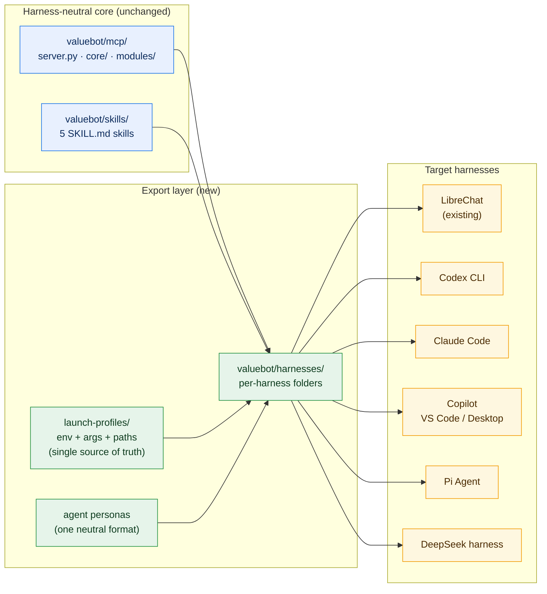

# valuebot multi-harness expansion — design

> **Status:** ✅ Current — docs-only adapters; task tracking in [implementation-plan.md](./implementation-plan.md)
> **Date:** 2026-10-27
> **Owner:** System Designer
> **Target repository:** `/Users/rkarumugam/LocalFiles/Projects/librechat-plugin`
> **Companion documents:** [valuebot-v2/design.md](../valuebot-v2/design.md) · [../../../architecture/db-mapping.md](../../db-mapping.md) · [../../../architecture/INDEX.md](../../INDEX.md)

> **Scope note:** this is a packaging/distribution change. The MCP server,
> skills and data stores are untouched; only per-harness launcher docs and
> markdown persona wrappers are new. See §6.1 for the storage record.

---

## 1. Problem statement

valuebot v2 today ships as a **LibreChat-only** Agent Plugin:

- `plugin.json` — LibreChat Agent Plugins 1.0.0 manifest (skills + `mcp.json`).
- `mcp.json` — declares one stdio MCP server `vw-mcp`, launched as
  `uv run --project ${PLUGIN_ROOT}/mcp server.py`, with env vars that LibreChat
  templates (`${PLUGIN_ROOT}`, `${PLUGIN_DATA}`).
- `skills/` — five SKILL.md-format skills (LibreChat packaging).
- `agent-builder-exports/` — six agents in LibreChat's `schemaVersion: "1.0.0"`
  JSON format.

**Goal:** run the *same* MCP server, skills and agents from additional
harnesses — **Codex CLI, Claude Code, Copilot (VS Code / Copilot Desktop),
Pi Agent, DeepSeek harness** — with zero changes to the MCP server itself
(`mcp/server.py`, `mcp/core/`, `mcp/modules/`), and with a single source of
truth for server launch config, skills and agent personas.

**Non-goals (for now):** changing the MCP server's tool surface, adding
harness-specific tools, remote/SSE transports, or rewriting the LibreChat
packaging.

> **⚠️ Superseded direction.** Research on 2026-10-27 (§11) found that
> **Agent Plugins 1.0 is a real cross-harness standard** and that `valuebot/`
> already conforms to its portable core. The "docs-only adapters" approach in
> §2–§5 is therefore the *fallback*, not the primary path. Read §11 before
> implementing anything from §5.

---

## 2. Design direction (working hypothesis)

Split the deliverable into **harness-neutral assets** plus **per-harness
adapters**, mirroring the existing v2 module philosophy (one owner, one
format, no cross-imports):



Key principles (to be validated against research findings):

1. **One MCP server, many launchers.** `mcp/server.py` is never edited.
   Each harness gets a launch declaration that points at the repo's portable
   launcher, `sh <PLUGIN_ROOT>/mcp/run.sh`, with the same env contract
   (`EDGAR_LOCAL_DATA_DIR`, `VW_THESIS_ROOT`, `VW_MAX_*`, `UV_*` caching
   vars — see `mcp.json` for the canonical set). `run.sh` uses
   `uv run --project` when `uv` is on `PATH` and otherwise builds a
   host-local venv at `$PLUGIN_DATA/venv`. LibreChat keeps calling `uv`
   directly because its image ships `uv`.
2. **Docs-only adapters — no new code, no new scripts.** The MCP server,
   `setup.sh` and the skill content ship unchanged. Each harness gets one
   markdown install guide containing (a) the copy-paste MCP launch snippet
   (JSON/TOML, ~15 lines) and (b) its persona files. No generator script:
   the launch env block is identical across harnesses except the two path
   roots, which the guide tells the user to substitute. Hand-edited
   duplication of five env blocks is replaced by five reviewed snippets.
3. **Skills travel as-is.** SKILL.md frontmatter (`name`, `description`) is
   already the common denominator across VS Code, Claude Code and Cline per
   the skill-writer reference. Skill *content is never edited*; each harness
   guide tells the user where to copy the five `skills/<name>/SKILL.md`
   folders (optionally with the harness's optional frontmatter additions).
4. **Agent personas become markdown wrappers.** The six
   `agent-builder-exports/*.json` stay as the canonical LibreChat reference.
   For every other harness the same instructions, tool list, skills and
   model settings are rewritten **as markdown** in that harness's native
   format (Claude `.claude/agents/*.md`, Copilot `.agent.md`/
   `.prompt.md`, Codex `AGENTS.md`/prompts). Content identical, wrapper
   changes — the persona delta really is markdown-only.
5. **No new data stores.** This is a packaging/distribution change. The MCP
   server's data roots (`${PLUGIN_DATA}/modules/...`, `${PLUGIN_DATA}/edgar`)
   stay exactly where they are; per-harness config only needs to resolve the
   same absolute paths. No changes to `../db` or any module schema. Recorded
   in §6.1 rather than a separate `db-mapping.md`, because no storage element
   changes.

---

## 3. Verified baseline facts (from repo inspection)

| Fact | Source |
|:---|:---|
| Server launch (LibreChat): `uv run --project ${PLUGIN_ROOT}/mcp server.py`, cwd `${PLUGIN_ROOT}/mcp`, stdio | `valuebot/mcp.json` |
| Server launch (desktop harnesses): `sh <PLUGIN_ROOT>/mcp/run.sh`, verified working 2026-10-27 | `valuebot/mcp/run.sh`, §10 |
| `uv` is absent on the verification machine; `run.sh` built a venv and served every tool in 26 s | `.agent_state/verification/server-deep.md` |
| Tool inventory is **19**, not 16: core 3 + fundamentals 6 + analysis 3 + reports 5 + thesis 2 | live `tools/list`, `.agent_state/verification/server-deep.md` |
| `ping` reports all four modules `ready` and `identity_configured: false` without an identity | live `tools/call ping`, same file |
| `symbol_resolve` takes the argument name `query`, not `symbol` | live `tools/call`, same file |
| Canonical env set: `EDGAR_LOCAL_DATA_DIR`, `EDGAR_RATE_LIMIT_PER_SEC`, `EDGAR_HTTP_TIMEOUT`, `VW_THESIS_ROOT`, `VW_MAX_HTML_MB`, `VW_MAX_FACTS_COMPANIES`, `VW_ENABLE_PRICE`, `VW_ARTIFACT_HTTP_*`, `UV_PROJECT_ENVIRONMENT`, `UV_CACHE_DIR`, `UV_PYTHON_INSTALL_DIR` | `valuebot/mcp.json` |
| `${PLUGIN_ROOT}` / `${PLUGIN_DATA}` are LibreChat template vars, not MCP standard | `valuebot/mcp.json` + LibreChat Agent Plugins schema |
| Config resolution is `env → default` with `${VAR}` / `${VAR:-default}` templates inside `core/config.py` | `valuebot/mcp/core/config.py` |
| 5 skills, SKILL.md format with `name`/`description` frontmatter | `valuebot/skills/*/SKILL.md` |
| 6 agents in LibreChat `schemaVersion: "1.0.0"` JSON (name, description, provider, model, instructions, tools, skills, subagents) | `valuebot/agent-builder-exports/*.json` |
| Tools are namespaced `<tool>_mcp_vw-mcp` in LibreChat; `citation_view`/`citation_resolve` are evidence channels needing MCP content-block support | `valuebot/README.md`, `skills/grounded-citation/SKILL.md` |
| Skill-writer reference already documents skill adaptation across VS Code, Claude Code, Cline — reusable for the adapter matrix | `.github/skills/skill-writer/SKILL.md` |

## 4. Harness adapter matrix (research locked 2026-10-27)

| Harness | MCP config file | Launch schema (verbatim keys) | Skills location | Agent persona format | Auto-approve MCP calls? | macOS |
|:---|:---|:---|:---|:---|:---|:---|
| **Codex CLI** | `~/.codex/config.toml` (user) or `.codex/config.toml` (trusted project) | TOML `[mcp_servers.vw-mcp]`: `command`, `args`, `env`, `env_vars`, `cwd`, `startup_timeout_sec`, `tool_timeout_sec`, `default_tools_approval_mode`. No `type`. No `env_file`. | `.agents/skills/<name>/SKILL.md` (cwd → repo root) and `~/.agents/skills/` — **not** `.codex/skills/` | `AGENTS.md` at repo root / `~/.codex/AGENTS.md`; prompts `~/.codex/prompts/<name>.md` with `description:`, `argument-hint:` (deprecated in favour of skills) | `default_tools_approval_mode` per server: `auto` \| `prompt` \| `writes` \| `approve` | ✅ |
| **Claude Code** | project `.mcp.json` (top-level `mcpServers`); user/local in `~/.claude.json` via `claude mcp add` | JSON `{"type":"stdio","command","args","env"}`. **Expands `${VAR}` and `${VAR:-default}`** in command/args/env. `~` not documented. | `.claude/skills/<name>/SKILL.md`, `~/.claude/skills/`, nested `.claude/skills/` | `.claude/agents/<name>.md`; required frontmatter `name`, `description`; optional `tools`, `disallowedTools`, `model`, `permissionMode`, `skills`, `mcpServers` | Server starts “⏸ Pending approval” until approved once; then allowlist `mcp__vw-mcp__<tool>` in `permissions.allow` | ✅ |
| **Copilot (VS Code)** | `.vscode/mcp.json` (`servers` key, VS Code format) or portable workspace `.mcp.json` / `~/.copilot/mcp-config.json` (`mcpServers` key) | JSON `{"type":"stdio","command","args","env","envFile"}`; portable supports braced `${VAR}` expansion but **not** `envFile` | `.github/skills/`, `.agents/skills/`, `~/.copilot/skills/` | `.github/agents/<name>.agent.md` frontmatter `name`, `description`, `tools`, `model`; prompts `.github/prompts/<name>.prompt.md` | Per-call approval prompts; `chat.tools.autoApprove` for auto | ✅ |
| **Copilot Desktop** | ❌ **UNVERIFIED — no documented product or config path.** Adapter omitted; guide points at Copilot CLI (`~/.copilot/mcp-config.json`, stdio supported) as best effort | — | — | — | — | — |
| **Pi (`pi.dev`)** | `~/.pi/agent/mcp.json` (user), `.pi/mcp.json` (trusted project) | JSON `{"mcpServers":{name:{type?,command,args,env,cwd}}}`; `command` is one executable, never a shell string. **`~/` expands in command/args/cwd; `${VAR}` expands in env/headers; `!cmd` captures output** | `.agents/skills/`, `~/.agents/skills/` (Agent Skills spec), invoke `/skill:<name>` | **No sub-agents** — personas do not map; skills + MCP instructions only | n/a | ✅ |
| **Hermes Agent (Nous Research)** | `~/.hermes/config.yaml` → `mcp_servers`; or install as an Agent Plugins package | Agent Plugins: `hermes plugins install owner/repo` then `hermes plugins enable <name>` (arrives disabled). `${VAR}` forwarded from shell/`.env`, `${userHome}`, `${workspaceFolder}`. Legacy SSE skipped | `~/.hermes/skills/` (agentskills.io), namespaced `<plugin>:<skill>` | Agent Plugins `agents/` via client extension (UNVERIFIED detail) | n/a | ✅ |
| **Open WebUI** | ⚠️ **Not stdio-native.** Native MCP is Streamable HTTP only since v0.6.31 → needs the `mcpo` bridge for our stdio server | Bridge: `uvx mcpo --config <claude-format-mcp.json> --port 8000`; Open WebUI → Admin → Integrations → External Tool Servers → Type `MCP (Streamable HTTP)`. Requires `WEBUI_SECRET_KEY`; `ENABLE_TOOL_SERVERS` must not be false | Workspace → Skills (markdown + `SKILL.md`) | Workspace → Models (system prompt + tools + skills preset) | n/a | ✅ |
| **DeepSeek Harness (`dsh`)** | `$DSH_HOME/profiles/<profile>/cordis.yml` | YAML plugin entry `@deepseek-ai/dsh-mcp-client`: `serverName` (`[A-Za-z0-9_-]{1,32}`), `transport: stdio`, `command`, `args`, `env`, `cwd`, `toolCallTimeoutMs`, `failOnStartupError`, `reconnect.*`. No `~`/`${VAR}` — use `!!js` expressions | **Unverified** | **Unverified** | Tool permission rules (detail unverified) | ✅ CLI; desktop UNVERIFIED |

**Cross-harness path rule:** only Claude Code (and Copilot portable) expand
`${VAR}`; no harness documents `~` expansion in MCP configs. Every snippet
must therefore hardcode absolute paths for `--project` and the env roots,
with a visible substitution step in the guide.

**Approval and the evidence channel.** `citation_view` returns HTML content
blocks and `citation_resolve` returns paged text. Harnesses that prompt on
every call (Codex `default_tools_approval_mode = "prompt"`, Copilot
`chat.tools.autoApprove`, Claude `permissions.allow`) interrupt that flow,
so each guide documents the allow-list or auto-approve setting rather than
leaving the user to discover it.

---

## 5. Folder layout (docs-only)

```
valuebot/
├── plugin.json · mcp.json · setup.sh        (LibreChat, unchanged)
├── skills/                                  (unchanged, harness-neutral)
├── agent-builder-exports/                   (LibreChat personas, canonical)
├── harnesses/                               ← new: docs-only adapters
│   ├── README.md                            support matrix + launch contract
│   ├── claude-code/
│   │   ├── INSTALL.md                       guide + .mcp.json snippet
│   │   └── personas/vw-*.md                 6 × .claude/agents/ format
│   ├── codex/
│   │   ├── INSTALL.md                       guide + config.toml snippet
│   │   └── personas/vw-*.md                 6 × AGENTS.md/prompt format
│   ├── copilot/
│   │   ├── INSTALL.md                       guide + .vscode/mcp.json snippet
│   │   └── personas/vw-*.agent.md           6 × .agent.md format
│   ├── deepseek/        INSTALL.md          cordis.yml snippet
│   └── pi-agent/        INSTALL.md          non-support notice
└── docs/users/09-multi-harness.md           user-facing guide
```

No `export.py`, no `launch-profiles.yaml`, no `personas.yaml`. Everything
new is markdown; the only non-markdown artifacts are the ~15-line JSON/TOML/
YAML launch snippets embedded inside the INSTALL guides.

---

## 6. Data & interface matrix

No new data elements are introduced. This is a distribution change only.

| Artifact | Owner | Format | Path resolution |
|:---|:---|:---|:---|
| MCP launch declaration | each harness config | JSON / TOML / YAML snippet inside `INSTALL.md` | absolute paths substituted by the user; Claude Code and Copilot portable may use `${VAR}` |
| Skill folders | `valuebot/skills/` (unchanged) | `SKILL.md` + `name`/`description` frontmatter | copied to the harness skill dir; content never edited |
| Agent personas | `valuebot/agent-builder-exports/` (canonical) | LibreChat JSON | rewritten as native markdown per harness; instructions/tools identical |
| Env contract | `valuebot/mcp.json` (canonical) | 13 keys | repeated verbatim in each snippet |

### 6.1 Storage impact

| Question | Answer |
|:---|:---|
| New SQLite files? | **None.** |
| New artifact directories? | **None.** |
| New writable roots? | **None.** `<PLUGIN_DATA>` is the existing writable root and is only referenced, not created, by these adapters. |
| Does this touch `../db` or the Phase 3 double-disk layout? | **No.** Those designs are unaffected and out of scope here. |
| Does any data root become harness-specific? | **No.** All harnesses point at the same `<PLUGIN_DATA>`, so switching harness reuses the existing cache, artifacts and fact mirror. |

Because no storage element changes, this design needs no companion
`db-mapping.md`; §6.1 above is the storage record.

---

## 7. Implementation order

See [implementation-plan.md](./implementation-plan.md) — 10 tasks,
`T1 → T2 → {T3..T7} → {T8, T9} → T10`.

---

## 8. Decisions and remaining questions

**Decided:**

1. **Docs-only.** No generator, no launch-profiles file, no server change.
2. **Persona wrappers.** Six personas rewritten as native markdown per
   harness, content identical; LibreChat JSON stays canonical.
3. **Unverified targets are documented as unsupported**, never invented —
   Pi Agent is a non-support notice, Copilot Desktop points at Copilot CLI.

**Open:**

1. **Priority order** of harnesses for the verification pass. Suggested:
   Claude Code and Copilot VS Code first (both locally available), Codex
   CLI next, `dsh` best-effort last.
2. **Multi-harness coexistence.** Should one machine point several harnesses
   at the same `<PLUGIN_DATA>` simultaneously? Assumed yes (read-mostly
   caches, per-module SQLite), but not load-tested.

---

## 9. Risks

| Risk | Impact | Mitigation |
|:---|:---|:---|
| Five hand-maintained snippets drift from `mcp.json` | Wrong env in one harness | `harnesses/README.md` holds the canonical block; each INSTALL repeats it verbatim and the verification pass diffs the key set |
| Absolute paths break on a different machine | Server will not start | Every guide makes the substitution step explicit and gives the symptom (`ENOENT`, `spawn uv ENOENT`) in troubleshooting |
| `dsh` and its plugin API are a developer preview | Config may change | Guide is marked preview; keys quoted verbatim with a link to the upstream README |
| Approval prompts make `citation_view` tedious | Degraded UX | Each guide documents the allow-list / auto-approve setting |
| Persona drift between JSON and markdown | Analysts behave differently per harness | Persona files are generated from the JSON at authoring time; verification compares tool lists |
| Pi Agent gains MCP support later | Stale non-support notice | Notice carries the research date and the revisit condition |

---

## 10. Verification results

Static checks and a live server probe executed 2026-10-27. Per-harness runtime
wiring is still outstanding.

| Check | Result | Evidence |
|:---|:---|:---|
| `harnesses/README.md` carries the canonical env block | ✅ PASS | 13 keys, matching `valuebot/mcp.json` |
| All five harness folders have `INSTALL.md` | ✅ PASS | `claude-code`, `codex`, `copilot`, `deepseek`, `pi-agent` |
| Env key set present in each snippet | ✅ PASS | `EDGAR_LOCAL_DATA_DIR` … `UV_PYTHON_INSTALL_DIR` in every guide |
| Persona count per adapter = 6 | ✅ PASS | 6 × `.md` (claude-code, codex), 6 × `.agent.md` (copilot) |
| Pi Agent guide invents no schema | ✅ PASS | 19 lines, non-support notice only |
| **Server starts and answers `initialize`** | ✅ PASS | protocol `2024-11-05`, server `valuebot` 0.2.0, exit 0 |
| **`tools/list` returns 19 tools** | ✅ PASS | core 3 + fundamentals 6 + analysis 3 + reports 5 + thesis 2 |
| **`ping` answers, all four modules `ready`** | ✅ PASS | `{"ok": true, ... "modules": {all ready}, "identity_configured": false}` |
| **`symbol_resolve` returns a clean error envelope** | ✅ PASS | `identity_not_configured`, retryable false, with a setup hint |
| **`run.sh` launches without `uv`** | ✅ PASS | built `$PLUGIN_DATA/venv`, served 19 tools, 26.02 s |
| **`uv` is installed on the verify machine** | ❌ FAIL | absent from `command -v`, homebrew, `/usr/local/bin`, `~/.local/bin`, `~/.cargo/bin` |
| **`run.sh` fallback on a clean network** | ❌ FAIL | `Could not find a version that satisfies the requirement mcp>=2.2.0` |
| `.mcp.json` / TOML / YAML blocks parse with 13 env keys | ✅ PASS | claude-code 1 server block + 1 `permissions.allow` list; copilot 2 server blocks; codex TOML 13 keys, no `type`; deepseek YAML `serverName: vw` |
| All 18 persona files have valid YAML frontmatter | ✅ PASS | 6 each for claude-code, codex, copilot; all carry `name` + `description` |
| No guide advertises `uv` as the launch method | ✅ PASS | only explanatory prose remains (`README.md:53`, `09-multi-harness.md:35`) |
| Identity configured (`~/.valuebot/identity.json`) | ⏳ UNVERIFIED | absent by design — user must run `./setup.sh` |
| Per-harness runtime install (Claude Code, Copilot, Codex, `dsh`) | ⏳ UNVERIFIED | no harness has valuebot wired yet |

**Findings corrected during verification.** Two defects in the first draft were
caught by the live probe and fixed:

1. The tool inventory was documented as 16; the server exposes **19**
   (`facts_export`, `citation_resolve` and `citation_view` were missing from
   the list). Fixed in `harnesses/README.md`, all four guides and the user
   guide.
2. Every guide launched `uv run --project …`, which cannot work on a machine
   without `uv`. All guides now launch `sh <PLUGIN_ROOT>/mcp/run.sh`, the
   repo's own portable launcher.

**False alarm, recorded so it is not re-investigated.** `import edgartools`
fails in `valuebot/.venv`, but that is expected: the package installs as
`edgar` and the code imports `import edgar` (see
`modules/fundamentals/sources/edgar_source.py`). The venv is healthy and all
four modules report `ready`.

**Known caveat:** VS Code's rendering of MCP tool identifiers in `.agent.md`
`tools:` lists varies by release; the Copilot guide tells users to confirm the
prefix in the Tools picker. The persona tool *sets* are authoritative.

---

## 11. Upstream plugin conventions (research 2026-10-27)

### 11.1 The headline: a standard exists and valuebot already conforms

**Agent Plugins 1.0** (`https://agent-plugins.org/specification`) is a
published cross-vendor spec. Its steering committee includes maintainers from
**Amazon, Cursor, Microsoft, OpenAI and Vercel**. Documented consumers include
**VS Code, GitHub Copilot, ChatGPT & Codex, Cursor, Kiro, Hermes, OpenClaw and
Grok Bot**.

Its **portable core is deliberately narrow**: root `plugin.json` +
`skills/<name>/SKILL.md` + root `mcp.json`. Agents, hooks and commands are
**client-namespaced extensions** (`com.github.copilot/…`, `extensions.com.openai`),
not portable.

`valuebot/` already matches that core exactly:

| Portable requirement | valuebot | Verdict |
|:---|:---|:---|
| Root `plugin.json` with `$schema` + `name` | present, `agent-plugins.org/schemas/1.0.0` | ✅ |
| `skills/<name>/SKILL.md` | five skills | ✅ |
| Root `mcp.json` with `mcpServers` | one server `vw-mcp`, stdio | ✅ |
| `${PLUGIN_ROOT}` / `${PLUGIN_DATA}` in `args` / `env` / `cwd` | both used in `args` | ✅ |
| `command` is a single bare token | `"uv"` | ✅ |
| Schema not fetched at load | schema URL is declarative only | ✅ |

**Consequence:** for Codex, Copilot VS Code, ChatGPT, Cursor and the rest of
the consumer list, valuebot needs **no adapter at all** — the plugin directory
*is* the distribution unit. The `harnesses/codex/` and `harnesses/copilot/`
guides written in §5 are therefore documentation of a **manual** wiring path
that the standard makes unnecessary for the happy path. They remain useful
only for: pinning a custom data root, working around a client that predates
Agent Plugins support, or debugging by hand.

### 11.2 Claude Code is the exception — it has its own, richer format

Claude Code does **not** consume Agent Plugins 1.0. Its own plugin format:

| Element | Detail |
|:---|:---|
| Manifest | `.claude-plugin/plugin.json`; `name` is the only required key |
| Bundles | `skills/`, `agents/`, `commands/`, `hooks/hooks.json`, and `.mcp.json` **at plugin root** |
| Tool namespace when installed as a plugin | `mcp__plugin_<plugin>_<server>__<tool>` — note the extra `plugin_` segment |
| Scaffold | `claude plugin init my-tool` (`--with skills`) |
| Validate | `claude plugin validate ./dir` (`--strict` for CI) |
| Local dev | `claude --plugin-dir ./dir` (also `--plugin-url`, `CLAUDE_CODE_PLUGIN_DIRS`) |
| Reload in session | `/reload-plugins` |
| MCP logs | `claude --debug=mcp`, stderr in `~/.claude/debug/<session-id>.txt` |
| Publish | `.claude-plugin/marketplace.json`, then `claude plugin marketplace add ./dir` |

Claude Code is closer to "the original Agent Plugin" than the standard is: it
ships skills **and** agents **and** MCP in one package. Our six personas map
directly onto its `agents/` directory, so a real Claude Code plugin is a small
manifest plus reusing `skills/` and the personas already written.

**Cross-read:** VS Code can also read Claude-format plugins
(`${CLAUDE_PLUGIN_ROOT}`), so a Claude-format package is *not* a dead end there.

### 11.3 Per-harness plugin development loops

| Harness | Manifest / format | Load locally | Iterate | Validate | MCP logs |
|:---|:---|:---|:---|:---|:---|
| **Agent Plugins 1.0** | root `plugin.json` + `skills/` + `mcp.json` | client-defined — spec has no install mechanism | client-defined | schema-validate `plugin.json`; never fetch schema at load | client-defined |
| **Claude Code** | `.claude-plugin/plugin.json` + `skills/ agents/ hooks/ .mcp.json` | `claude --plugin-dir <dir>` | `/reload-plugins` | `claude plugin validate [--strict]`; `claude plugin eval` | `claude --debug=mcp` → `~/.claude/debug/*.txt` |
| **Codex CLI** | portable `plugin.json`+`mcp.json`, or legacy `.codex-plugin/plugin.json` | `/plugins`; `@plugin-creator` scaffold; local marketplace | restart after `config.toml` change; **skills auto-detect** | none documented | `RUST_LOG=debug codex -c log_dir=./.codex-log`, `tail -F ./.codex-log/codex-tui.log` |
| **VS Code / Copilot** | Agent Plugins 1.0, Copilot legacy, and Claude format | `chat.pluginLocations` folder→bool (Experimental); `Chat: Install Plugin From Source` | restart/reload not documented → UNVERIFIED | Chat view → **Diagnostics** | Agent Customizations → MCP Servers → **Show Output** |
| **DeepSeek `dsh`** | Cordis plugin (module exporting `apply(ctx)`), entry in `cordis.yml` | `dsh --profile <name>` | `@deepseek-ai/dsh-hmr` unloads/reloads on save; `cordis.yml` diffed **by `id`** | none documented | UNVERIFIED |

**Two operational rules worth encoding in the docs:**

1. **Codex auto-detects skill changes but needs a restart for `config.toml`
   changes.** That asymmetry is the single most likely source of "I edited it
   and nothing happened" reports.
2. **`dsh` diffs `cordis.yml` by `id`.** Our guide already uses `id: mcp-vw`,
   which is required for hot reload to work — a stable id must be preserved.

### 11.4 Revised recommendation

| Harness | Ship | Why |
|:---|:---|:---|
| LibreChat | existing `plugin.json` + `mcp.json` | unchanged |
| Codex, Copilot VS Code, ChatGPT, Cursor | **nothing new** — point at `valuebot/` | Agent Plugins 1.0 already covers it |
| Claude Code | add `.claude-plugin/plugin.json` + `agents/` + root `.mcp.json` | only way to get first-class install, `/reload-plugins`, `plugin validate` |
| DeepSeek `dsh` | keep the `cordis.yml` snippet | needs an npm module or path + stable `id` |
| Pi (`pi.dev`) | **docs only** — `pi-agent/INSTALL.md` | native stdio MCP + Agent Skills; no sub-agents, so personas do not map |
| Hermes Agent | **nothing new** — consumes `valuebot/` as-is | listed Agent Plugins 1.0 consumer |
| Open WebUI | needs an **artifact**: `mcpo` bridge config | our server is stdio-only and Open WebUI's native MCP is Streamable HTTP only |

This downgrades `harnesses/codex/` and `harnesses/copilot/` from "the way to
install" to "manual fallback", and upgrades Claude Code from "copy files and
hope" to a validated plugin package.
