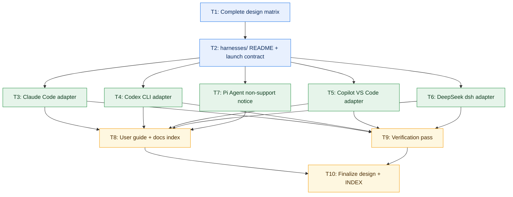

# valuebot multi-harness expansion — Implementation Plan

> **Status:** ✅ Delivered (T1–T8, T10) · ⏳ T9 runtime verification pending the user's machine
> **Date:** 2026-10-27
> **Owner:** Development Manager
> **Companion documents:** [design.md](./design.md) · [../valuebot-v2/design.md](../valuebot-v2/design.md) · [../../INDEX.md](../../INDEX.md)

---

## Delivery status

| Task | Status | Evidence |
|:---|:---|:---|
| T1 Complete design matrix | ✅ Done | `design.md` §4 matrix, §6 data table, no `[PENDING]` left |
| T2 `harnesses/` README + launch contract | ✅ Done | `valuebot/harnesses/README.md` |
| T3 Claude Code adapter | ✅ Done | `harnesses/claude-code/INSTALL.md` + 6 personas |
| T4 Codex CLI adapter | ✅ Done | `harnesses/codex/INSTALL.md`, `AGENTS.md` + 6 personas |
| T5 Copilot VS Code adapter | ✅ Done | `harnesses/copilot/INSTALL.md` + 6 `.agent.md` |
| T6 DeepSeek `dsh` adapter | ✅ Done | `harnesses/deepseek/INSTALL.md` |
| T7 Pi Agent non-support notice | ✅ Done | `harnesses/pi-agent/INSTALL.md` (19 lines) |
| T8 User guide + docs index | ✅ Done | `docs/users/09-multi-harness.md`, `docs/00-index.md` |
| T9 Verification pass | ⏳ Partial | Static checks PASS (§5); runtime install needs the user's macOS harnesses |
| T10 Finalize design + INDEX | ✅ Done | `design.md` ✅ Current, `architecture/INDEX.md` updated |
| V6 Hermes + Open WebUI guides | ✅ Done | `harnesses/hermes/INSTALL.md`, `harnesses/openwebui/INSTALL.md` |
| V7 OpenCode guide + 6 personas | ✅ Done | `harnesses/opencode/INSTALL.md`, `harnesses/opencode/personas/` |
| V8 Gemini CLI guide | ✅ Done | `harnesses/gemini-cli/INSTALL.md` |
| V9 Persona tool fix (citation tools added) | ✅ Done | `harnesses/claude-code/personas/*.md` frontmatter now lists `citation_resolve` + `citation_view`; `.agent_state/V9-persona-tools.report.json` |
| V10 Contract suite | ✅ Done | `valuebot/tests/contract/test_mcp_conformance.py`, `test_persona_consistency.py`, `test_package_schema.py`; `.agent_state/V10-contract-suite.report.json` |
| V11 Final verify | ⏳ Partial | `.agent_state/verification/final-verify.md` — 9/9 guides carry the launch contract; pytest summary lines pending a session with terminal access (see D1) |

**Scope note (post-plan additions):** the original plan covered six targets (Codex CLI, Claude
Code, Copilot VS Code, DeepSeek `dsh`, Pi Agent, Copilot Desktop). After delivery, **Hermes, Open
WebUI, OpenCode, Gemini CLI and Pi Agent** were added as first-class harness guides (V6–V8), the
Pi Agent guide moving from a non-support notice to a supported launch contract. Total: **9
`INSTALL.md` guides**, each carrying the `run.sh` launch reference and the
`EDGAR_LOCAL_DATA_DIR` env key.

---

## 0. Scope summary

**What this is:** docs-only adapters that let the existing valuebot stdio MCP
server (`uv run --project <abs>/mcp server.py`) run from Codex CLI, Claude
Code, GitHub Copilot (VS Code), DeepSeek Harness (`dsh`), and Pi Agent
(documented as unsupported). Every deliverable is markdown: one INSTALL guide
per harness with an embedded launch snippet, plus the six agent personas
rewritten as that harness's native markdown files.

**What it is not:** any change to `mcp/server.py`, `mcp/core/`, `mcp/modules/`,
`setup.sh`, skill content, the LibreChat packaging, or the tool surface.

**Storage:** this plan adds **no data stores and touches no storage paths**.
The only paths referenced are the existing plugin root and the existing
writable data root (`<PLUGIN_DATA>`). No `../db`, no new SQLite files, no
artifact directories — therefore no Phase 3 storage work applies and
`architecture/design-docs/phase3-double-disk-architecture.md` is not in play.

---

## 1. Locked research inputs (verified 2026-10-27)

Per-harness facts the implementation must use verbatim. Sources: official docs
(URLs embedded below). Where research could not verify a product, the plan
documents it as unsupported — never invented.

| Harness | MCP config file | Snippet schema | Skills location | Persona format | Approval |
|:---|:---|:---|:---|:---|:---|
| **Codex CLI** | `~/.codex/config.toml` (user) or `.codex/config.toml` (project) | TOML `[mcp_servers.vw-mcp]` with `command`, `args`, `env`, `env_vars`, `cwd`, `startup_timeout_sec`, `tool_timeout_sec`, `default_tools_approval_mode` | `.agents/skills/<name>/SKILL.md` (cwd→repo root) and `~/.agents/skills/` | `AGENTS.md` (repo) / `~/.codex/AGENTS.md`; prompts `~/.codex/prompts/<name>.md` (deprecated → prefer skills) | per-server `default_tools_approval_mode` |
| **Claude Code** | project `.mcp.json` (top-level `mcpServers`); user scope via `claude mcp add` | JSON `{"type":"stdio","command","args","env"}`; **supports `${VAR}` and `${VAR:-default}` expansion** in command/args/env | `.claude/skills/<name>/SKILL.md`, `~/.claude/skills/` | `.claude/agents/<name>.md` frontmatter: required `name`,`description`; optional `tools`,`disallowedTools`,`model`,`permissionMode`,`skills`,`mcpServers` | server approved once; tool allowlist `mcp__vw-mcp__<tool>` |
| **Copilot (VS Code)** | `.vscode/mcp.json` (VS Code format, `servers` key) or portable workspace `.mcp.json` / `~/.copilot/mcp-config.json` (`mcpServers` key) | JSON `{"type":"stdio","command","args","env","envFile"}`; portable supports `${VAR}` braced expansion | `.github/skills/`, `.agents/skills/`, `~/.copilot/skills/` | `.github/agents/<name>.agent.md` frontmatter: `name`,`description`,`tools`,`model` | `chat.tools.autoApprove` |
| **Copilot Desktop** | **Unverified — no documented product/URL.** Do not create a Desktop adapter. Point users at Copilot CLI (`~/.copilot/mcp-config.json`, stdio supported) as best effort. | — | — | — | — |
| **Pi Agent** | **Unsupported — no MCP client, config path, or docs found.** Adapter is a non-support notice only. | — | — | — | — |
| **DeepSeek Harness (`dsh`)** | `$DSH_HOME/profiles/<profile>/cordis.yml` | YAML plugin entry `@deepseek-ai/dsh-mcp-client` with `serverName`, `transport: stdio`, `command`, `args`, `env` (use `!!js` expressions; no `~`/`${VAR}`) | **Unverified** — state this in the doc | **Unverified** — state this in the doc | tool permission rules (unverified detail) |

**Cross-harness rule:** no harness except Claude Code (and Copilot portable)
expands `~` or `${VAR}` in MCP configs. Every snippet therefore hardcodes
**absolute paths** for `--project` and env roots, with a visible
`<PLUGIN_ROOT>` / `<PLUGIN_DATA>` substitution step in the guide.

---

## 2. Canonical launch contract

Single source of truth every snippet is derived from (`valuebot/mcp.json`):

- Command: `uv`
- Args: `run --project <PLUGIN_ROOT>/mcp server.py`
- Env (verbatim set; `<PLUGIN_DATA>` = writable data root, e.g. `/vw-data`):

```
EDGAR_LOCAL_DATA_DIR=<PLUGIN_DATA>/edgar
EDGAR_RATE_LIMIT_PER_SEC=5
EDGAR_HTTP_TIMEOUT=30
VW_THESIS_ROOT=/vw-data/theses
VW_MAX_HTML_MB=40
VW_MAX_FACTS_COMPANIES=100
VW_ENABLE_PRICE=0
VW_ARTIFACT_HTTP_PORT=0
VW_ARTIFACT_HTTP_HOST=127.0.0.1
VW_ARTIFACT_PUBLIC_BASE_URL=""
UV_PROJECT_ENVIRONMENT=<PLUGIN_DATA>/uv-env
UV_CACHE_DIR=<PLUGIN_DATA>/uv-cache
UV_PYTHON_INSTALL_DIR=<PLUGIN_DATA>/uv-python
```

---

## 3. Tasks

### T1 — Complete the design doc matrix with locked research

- **Description:** Edit `architecture/design-docs/multi-harness/design.md`:
  fill §4 adapter matrix and §6 data table from §1 above; fix the skills-path
  note for Codex (`.agents/skills/`, not `.codex/skills/`); mark Copilot
  Desktop and Pi Agent explicitly unverified/unsupported and DeepSeek as
  `dsh` (deepseek-ai/deepseek-harness); remove the "Re-run it first" note in
  §4 since research is now locked. Keep the docs-only adapter direction from
  the 2026-10-27 revision.
- **Dependencies:** none.
- **Expected Output:** design.md with §4/§6 filled, no `[PENDING]` sections,
  status bumped to "✅ Research complete — docs-only adapters" (implementation
  status stays pending until T10).
- **Verification:** `grep -n "PENDING\|? " architecture/design-docs/multi-harness/design.md` returns no rows for §4/§6.
- **Acceptance:** design.md matrix matches §1 of this plan row-for-row.

### T2 — `harnesses/` scaffold, README and launch contract

- **Description:** Create `valuebot/harnesses/` with one folder per harness
  (`codex/`, `claude-code/`, `copilot/`, `deepseek/`, `pi-agent/`) and a
  `README.md` that contains: the support matrix (5 rows, with Desktop/Pi
  marked unsupported), the §2 canonical launch contract, the absolute-path
  substitution instructions (`<PLUGIN_ROOT>` = `valuebot/` checkout path,
  `<PLUGIN_DATA>` = writable data root), and the per-harness expansion rules
  (Claude Code `${VAR}` OK; dsh `!!js`; everyone else absolute only).
- **Dependencies:** T1.
- **Expected Output:** `valuebot/harnesses/README.md` + 5 empty per-harness
  folders with placeholder `INSTALL.md` stubs (content lands in T3–T7).
- **Verification:** `ls valuebot/harnesses/` shows the 5 folders + README; README env block matches `valuebot/mcp.json` env keys exactly.
- **Acceptance:** a user can answer "where do I put the server launch config" for any harness from the README alone.

### T3 — Claude Code adapter

- **Description:** Write `harnesses/claude-code/INSTALL.md` with the verbatim
  project `.mcp.json` snippet:

  ```json
  {"mcpServers":{"vw-mcp":{"type":"stdio","command":"uv",
    "args":["run","--project","<PLUGIN_ROOT>/mcp","server.py"],
    "env":{ ... §2 env block ... }}}}
  ```

  plus: skills copy step (`cp -R skills/<name> .claude/skills/`, five times),
  approval steps (approve server once; allowlist `mcp__vw-mcp__<tool>` in
  `permissions.allow`), and the six personas as
  `harnesses/claude-code/personas/vw-*.md` in `.claude/agents/` format —
  frontmatter `name`, `description`, `tools`, `model`, `skills`; body =
  identical instructions from `valuebot/agent-builder-exports/*.json`.
- **Dependencies:** T2.
- **Expected Output:** `INSTALL.md` + 6 persona files, instructions/tools
  matching the JSON exports (orchestrator, fundamentals-analyst,
  analysis-analyst, reports-analyst, thesis-analyst, citation-auditor).
- **Verification:** `grep -c "mcpServers" harnesses/claude-code/INSTALL.md` ≥ 1; each persona file has `name:` + `description:` frontmatter; tool lists match the JSON `tools` arrays.
- **Acceptance:** an evaluator can install Claude Code support by copy-pasting from the guide; all 16 tools appear as `mcp__vw-mcp__*`; one persona loads as a subagent.

### T4 — Codex CLI adapter

- **Description:** Write `harnesses/codex/INSTALL.md` with the verbatim
  `~/.codex/config.toml` snippet:

  ```toml
  [mcp_servers.vw-mcp]
  command = "uv"
  args = ["run", "--project", "<PLUGIN_ROOT>/mcp", "server.py"]
  env = { ... §2 env block ... }
  env_vars = []                    # add secrets here to forward from Codex env
  startup_timeout_sec = 20
  tool_timeout_sec = 120
  default_tools_approval_mode = "prompt"   # or "auto" once trusted
  ```

  plus skills copy to `~/.agents/skills/` (or project `.agents/skills/`),
  and personas: project `AGENTS.md` describing the six VW specialists +
  `harnesses/codex/personas/*.md` prompt files (note the deprecation note:
  skills preferred). Document `default_tools_approval_mode` trade-off for
  the `citation_view` evidence flow.
- **Dependencies:** T2.
- **Expected Output:** `INSTALL.md` + persona markdown files.
- **Verification:** `grep -n "mcp_servers.vw-mcp" harnesses/codex/INSTALL.md`; TOML snippet parses (`uv run --python 3.12 -c "import tomllib; tomllib.loads(open(...).read())"` on the extracted block); env keys match §2.
- **Acceptance:** copy-paste install works on macOS Codex CLI; `vw-mcp` appears in `codex mcp list`; skills discovered from `.agents/skills/`.

### T5 — Copilot (VS Code) adapter

- **Description:** Write `harnesses/copilot/INSTALL.md` with **both** configs:
  (a) `.vscode/mcp.json` VS Code format using `servers` key (include
  `envFile` note), and (b) portable workspace `.mcp.json` / `~/.copilot/mcp-config.json`
  using `mcpServers` with `${VAR}` braced expansion where useful. Absolute
  paths still the default. Skills → `.github/skills/`. Personas → six
  `harnesses/copilot/personas/vw-*.agent.md` with frontmatter `name`,
  `description`, `tools`, `model`. Add a **Copilot Desktop** subsection:
  unverified product → point to Copilot CLI `~/.copilot/mcp-config.json`
  (stdio supported) as best effort, clearly labeled.
- **Dependencies:** T2.
- **Expected Output:** `INSTALL.md` + 6 `.agent.md` personas + Desktop note.
- **Verification:** `grep -n '"servers"' harnesses/copilot/INSTALL.md` and `grep -n 'mcpServers' harnesses/copilot/INSTALL.md` both ≥ 1; every `.agent.md` has valid YAML frontmatter.
- **Acceptance:** VS Code picks up the MCP server (Tools list shows `vw-mcp_*`); one agent mode appears in the mode picker.

### T6 — DeepSeek Harness (`dsh`) adapter

- **Description:** Write `harnesses/deepseek/INSTALL.md` for
  `deepseek-ai/deepseek-harness`: profile at
  `$DSH_HOME/profiles/<profile>/cordis.yml` with the verbatim plugin entry:

  ```yaml
  - id: mcp-vw
    name: '@deepseek-ai/dsh-mcp-client'
    config:
      serverName: vw
      transport: stdio
      command: uv
      args: ['run', '--project', '<PLUGIN_ROOT>/mcp', 'server.py']
      env:
        VW_DB_ROOT: !!js process.env.VW_DB_ROOT   # example — mirror §2 keys
  ```

  Document: tools surface as `mcp__vw__<tool>`; ambient env scrubbing rules;
  skills/persona support **UNVERIFIED** (say so, and point at dsh plugin docs
  for updates). Note model guidance from skill-writer (DeepSeek: literal
  instructions, avoid metaphors) as a persona-writing note.
- **Dependencies:** T2.
- **Expected Output:** `INSTALL.md` with YAML snippet + unverified-marked sections.
- **Verification:** YAML block parses (`uv run --python 3.12 -c "import yaml,sys; yaml.safe_load(open(...).read())"` on extracted block); `serverName` matches `^[A-Za-z0-9_-]{1,32}$`.
- **Acceptance:** a dsh user can add the plugin and see `mcp__vw__*` tools; doc honestly marks what was not verified.

### T7 — Pi Agent non-support notice

- **Description:** Write `harnesses/pi-agent/INSTALL.md` stating plainly:
  no documented MCP client, config path, skills dir, or persona format exists
  for Inflection Pi Agent (research date 2026-10-27); do **not** invent a
  config format. If Pi gains MCP support, revisit. Keep the file short
  (< 40 lines).
- **Dependencies:** T2.
- **Expected Output:** short non-support notice.
- **Verification:** file exists; contains no fabricated config schema.
- **Acceptance:** a user cannot mistake Pi for a supported harness.

### T8 — User guide and docs index

- **Description:** Write `valuebot/docs/users/09-multi-harness.md`: overview
  ("same MCP server, different launcher"), supported-harness table, quick
  install per harness (Claude Code, Codex, Copilot VS Code), deep-dive
  pointers to each `harnesses/<name>/INSTALL.md`, path substitution
  explanation, troubleshooting (server not starting, tools not visible,
  approval fatigue). Add a row to `valuebot/docs/00-index.md` linking it.
- **Dependencies:** T3, T4, T5, T6, T7.
- **Expected Output:** `09-multi-harness.md` + updated `00-index.md`.
- **Verification:** `grep -n "09-multi-harness" valuebot/docs/00-index.md`; every `harnesses/<name>/INSTALL.md` is linked from the guide.
- **Acceptance:** a new user can follow the guide end-to-end for Claude Code without reading the design docs.

### T9 — Verification pass

- **Description:** On macOS, for each supported harness actually available
  (minimum: Claude Code and VS Code Copilot; Codex CLI and `dsh` if
  installed): apply the INSTALL.md steps, start the server, confirm `ping`
  returns, confirm all 16 tools are listed, confirm one skill loads and one
  persona file is recognized. Record PASS/FAIL per harness in
  `harnesses/README.md` (a "Verified on" table). Pi Agent: no verification
  (unsupported). Do **not** modify server code to fix failures — report them
  and adjust only the guide.
- **Dependencies:** T3, T4, T5, T6.
- **Expected Output:** verification table in `harnesses/README.md` + issues list.
- **Verification:** `grep -c "PASS\|FAIL" harnesses/README.md` ≥ 2 rows; ping evidence logged per harness.
- **Acceptance:** every supported harness row has a dated PASS/FAIL entry with evidence.

### T10 — Finalize design doc and architecture index

- **Description:** Update `architecture/design-docs/multi-harness/design.md`
  status to ✅ Current; update `architecture/INDEX.md`: add the two new
  documents (multi-harness design, implementation plan) to the documents
  table and add a "Multi-harness expansion" row to the architectural state
  table.
- **Dependencies:** T1, T9.
- **Expected Output:** consistent statuses across design, INDEX, and plan.
- **Verification:** `grep -n "multi-harness" architecture/INDEX.md` shows both doc links.
- **Acceptance:** INDEX.md reflects the shipped adapter set with no stale claims.

---

## 4. Task flow graph



**Execution order:** T1 → T2 → {T3..T7 in parallel} → {T8, T9} → T10.
T3–T7 are independent of each other and are the parallelizable fan-out.
