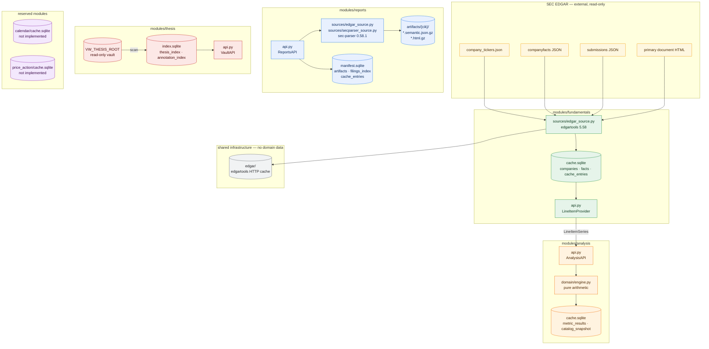

# valuebot v2 — Module-Owned Data Mapping

> **Status:** Proposed — follows [design.md](./design.md)
> **Date:** 2026-10-18
> **Scope:** Planned storage for the data-owned modules `fundamentals`, `analysis`, `reports`, `thesis` and the reserved `calendar` and `price_action` modules.
> **Ownership rule:** one module owns one SQLite file and one file directory. No module reads another module's storage. Cross-module data moves only through `core/contracts.py`.
> **Note:** this file moves into [architecture/db-mapping.md](../../db-mapping.md) once the implementation is validated.

---

## 1. Visual data landscape



---

## 2. Environment and roots

All roots resolve with **`mcp.json` `env:` → `core/config.py` default** precedence. LibreChat spawns stdio MCP servers with only the literal `env` block plus default process variables, so container-level variables do not reach the child process.

| Variable | `mcp.json` value | Default | Owner |
|:---|:---|:---|:---|
| `PLUGIN_ROOT` | — | plugin directory | `core` |
| `PLUGIN_DATA` | `${PLUGIN_DATA}` (LibreChat) | `~/.valuebot` | `core` |
| `SEC_USER_AGENT` | — (one-time `./setup.sh`) | `""` | `core` (shared by `fundamentals` and the `reports` locator); persisted at `${PLUGIN_DATA}/identity.json` |
| `EDGAR_LOCAL_DATA_DIR` | `${PLUGIN_DATA}/edgar` | same | `core` (shared library HTTP cache) |
| `EDGAR_RATE_LIMIT_PER_SEC` | `5` | `5` | `core` (shared) |
| `EDGAR_HTTP_TIMEOUT` | `30` | `30` | `core` (shared) |
| `VW_FUND_CACHE` | `${PLUGIN_DATA}/modules/fundamentals/cache.sqlite` | same | `fundamentals` |
| `VW_MAX_FACTS_COMPANIES` | `100` | `100` | `fundamentals` |
| `VW_FUND_MAX_MB` | `500` | `500` | `fundamentals` |
| `VW_ANALYSIS_CACHE` | `${PLUGIN_DATA}/modules/analysis/cache.sqlite` | same | `analysis` |
| `VW_ANALYSIS_MAX_MB` | `32` | `32` | `analysis` |
| `VW_REPORTS_DB` | `${PLUGIN_DATA}/modules/reports/manifest.sqlite` | same | `reports` |
| `VW_REPORTS_ARTIFACTS` | `${PLUGIN_DATA}/modules/reports/artifacts` | same | `reports` |
| `VW_REPORTS_MAX_MB` | `512` | `512` | `reports` |
| `VW_MAX_HTML_MB` | `40` | `40` | `reports` |
| `VW_ARTIFACT_LRU` | `2` | `2` | `reports` |
| `VW_THESIS_ROOT` | `/vw-data/theses` | `${PLUGIN_DATA}/theses` | `thesis` |
| `VW_THESIS_INDEX` | `${PLUGIN_DATA}/modules/thesis/index.sqlite` | same | `thesis` |
| `VW_ENABLE_PRICE` | `0` | `0` | `price_action` (reserved) |
| `UV_PROJECT_ENVIRONMENT` | `${PLUGIN_DATA}/uv-env` | — | deployment |
| `UV_CACHE_DIR` | `${PLUGIN_DATA}/uv-cache` | — | deployment |

**No module may read another module's environment variable.** Shared defaults, including the `EDGAR_*` transport settings, live in `core/config.py`; module-specific values are read in `modules/<name>/config.py`.

---

## 3. `fundamentals` storage

**File:** `${PLUGIN_DATA}/modules/fundamentals/cache.sqlite` (WAL, `foreign_keys=ON`, `busy_timeout=5000`).

### 3.1 `companies`

| Column | Type | Constraints | Purpose |
|:---|:---|:---|:---|
| `cik` | INTEGER | PRIMARY KEY | SEC CIK |
| `ticker` | TEXT | NOT NULL | Primary ticker at sync time |
| `name` | TEXT | NOT NULL | Entity name |
| `exchange` | TEXT | | Primary exchange |
| `sic` | TEXT | | SIC code |
| `industry` | TEXT | | SIC description |
| `fiscal_year_end` | TEXT | | `MMDD` as reported |
| `filer_category` | TEXT | | Large accelerated, accelerated, non-accelerated, smaller reporting |
| `is_foreign` | INTEGER | NOT NULL DEFAULT 0 | 20-F or 40-F indicator |
| `updated_at` | REAL | NOT NULL | Profile sync time |
| `facts_synced_at` | REAL | | Last facts ingest |
| `facts_access` | REAL | | LRU timestamp |
| `fact_count` | INTEGER | NOT NULL DEFAULT 0 | Rows in `facts` for this CIK |
| `facts_bytes_estimate` | INTEGER | NOT NULL DEFAULT 0 | `fact_count * 200` |

**Indexes:** primary key on `cik`; index on `ticker`.

**Eviction:** when the company count exceeds `VW_MAX_FACTS_COMPANIES` or the sum of `facts_bytes_estimate` exceeds `VW_FUND_MAX_MB`, delete whole companies ordered by `facts_access ASC`, then `DELETE FROM facts WHERE cik = ?`. Whole-company eviction keeps every surviving company internally consistent. Run `PRAGMA incremental_vacuum` after a batch of evictions.

### 3.2 `facts`

| Column | Type | Constraints | Purpose |
|:---|:---|:---|:---|
| `fact_key` | TEXT | PRIMARY KEY | `sha256(cik, concept, unit, period_type, period_start, period_end, accession, dimensions)[:24]` |
| `cik` | INTEGER | NOT NULL REFERENCES companies(cik) ON DELETE CASCADE | Issuer |
| `concept` | TEXT | NOT NULL | Local concept name |
| `taxonomy` | TEXT | NOT NULL | `us-gaap`, `dei`, `ifrs-full`, … |
| `label` | TEXT | | Human label |
| `unit` | TEXT | NOT NULL | `USD`, `shares`, `USD/shares`, … |
| `value` | TEXT | | Raw value as reported |
| `numeric_value` | REAL | | Parsed number when possible |
| `period_type` | TEXT | NOT NULL | `instant` or `duration` |
| `period_start` | TEXT | | ISO date for duration facts |
| `period_end` | TEXT | NOT NULL | ISO date |
| `duration_days` | INTEGER | | Computed at ingest |
| `fiscal_year` | INTEGER | | **Filing** metadata only; never used for period matching |
| `fiscal_period` | TEXT | | Filing metadata: `FY`, `Q1`…`Q4` |
| `form_type` | TEXT | | Form that tagged the fact |
| `accession` | TEXT | | Filing accession |
| `filing_date` | TEXT | | ISO date |
| `is_audited` | INTEGER | | 0, 1 or null |
| `is_restated` | INTEGER | | 0, 1 or null |
| `data_quality` | TEXT | | edgartools quality flag |
| `confidence_score` | REAL | | edgartools confidence |
| `dimensions_json` | TEXT | | Serialized dimensions when present |

**Indexes**

```sql
CREATE INDEX idx_facts_concept ON facts(cik, concept, period_end);
CREATE INDEX idx_facts_period  ON facts(cik, period_end, period_type);
CREATE INDEX idx_facts_form    ON facts(cik, form_type, filing_date);
```

**Canonical annual series query**

```sql
WITH annual AS (
  SELECT period_end, duration_days, numeric_value, form_type, accession,
         filing_date,
         ROW_NUMBER() OVER (
           PARTITION BY period_end
           ORDER BY filing_date DESC, (form_type = '10-K') DESC
         ) AS rn
  FROM facts
  WHERE cik = ? AND concept = ? AND unit = ?
    AND period_type = 'duration' AND duration_days BETWEEN 350 AND 380
)
SELECT period_end, duration_days, numeric_value, form_type, accession, filing_date
FROM annual
WHERE rn = 1
ORDER BY period_end DESC
LIMIT ?;
```

> **Critical:** `fiscal_year` is the fiscal year of the **filing** that tagged the fact. A FY2025 10-K tags its FY2024 comparative with `fiscal_year = 2025`. All period matching, provenance and growth checks use `period_end` and `duration_days`.

**Line-item batch query** uses the same pattern per concept chain: the module resolves a line item to its concept fallbacks, runs one query per concept, and keeps the first concept that yields a value for each `period_end`.

### 3.3 `cache_entries`

Shared TTL-cache table shape, created in the fundamentals file only.

| Column | Type | Constraints |
|:---|:---|:---|
| `namespace` | TEXT | NOT NULL |
| `cache_key` | TEXT | NOT NULL |
| `created_at` | REAL | NOT NULL |
| `expires_at` | REAL | NOT NULL |
| `last_access` | REAL | NOT NULL |
| `bytes` | INTEGER | NOT NULL |
| `payload` | BLOB | NOT NULL |

**Primary key:** `(namespace, cache_key)`. **Indexes:** `expires_at`, `last_access`.

**Namespaces and TTLs**

| Namespace | TTL | Content |
|:---|:---|:---|
| `symbols` | 24 h | Ticker map |
| `company` | 12 h | Profile payload |
| `statements` | 24 h | Normalized statements |

**Cap:** 64 MB; LRU eviction after insert. A corrupt file is discarded and recreated; the cache is never the source of truth.

---

## 4. `analysis` storage

**File:** `${PLUGIN_DATA}/modules/analysis/cache.sqlite`.

### 4.1 `metric_results`

| Column | Type | Constraints | Purpose |
|:---|:---|:---|:---|
| `cik` | INTEGER | NOT NULL | Issuer (from the line-item series) |
| `metric_id` | TEXT | NOT NULL | Metric identifier |
| `period_end` | TEXT | NOT NULL | Period |
| `balance_basis` | TEXT | NOT NULL | `average` or `ending`; part of the key because it changes the value |
| `formula_version` | INTEGER | NOT NULL | Formula version used |
| `facts_version` | TEXT | NOT NULL | Fundamentals fingerprint |
| `quality` | TEXT | NOT NULL | `ok`, `partial`, `unavailable`, `not_meaningful`, `gap` |
| `value` | REAL | | Null unless quality is `ok` or `partial` |
| `display` | TEXT | | Rendered value |
| `unit` | TEXT | NOT NULL | `percent`, `ratio`, `currency`, `turns`, `days` |
| `payload` | TEXT | NOT NULL | Serialized `MetricResult` with inputs and citations |
| `computed_at` | REAL | NOT NULL | Insert time |
| `last_access` | REAL | NOT NULL | LRU timestamp |

**Primary key:** `(cik, metric_id, period_end, balance_basis, formula_version)`. **Indexes:** `(cik, metric_id, period_end)`, `last_access`.

**Invalidation:** a row is valid only when `formula_version` matches the current definition, `balance_basis` matches the request, and `facts_version` matches the series fingerprint. Otherwise it is recomputed and replaced.

**Eviction:** TTL 24 h plus LRU to `VW_ANALYSIS_MAX_MB` (32 MB). The entire file can be deleted safely; it is derived data.

### 4.2 `catalog_snapshot`

| Column | Type | Constraints | Purpose |
|:---|:---|:---|:---|
| `cik` | INTEGER | NOT NULL | Issuer the availability snapshot refers to |
| `catalog_version` | INTEGER | NOT NULL | Metric catalog version |
| `payload` | TEXT | NOT NULL | Availability per metric (which line items were found) |
| `computed_at` | REAL | NOT NULL | Snapshot time |

**Primary key:** `(cik, catalog_version)`.

**Why this table exists:** `ratio_catalog` must answer "which metrics can this company support?" without recomputing every metric. The snapshot records which required line items were present at the last computation.

### 4.3 DCF

No DCF table exists. `dcf_compute` is deterministic arithmetic over one cached line-item batch and returns every assumption, input and citation in its response, so a run is reproducible without persistence. Storing runs would add a schema, a staleness surface and duplicate the fundamentals cache without improving latency (the arithmetic is under 5 ms).

If an audit trail is required later, add a single `dcf_runs` table keyed by `(cik, base_period_end, assumptions_hash, model_version)` with the response payload; do not add a second cache of line items.

---

## 5. `reports` storage

**Database:** `${PLUGIN_DATA}/modules/reports/manifest.sqlite`.
**Files:** `${PLUGIN_DATA}/modules/reports/artifacts/{cik}/{accession}.semantic.json.gz` and `{accession}.html.gz`.

### 5.1 `artifacts`

| Column | Type | Constraints | Purpose |
|:---|:---|:---|:---|
| `accession` | TEXT | PRIMARY KEY | Filing accession |
| `cik` | INTEGER | NOT NULL | Issuer |
| `form` | TEXT | NOT NULL | `10-K`, `10-Q`, … |
| `filed` | TEXT | | ISO date |
| `period_of_report` | TEXT | | ISO date |
| `primary_document` | TEXT | | SEC document filename |
| `source_url` | TEXT | | SEC Archives URL |
| `profile` | TEXT | NOT NULL | `10-K`, `10-Q`, `8-K`, `proxy`, `generic` |
| `parser_version` | TEXT | NOT NULL | sec-parser version |
| `rules_version` | TEXT | NOT NULL | Section-heuristic version |
| `schema_version` | INTEGER | NOT NULL | Artifact JSON schema |
| `html_sha256` | TEXT | | Raw HTML hash |
| `html_bytes` | INTEGER | | Raw HTML size |
| `artifact_bytes` | INTEGER | | Gzip artifact size |
| `element_count` | INTEGER | | Element count |
| `section_count` | INTEGER | | Section count |
| `note_count` | INTEGER | | Note count |
| `table_count` | INTEGER | | Table count |
| `coverage_json` | TEXT | | `coverage` object, including `degraded` |
| `warnings_json` | TEXT | | Deduplicated parser warnings |
| `status` | TEXT | NOT NULL | `ready`, `building`, `failed` |
| `error` | TEXT | | Failure message |
| `built_at` | REAL | NOT NULL | Build time |
| `last_access` | REAL | NOT NULL | LRU timestamp |

**Indexes:** `(cik, filed DESC)`, `last_access`, `status`.

**Validity:** `schema_version`, `parser_version`, `rules_version` and `profile` must match current constants and both files must exist. Otherwise rebuild and replace atomically.

**Eviction:** sum `artifact_bytes + html_bytes`; over `VW_REPORTS_MAX_MB`, delete rows and files in `last_access ASC` order. Never evict `status='building'` unless the row is older than 30 minutes (stale lock).

### 5.2 `filings_index`

| Column | Type | Constraints | Purpose |
|:---|:---|:---|:---|
| `accession` | TEXT | PRIMARY KEY | Filing accession |
| `cik` | INTEGER | NOT NULL | Issuer |
| `form` | TEXT | NOT NULL | `10-K`, `10-Q`, `8-K`, `DEF 14A`, … |
| `filed` | TEXT | | ISO date |
| `period_of_report` | TEXT | | ISO date |
| `primary_document` | TEXT | | SEC document filename |
| `is_xbrl` | INTEGER | | 0 or 1 |
| `source_url` | TEXT | | SEC Archives URL |
| `synced_at` | REAL | NOT NULL | Index sync time |

**Indexes:** `(cik, filed DESC)`, `(cik, form, filed DESC)`.

**Ownership:** `reports` is the only owner of filing metadata. There is no foreign key to any fundamentals table because the two modules share no database.

### 5.3 `cache_entries`

Same shape as §3.3, in the reports file only.

| Namespace | TTL | Content |
|:---|:---|:---|
| `issuer` | 12 h | `symbol → cik` resolution |
| `filings` | 12 h | Filing index page |
| `sections` | 1 h | Section index page |
| `search` | 1 h | Search result page |

Artifacts themselves do not expire; they are immutable and LRU-evicted.

### 5.4 Artifact JSON

```json
{
  "schema": 1,
  "accession": "0000320193-25-000079",
  "cik": 320193,
  "form": "10-K",
  "filed": "2025-10-31",
  "period_of_report": "2025-09-27",
  "primary_document": "aapl-20250927.htm",
  "source_url": "https://www.sec.gov/Archives/edgar/data/320193/000032019325000079/aapl-20250927.htm",
  "profile": "10-K",
  "parser_version": "0.58.1",
  "rules_version": "1",
  "html_sha256": "…",
  "html_bytes": 1520208,
  "warnings": [],
  "coverage": {
    "parser_top_sections": 8,
    "heuristic_items": 16,
    "expected_items": 16,
    "missing_items": [],
    "notes_found": 13,
    "degraded": false
  },
  "sections": [
    {
      "id": "part2-item8",
      "parent_id": "part2",
      "kind": "item",
      "title": "Item 8. Financial Statements and Supplementary Data",
      "section_type": null,
      "level": 0,
      "start": 230,
      "end": 410,
      "char_count": 84210,
      "table_ids": ["t14", "t15"],
      "note_number": null
    }
  ],
  "elements": [
    {"type": "TextElement", "level": 0, "text": "…", "section_id": "part2-item7", "table_id": null}
  ],
  "tables": [
    {
      "id": "t14",
      "section_id": "part2-item8",
      "index": 14,
      "caption": "Consolidated Statements of Operations",
      "header_rows": 2,
      "grid": [["", "September 27, 2025", "September 28, 2024"], ["", "$", "$"]]
    }
  ]
}
```

No HTML is stored in the semantic artifact; only text, section spans and table grids. Markdown is generated on demand and never persisted.

### 5.5 Size estimates (observed AAPL filings)

| Component | 10-K FY2025 | 10-Q Q2 FY2026 |
|:---|:---|:---|
| Raw HTML | 1,520,208 B (gzip ~250–400 KB) | 999,810 B (gzip ~180–300 KB) |
| Element JSON | 221,741 B | 91,822 B |
| Element gzip | 54,107 B | 23,781 B |
| Table grids (estimated) | 150–300 KB JSON | 80–150 KB JSON |
| Semantic artifact (gzip) | ~120–200 KB | ~60–100 KB |
| Raw HTML (gzip) | ~250–400 KB | ~180–300 KB |
| **Per filing total** | **~0.4–0.6 MB** | **~0.25–0.4 MB** |

Five hundred cached filings ≈ 200–300 MB, within the 512 MB default cap.

---

## 6. `thesis` storage

**Database:** `${PLUGIN_DATA}/modules/thesis/index.sqlite`.
**Source (read-only):** `${VW_THESIS_ROOT}`.

### 6.1 `thesis_index`

| Column | Type | Constraints | Purpose |
|:---|:---|:---|:---|
| `symbol` | TEXT | PRIMARY KEY | Uppercase ticker |
| `path` | TEXT | NOT NULL | Relative path under the vault |
| `mtime` | REAL | NOT NULL | Source mtime |
| `size` | INTEGER | NOT NULL | Source size |
| `title` | TEXT | | Front-matter title or first heading |
| `front_matter_json` | TEXT | | Parsed front matter |
| `indexed_at` | REAL | NOT NULL | Index time |

**Staleness:** a row is valid only when the source `mtime` and `size` match. Otherwise the document is re-read and the row replaced.

### 6.2 `annotation_index`

| Column | Type | Constraints | Purpose |
|:---|:---|:---|:---|
| `symbol` | TEXT | NOT NULL | Ticker |
| `doc` | TEXT | NOT NULL | Annotation document name |
| `path` | TEXT | NOT NULL | Relative path |
| `mtime` | REAL | NOT NULL | Source mtime |
| `annotation_count` | INTEGER | NOT NULL | Number of annotations |
| `indexed_at` | REAL | NOT NULL | Index time |

**Primary key:** `(symbol, doc)`.

### 6.3 Vault layout (read-only)

| Path | Format | Access |
|:---|:---|:---|
| `{TICKER}/thesis.md` | Markdown plus YAML front matter | Read-only; 8 KB pages |
| `{TICKER}/attachments/*` | Arbitrary files | Listed only |
| `{TICKER}/.thesis/annotations/*.json` | JSON `{mtime, annotations[]}` | Read-only; 200 documents |

**Security:** ticker regex `^[A-Za-z0-9.\-]{1,10}$`; normalized relative paths; the resolved path must remain under `{VW_THESIS_ROOT}/{TICKER}`. Nothing in the vault is ever written.

---

## 7. Reserved module storage

These schemas are declared for planning only. No tables are created and no tools are registered in v1.

### 7.1 `calendar` (proposed)

**File:** `${PLUGIN_DATA}/modules/calendar/cache.sqlite`

| Table | Columns | Notes |
|:---|:---|:---|
| `events` | `symbol, kind, event_date, payload_json, source, retrieved_at` | Kinds: `earnings`, `dividend`, `split`, `fiscal_period` |
| `cache_entries` | same shape as §3.3 | TTL per kind |

**Constraints:** no source selected; no rate limits verified; must not be imported by any v1 module.

### 7.2 `price_action` (proposed)

**File:** `${PLUGIN_DATA}/modules/price_action/cache.sqlite`

| Table | Columns | Notes |
|:---|:---|:---|
| `bars` | `symbol, interval, ts, open, high, low, close, adj_close, volume, source` | Primary key `(symbol, interval, ts)` |
| `indicators` | `symbol, interval, ts, indicator_id, params_hash, value_json, computed_at` | Derived, rebuildable |
| `cache_entries` | same shape as §3.3 | TTL per interval |

**Constraints:** no source selected; `yfinance` remains an optional extra; must not be imported by any v1 module.

---

## 8. Cross-module payloads and shared response shapes

Only one payload crosses a module boundary in v1: `LineItemSeries` from `fundamentals` to `analysis`. The others are internal response shapes or single-module DTOs.

| Payload | Producer | Consumer | Fields | Size |
|:---|:---|:---|:---|:---|
| `LineItemValue` | `fundamentals` | `analysis` | `line_item, label, unit, period_end, value, concept, citation` | <1 KB |
| `LineItemSeries` | `fundamentals` | `analysis` | `cik, periods[], items{}, facts_version` | 10–50 KB |
| `CompanyRef` | `fundamentals` | fundamentals tools | `symbol, cik, name` | <1 KB |
| `CompanyProfile` | `fundamentals` | fundamentals tools | identity, SIC, FYE, filer category | <2 KB |
| `FactPage` / `FactSeries` | `fundamentals` | fundamentals tools | rows or points plus citations | <6 KB |
| `NormalizedStatement` | `fundamentals` | fundamentals tools | periods, rows, unit, provenance | <8 KB |
| `MetricDef` | `analysis` | analysis tools | id, label, family, formula, line items, unit, direction, window, version | <1 KB |
| `MetricResult` | `analysis` | analysis tools | metric, period, value, quality, inputs, citations | <2 KB |
| `DcfAssumption` / `DcfResult` | `analysis` | analysis tools | assumptions with provenance, forecast, valuation, sensitivity, warnings | <8 KB |
| `FilingRef` / `FilingPage` | `reports` | reports tools | accession, form, dates, primary document, URL | <6 KB |
| `Section` / `SectionsPage` | `reports` | reports tools | id, parent, kind, title, span, coverage | <6 KB |
| `TableGrid` / `TableSlice` | `reports` | reports tools | grid, header rows, paging | <8 KB |
| `VaultDocument` | `thesis` | thesis tools | front matter, body, attachments | <8 KB |

No payload contains SQL, a connection string, a filesystem path outside its owning module, or a credential.

---

## 9. Lifecycle

### 9.1 Fundamentals sync

```
facts_query / facts_timeseries / statement_get / line_items
  → companies.facts_synced_at fresh?
      yes → SQL query
      no  → edgar_source.company_facts(symbol)
              → normalize FinancialFact (taxonomy, duration_days, fact_key)
              → executemany INSERT OR REPLACE in one transaction
              → UPDATE companies.fact_count, facts_synced_at, facts_access
              → edgar.clear_company_facts_cache()
              → drop EntityFacts reference
              → evict whole companies over the cap
              → SQL query
```

- One company at a time.
- `PRAGMA synchronous=NORMAL` is sufficient for a rebuildable cache.
- A failed sync leaves the previous company rows intact until commit.

### 9.2 Analysis computation

```
ratio_compute
  → resolve MetricDefs and the union of required line items
  → one LineItemProvider.line_items() call
  → for each metric and period:
      cache row valid for (formula_version, facts_version, balance_basis)?
        yes → reuse
        no  → evaluate; write metric_results
  → evict by TTL and LRU

dcf_compute
  → resolve base annual period and the union of DCF line items
  → one LineItemProvider.line_items() call
  → derive or merge assumptions; label source; validate ranges
  → assumptions_only? return the assumption table
  → project FCFF; terminal value; equity value; sensitivity grid
  → return assumptions + forecast + valuation + warnings (no persistence)
```

- A failed or `unavailable` metric is stored with its quality state, but never with a fabricated value.
- `ratio_catalog` updates `catalog_snapshot` for the issuer.

### 9.3 Reports index and artifact build

```
filing_list / report_*
  → issuer and filing resolution
      cache hit → FilingRef
      miss      → Company(symbol) + submissions JSON (get_by_accession_number fallback)
  → filings_index fresh for the issuer?
      yes → query filings_index
      no  → sync filings.recent rows from the submissions JSON
  → manifest row valid and both files exist?
      yes → update last_access; load
      no  → acquire artifacts/{cik}/{accession}.lock
              → re-check manifest
              → requests GET source_url (filing.html() fallback); enforce VW_MAX_HTML_MB
              → write raw HTML gzip atomically
              → sec_parser.parse(html); capture warnings
              → build sections, notes, table grids
              → serialize artifact JSON, gzip, atomic replace
              → UPSERT artifacts status='ready'
              → evict by LRU
              → release lock in finally
```

- Filing resolution and indexing are owned by `reports`; no other module is involved.
- Failure writes `status='failed'` with `error` and keeps the HTML for retry.
- A previous valid artifact is not deleted until the new one is ready.
- Warm reads decompress into an in-process LRU (`VW_ARTIFACT_LRU=2`); slices never mutate it.

### 9.4 Thesis index

```
thesis_read
  → index row mtime/size match?
      yes → serve from vault
      no  → re-read document, update index, serve
```

The vault is always the source of truth; the index is a rebuildable accelerator.

---

## 10. Access methods

| Consumer | Method | Notes |
|:---|:---|:---|
| `core.ttl_cache` | `sqlite3` against the calling module's file only | Created per module; no shared instance |
| `fundamentals.store` | Parameterized SQL | No cross-file `ATTACH` |
| `analysis.store` | Parameterized SQL | Only `metric_results` and `catalog_snapshot` |
| `reports.store` | `gzip` plus `json`; `os.replace` for atomicity | Validate `cik` and `accession` before path construction |
| `thesis.store` | `sqlite3` plus file `stat` | Vault is read-only |
| modules | `core.contracts` protocols | The only cross-module access path |
| composition root | Module builders and registry | No domain logic |

---

## 11. Security and integrity controls

| Surface | Control |
|:---|:---|
| Module path | Fixed root per module from `core.paths.module_data_dir(name)` |
| Artifact path | `cik` digits only; `accession` matches `^\d{10}-\d{2}-\d{6}$` |
| Thesis path | Ticker regex; `PurePosixPath` normalization; resolved path under the ticker directory |
| SQL | Parameterized statements only; no dynamic identifiers from user input |
| HTML | Never returned to the model; text and GFM only |
| Cross-module payloads | Frozen dataclasses; no paths or credentials |
| JSON artifact | `schema_version` checked; unknown schema rebuilt |
| Concurrency | WAL plus per-accession `flock`; atomic rename |
| Corruption | TTL cache recreated; artifacts rebuilt; facts re-synced; thesis index rebuilt |
| Secrets | No API keys; identity is a contact string; never logged |
| Stdout | All logs to stderr, including `loguru`; no stdout sink |

---

## 12. Migration from v1

| v1 artifact | v2 treatment |
|:---|:---|
| `VW_DB_ROOT/debug/jsonData/companyFacts_*.json` | Not read at runtime; equivalent data from `Company.get_facts()` |
| `VW_DB_ROOT/debug/merged/**/*.tables.filtered.md` | Not read; tables come from filing HTML |
| `VW_DB_ROOT/filing/**/*.htm` | Not read; HTML comes from `filing.html()` |
| `VW_DB_ROOT/leadership-debug/`, `insider-debug/` | No v1 equivalent module; reserved for a future module |
| `VW_THESIS_ROOT/**` | Unchanged, read-only; now indexed by `thesis` |
| `VW_MCP_CACHE` | Replaced by per-module files; the old file can be deleted |
| `VW_GCS_BUCKET` | Not used |

**No data migration is required.** The existing `../db` tree remains the fixture source, and the thesis vault remains the user's source of truth.

---

## 13. Operational checks

| Check | Command or signal |
|:---|:---|
| Module readiness | `ping` returns `modules: {fundamentals, analysis, reports, thesis}` with state and error code |
| DB integrity | `PRAGMA integrity_check` per module on boot; log only |
| Facts footprint | `SELECT SUM(facts_bytes_estimate) FROM companies`; evict above cap |
| Artifact footprint | `SELECT SUM(artifact_bytes + html_bytes) FROM artifacts`; evict above cap |
| Analysis footprint | `SELECT COUNT(*) FROM metric_results`; evict above cap |
| Stale builds | `SELECT * FROM artifacts WHERE status='building' AND built_at < ?` |
| Stale artifacts | `schema_version`, `parser_version`, `rules_version` mismatch at read time |
| Stale metrics | `formula_version` or `facts_version` mismatch at read time |
| Thesis staleness | index `mtime` or `size` mismatch at read time |
| Identity | `ping` returns `identity_configured` without exposing the value |
| Versions | `ping` returns module `API_VERSION`, edgartools, sec-parser, mcp, schema and rules versions |
| Degraded parsing | `report_sections` returns `coverage.degraded` and `warnings` |
| Module isolation | Contract tests fail CI on cross-module imports or file access |
