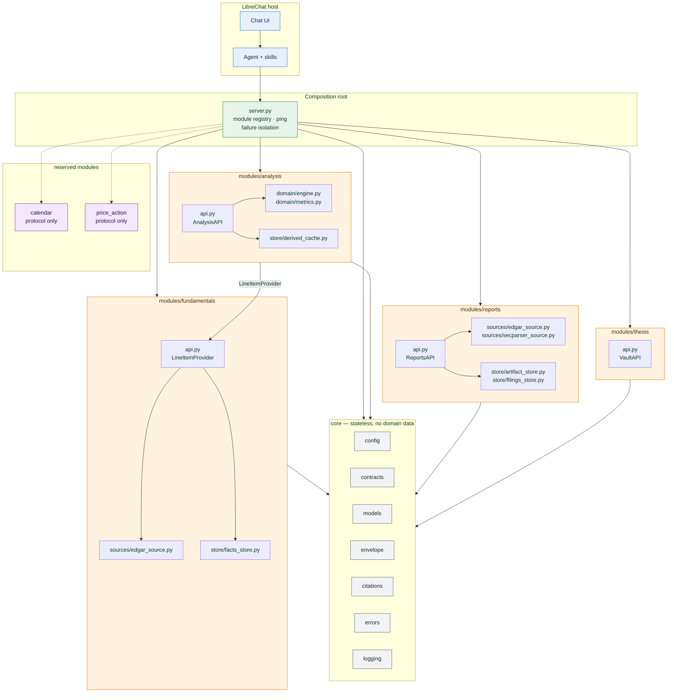
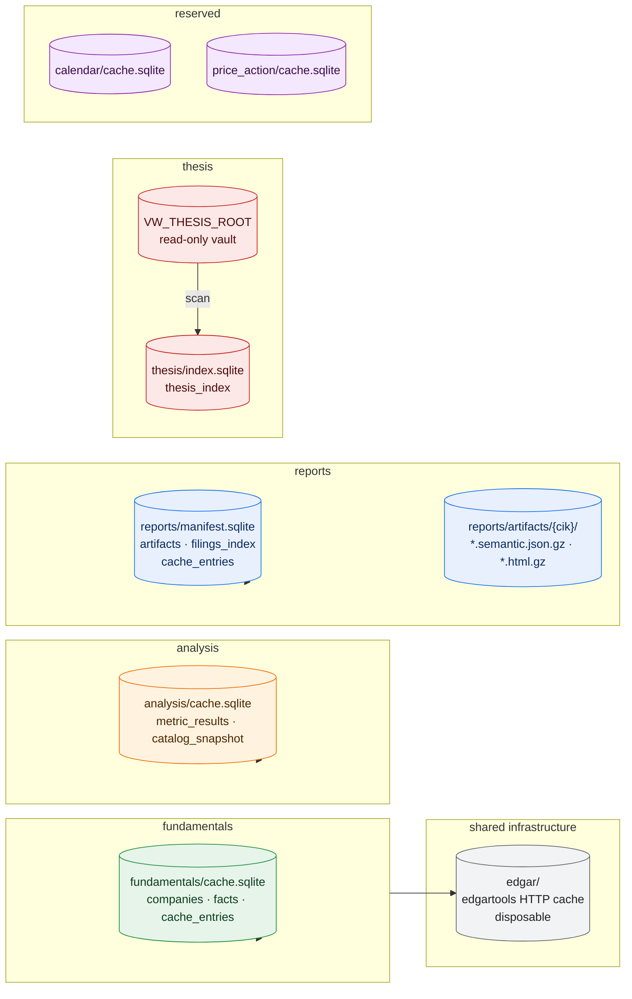
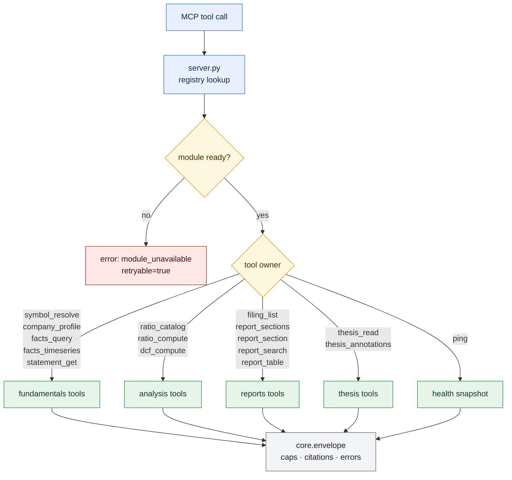
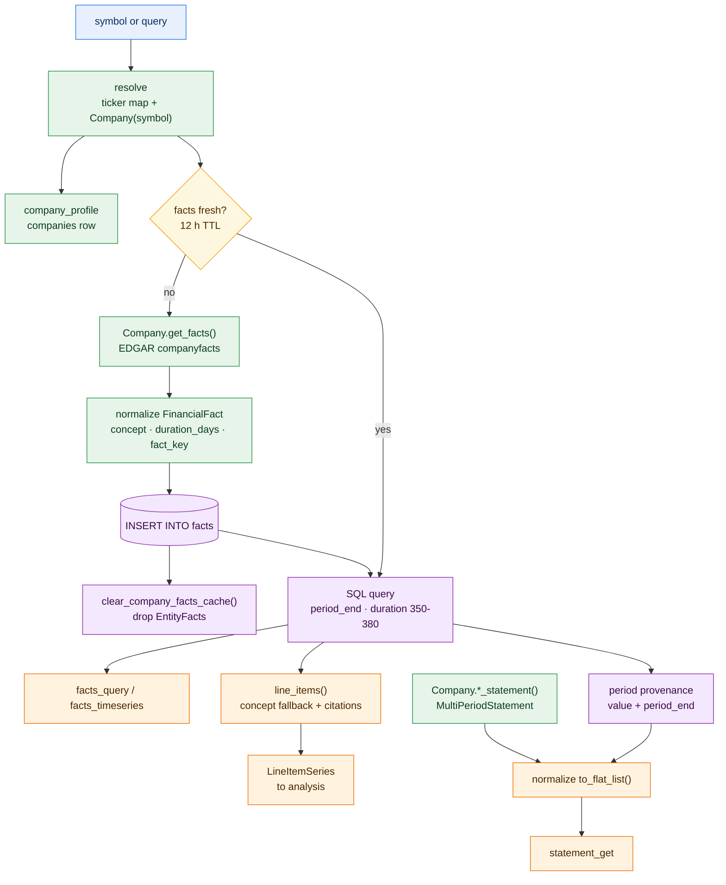
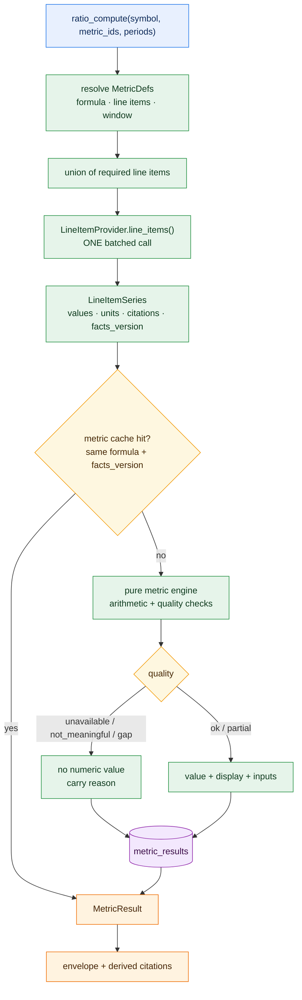
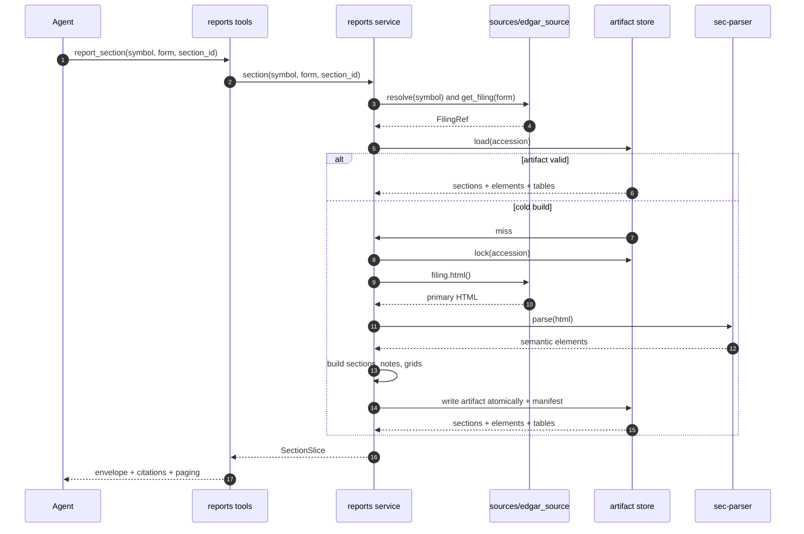
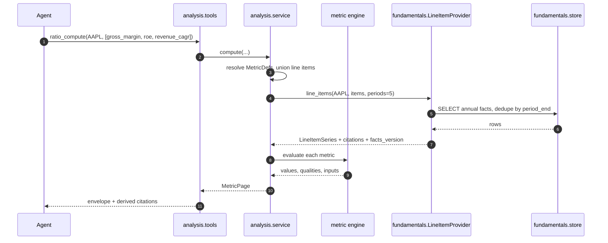
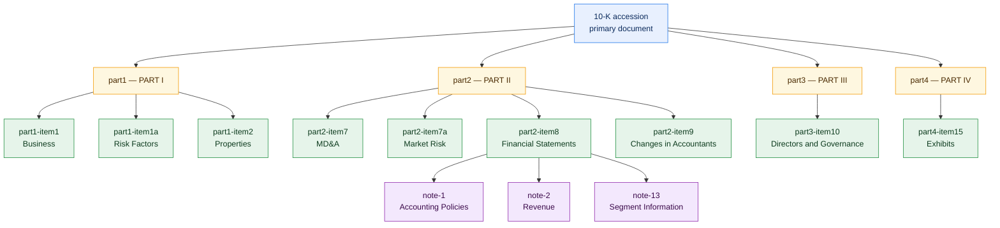
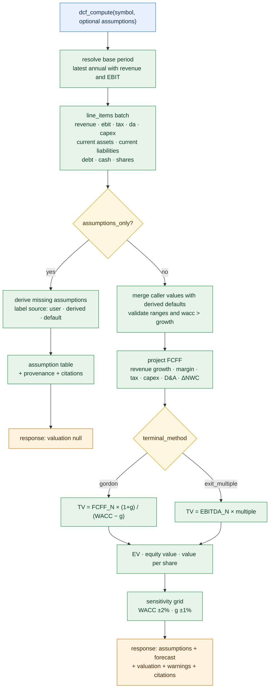
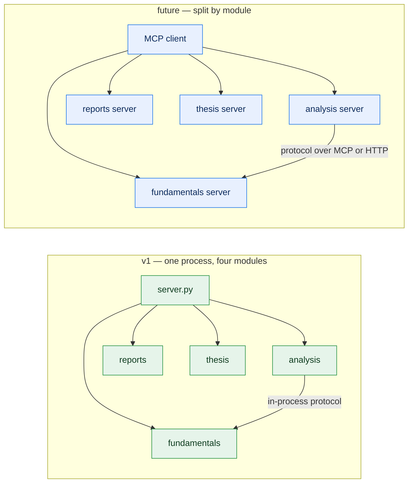

# valuebot v2 — Data-Owned Module Design

> **Status:** Proposed (revised)
> **Date:** 2026-10-18
> **Owner:** System Designer
> **Target repository:** `/Users/rkarumugam/LocalFiles/Projects/librechat-plugin`
> **Target plugin root:** `valuebot/` — approved (replaces the empty submodule placeholder)
> **Supersedes:** the single-layer file-reading design archived at [../_superseded/2026-10-18/valuebot-design-superseded-2026-10-18.md](../_superseded/2026-10-18/valuebot-design-superseded-2026-10-18.md)
> **Companion documents:** [db-mapping.md](./db-mapping.md) · [architecture/db-mapping.md](../../db-mapping.md) · [architecture/INDEX.md](../../INDEX.md)

---

## 1. Design Summary

valuebot v2 is a LibreChat Agent Plugin split into modules that are isolated by the data they use. **fundamentals** owns SEC XBRL facts, company metadata and annual statements through edgartools. **analysis** owns custom ratio, growth and DCF analytics and computes only from fundamentals line items supplied through a narrow port. A parameter-free DCF derives labeled assumptions and returns them alongside the valuation. **reports** owns the filing index, filing download and sec-parser semantics: parts, items, notes, paragraphs and table grids. **thesis** owns the read-only investment vault. **calendar** and **price-action** are reserved modules with contracts but no implementation. Each module has its own SQLite file, artifacts, migrations, configuration, tools and tests. No module imports another module's internals or reads another module's tables. A stateless core supplies contracts, the response envelope, citations, errors and configuration; a composition root wires modules together and isolates boot and runtime failures. Analysis values carry their input facts and citations, so derived numbers stay traceable. Reports resolves and parses filings independently. The plugin exposes 15 domain tools plus `ping`; no LibreChat fork, terminal server or local pipeline.

---

## 2. Design Rationale & Tradeoffs

### 2.1 Why data ownership is the boundary

The previous design split by technical layer (`sources` → `domain` → `store` → `tools`). That groups code by *how* it works, not by *what data it uses*, so an analytics change and a filing-parsing change both touch the same folders, and a failure in one contaminates the other's cache and startup. Splitting by data ownership gives four concrete benefits:

| Benefit | Mechanism |
|:---|:---|
| Independent change | A metric formula edit touches only `analysis`; a sec-parser upgrade touches only `reports`. |
| Independent failure | A module that cannot initialise is marked unavailable; the other modules keep serving. |
| Independent storage | One SQLite file, one artifact directory and one eviction policy per module. No shared tables, no cross-module `JOIN`. |
| Independent extraction | Any module can become its own MCP server or process because its only outbound dependency is a `core` protocol, not another module's database. |

The consequences are deliberate: some values are computed instead of stored twice, cross-module calls replace shared tables, and the composition root carries wiring that a layered design hid inside imports. Those costs are bounded and listed in §2.12.

### 2.2 Module inventory

| Module | Data it owns | Data it must not touch | Public surface | Tools |
|:---|:---|:---|:---|:---|
| `fundamentals` | SEC company facts, company metadata, annual statements, XBRL concept vocabulary | Filing index, filing HTML semantics, ratios, prices, thesis | `LineItemProvider` | `symbol_resolve`, `company_profile`, `facts_query`, `facts_timeseries`, `statement_get` |
| `analysis` | Metric definitions, computed metric values, growth windows, DCF assumptions and results | XBRL raw facts, EDGAR network, filing text | `AnalysisAPI` | `ratio_catalog`, `ratio_compute`, `dcf_compute` |
| `reports` | Filing index, filing HTML, semantic artifacts, section and table indexes | XBRL facts tables, ratios, prices, thesis | `ReportsAPI` | `filing_list`, `report_sections`, `report_section`, `report_search`, `report_table` |
| `thesis` | Thesis index, annotation index; vault is read-only source | EDGAR, XBRL, ratios | `VaultAPI` | `thesis_read`, `thesis_annotations` |
| `calendar` (later) | Corporate calendar events | Everything above | `CalendarAPI` | not registered |
| `price_action` (later) | OHLCV series, technical indicators | Everything above | `PriceAPI` | not registered |
| `core` | Nothing | All domain data | Contracts, envelope, citations, errors, config, models, logging | `ping` lives in the composition root |

**Naming rule:** a module directory, its config key, its data directory and its documentation all use the same identifier (`price_action`, not "price action" or "prices"). Tool names are domain-readable; ownership is recorded in one registry so the agent instructions can group them.

### 2.3 The isolation contract

These rules are normative and are enforced by tests (§6.4).

1. **Import rule.** A module may import `core` and third-party libraries. It may not import another `modules.*` package. The composition root is the only place that imports more than one module.
2. **Data rule.** A module opens only its own SQLite file and its own artifact directory. Cross-module data is requested through a protocol in `core/contracts.py`.
3. **Protocol rule.** Cross-module calls accept and return `core.models` dataclasses or primitive values. A module's internal ORM rows, SQL, and private classes never cross the boundary.
4. **Version rule.** Every module exports `API_VERSION`. The composition root refuses to wire a provider whose version is not in the consumer's supported set.
5. **Failure rule.** Module construction is wrapped. A failed module is recorded as unavailable; its tools return `module_unavailable`, and every other module keeps serving.
6. **Schema rule.** No foreign key, trigger or view crosses module files. Each module owns its migrations and can be deleted without affecting another module's schema.
7. **Write rule.** Only `fundamentals`, `analysis`, `reports` and `thesis` (index only) write, and only under `${PLUGIN_DATA}/modules/<module>/`. No module writes to the plugin tree, `../db`, or SEC.
8. **Dependency direction.** `analysis → fundamentals` is the only cross-module edge. `fundamentals` never imports or calls `analysis` or `reports`. `reports` and `thesis` have no module dependencies at all.

### 2.4 `fundamentals` module

**Owns** the numeric and identity truth for one issuer:

- ticker → CIK resolution and company profile;
- company facts (`Company.get_facts()`) mirrored to SQLite;
- annual and quarterly statements from `MultiPeriodStatement` and as-reported `Statement`;
- the canonical XBRL line-item vocabulary (concept fallback chains);
- period-level provenance (accession/form/filed per `period_end`), taken directly from the fact rows.

**Why edgartools here:** it is the module that talks to SEC for numeric data. One identity, one rate limit and one retry policy apply across the plugin; `reports` uses the same shared transport settings for filing documents.

**Deliberate exclusion:** the filing index and filing documents belong to `reports`. Facts already carry `accession`, `form_type` and `filing_date`, which is all the provenance join needs, so `fundamentals` does not need a filings table or a filing-listing tool.

**Public API:**

```python
API_VERSION = 1

class FundamentalsAPI(LineItemProvider):
    def resolve(self, symbol: str) -> CompanyRef: ...
    def profile(self, symbol: str) -> CompanyProfile: ...
    def facts(self, symbol: str, *, concepts=None, search=None, forms=None,
              start=None, end=None, unit=None, annual_only=False,
              dedupe=True, limit=20, offset=0) -> FactPage: ...
    def timeseries(self, symbol: str, concept: str, *, annual_only=True,
                   start=None, end=None, limit=20) -> FactSeries: ...
    def statement(self, symbol: str, statement: str, *, basis="company",
                  periods=4, accession=None) -> NormalizedStatement: ...
    def line_items(self, symbol: str, items: Sequence[str], *, periods=5,
                   annual_only=True, balance_basis="average") -> LineItemSeries: ...
    def concept_vocabulary(self) -> dict[str, tuple[str, ...]]: ...
```

**`line_items` is the analysis boundary.** It accepts line-item names (`revenue`, `total_debt`), not raw concepts. The module resolves the concept fallback chain, picks the latest filing per `period_end`, attaches citations, and returns one series per item. Analysis therefore contains no XBRL knowledge and cannot drift from the fundamentals concept map.

**Internals:** `sources/edgar_source.py` (lazy edgartools import, identity, retries, rate limit), `domain/concepts.py` (line-item vocabulary), `domain/statements.py` (normalization and provenance), `store/facts_store.py` (schema, ingest, SQL, LRU), `tools/` (five MCP tools).

**Storage:** `${PLUGIN_DATA}/modules/fundamentals/cache.sqlite`. Schema in [db-mapping.md](./db-mapping.md) §3. edgartools' own HTTP cache is shared transport infrastructure at `${PLUGIN_DATA}/edgar/`, owned by the platform rather than by a domain module, because edgartools reads its location from a process-wide variable.

**Key correctness rule:** `fiscal_year` is filing metadata, not the period. Annual selection and provenance use `period_end` and `duration_days` (350–380). This follows from the verified edgartools behaviour in §2.12.

### 2.5 `analysis` module

**Owns** the definition, computation, caching and explanation of derived metrics.

- A declarative **metric catalog**: id, label, family, formula, required line items, unit, direction, period policy, window, formula version.
- A **pure engine** that performs arithmetic on `LineItemSeries` and returns values, inputs, quality and citations.
- A **derived cache** keyed by issuer, metric, period, balance basis, formula version and a facts fingerprint.

It does not query EDGAR, read `fundamentals` tables, parse filings, or know about prices.

**Public API:**

```python
API_VERSION = 1

class AnalysisAPI:
    def catalog(self, symbol: str | None = None) -> MetricCatalog: ...
    def compute(self, symbol: str, metric_ids: Sequence[str], *, periods=5,
                balance_basis="average", include_inputs=True) -> MetricPage: ...
```

**Computation contract:**

1. Resolve the union of required line items for the requested metrics.
2. Call `LineItemProvider.line_items(symbol, items, periods, annual_only=True, balance_basis)` **once**.
3. Compute each metric from that single series set.
4. Return per metric: value, display, unit, period, inputs (each with concept and citation), formula text, formula version, quality.
5. Cache the result; never cache a failed computation as a value.

**Quality states:** `ok`, `unavailable` (missing line item), `not_meaningful` (zero/negative denominator, negative equity for ROE, negative EBITDA for leverage), `gap` (growth window not covered by consecutive periods), `partial` (some periods unavailable). The engine never substitutes zero, never estimates, and never silently drops a period.

**Why a declarative catalog:** formulas and applicability change more often than code. A table of metric definitions with a version lets the agent list what exists, lets tests cover each formula independently, and avoids a growing `if metric_id == ...` chain.

### 2.5.1 DCF valuation

The module owns one valuation model, a simple free-cash-flow-to-firm DCF. It is deliberately small: three to fifteen forecast years, one terminal method, explicit assumptions, no price data.

**Three ways to call it:**

| Call | Behaviour |
|:---|:---|
| Partial or no assumptions | Derive every missing assumption from the issuer's annual history, label each one `derived` or `default`, compute the valuation, and return the assumptions with the result. |
| `assumptions_only=true` | Derive and return the assumptions without computing a valuation. The model can inspect and adjust them, then call again with explicit values. |
| Full assumptions | Use the supplied values, label them `user`, and still return the complete assumption set so the caller can audit the run. |

The response always contains the assumption list and each assumption's provenance. There is no hidden default: if a value came from a policy default rather than the company's history, it says so.

**Forecast mechanics (end-of-year, simple):**

```
revenue_t      = revenue_{t-1} * (1 + growth_t)
ebit_t         = revenue_t * operating_margin_t
nopat_t        = ebit_t * (1 - tax_rate)
fcff_t         = nopat_t + da_t - capex_t - delta_nwc_t
da_t           = revenue_t * da_pct
capex_t        = revenue_t * capex_pct
nwc_t          = revenue_t * nwc_pct
delta_nwc_t    = nwc_t - nwc_{t-1}
discount_t     = 1 / (1 + wacc) ^ t

ev             = sum(fcff_t * discount_t) + terminal_value * discount_N
tv_gordon      = fcff_N * (1 + terminal_growth) / (wacc - terminal_growth)
tv_multiple    = ebitda_N * exit_multiple
equity_value   = ev - net_debt
value_per_share = equity_value / shares_diluted
```

`nwc` is defined as current assets minus current liabilities at the base period and then held at a constant percentage of revenue. This is a deliberate simplification; interest-bearing debt and cash are handled through `net_debt`, not through working capital.

**Assumption defaults (derived from annual history unless noted):**

| Assumption | Default derivation | Clip |
|:---|:---|:---|
| `base_period_end` | Latest annual period with revenue and operating income | — |
| `forecast_years` | 5 | 3–15 |
| `revenue_growth` | 3-year revenue CAGR | −10% to 25% |
| `operating_margin` | Median of the last 3 annual operating margins | 0% to 60% |
| `tax_rate` | Median effective tax rate (`income_tax / pretax_income`), last 3 years | 0% to 40% |
| `capex_pct_revenue` | Median last 3 years | 0% to 30% |
| `da_pct_revenue` | Median last 3 years | 0% to 20% |
| `nwc_pct_revenue` | Base working capital divided by base revenue | −20% to 50% |
| `wacc` | **Policy default 9%**, not market-derived | 3% to 30% |
| `terminal_growth` | **Policy default 2.5%** | −2% to 4% |
| `shares_diluted` | Latest annual diluted shares | > 0 |
| `net_debt` | Total debt minus cash at the base period | — |

The `wacc` and `terminal_growth` defaults are modelling conventions, not observations. They are labeled `source="default"`, and the response includes `assumption_quality: "policy_default"` so the model must present them as such. Every other default is labeled `source="derived"` with the periods used and a citation to the underlying facts.

**Validation and guardrails:**

- Rates are decimals (`0.08` is 8%). A value outside its clip range returns `invalid_argument` with the accepted range; the tool never silently rescales a percentage.
- `wacc` must exceed `terminal_growth` by at least 1 percentage point; otherwise `invalid_argument`.
- A missing base line item returns `unavailable` with `missing_line_items`; the tool never substitutes zero for revenue, shares or net debt.
- Negative or zero base EBIT computes but adds `negative_base_earnings`; negative equity or negative EBITDA is reported, not corrected.
- Warning `terminal_value_dominates` when terminal value exceeds 75% of enterprise value.
- Warning `assumptions_not_company_specific` when `wacc` or `terminal_growth` remains a policy default.
- No price, no market comparison, no buy/hold/sell language. The tool returns an intrinsic value only; relative valuation belongs to `price_action` later.

`dcf_compute` is deterministic: the same symbol, base period, assumptions and model version produce the same output. It is not cached as a value; it reuses the cached line-item call and costs less than 5 ms of arithmetic.

**API:**

```python
class AnalysisAPI:
    def catalog(...) -> MetricCatalog: ...
    def compute(...) -> MetricPage: ...
    def dcf(self, symbol: str, *, assumptions: DcfAssumptions | None = None,
            assumptions_only: bool = False) -> DcfResult | DcfAssumptionPage: ...
```

**Storage:** `${PLUGIN_DATA}/modules/analysis/cache.sqlite` (`metric_results`, `catalog_snapshot`). Small, rebuildable, TTL 24 h plus facts-fingerprint invalidation. DCF runs are not persisted; the response echoes every assumption and input citation, so a run is reproducible.

### 2.6 `reports` module

**Owns** everything about filing documents:

- the filing index for an issuer (accession, form, filed, period, primary document, source URL);
- filing HTML download (primary document);
- sec-parser element stream;
- section and note index with stable IDs;
- table grids extracted from source HTML;
- full-text search inside one artifact;
- artifact manifest, raw HTML cache, LRU eviction.

**Public API:**

```python
API_VERSION = 1

class ReportsAPI:
    def filings(self, symbol: str, *, forms=None, start=None, end=None,
                limit=50, offset=0) -> FilingPage: ...
    def sections(self, *, symbol=None, accession=None, form="10-K",
                 kind="all", include_tables=False, offset=0, limit=40) -> SectionsPage: ...
    def section(self, *, symbol=None, accession=None, form="10-K",
                section_id: str, offset=0, limit_chars=8000) -> SectionSlice: ...
    def search(self, *, symbol=None, accession=None, form="10-K",
               query: str, limit=20) -> SearchPage: ...
    def table(self, *, symbol=None, accession=None, form="10-K",
              table_id: str, columns=None, row_offset=0, max_rows=40) -> TableSlice: ...
```

**Dependency: none.** The module resolves tickers itself through edgartools (`Company(symbol)`) and fetches its filing index from the SEC submissions JSON (`https://data.sec.gov/submissions/CIK##########.json`) with `requests`, stores its own index and artifacts, and never reads a fundamentals table or protocol. Filing HTML comes from the Archives `source_url` first, with `get_by_accession_number()` + `filing.html()` as a fallback. That means a fundamentals outage cannot break report reading, and a sec-parser upgrade cannot affect XBRL or metrics.

**Why the filing index lives here rather than in fundamentals:** listing, downloading and parsing a filing are one data lifecycle. Splitting the index from the document would create a cross-module edge and duplicate the same accession metadata in two stores. Facts already carry `accession`, `form_type` and `filing_date`, so fundamentals needs nothing from `reports`.

**Why sec-parser here and nowhere else:** it is the only component that converts filing HTML into typed semantics. Keeping it isolated means a parser upgrade or a heuristic change cannot affect XBRL correctness or metric definitions.

**Known parser limits that shape the module:**

- A 10-K yields only 8 `TopSectionTitle`s; Items 1A, 7, 7A, 8 and 9+ are rejected as `InvalidTopSectionIn10Q`. The module therefore runs a canonical 10-K item heuristic over `TitleElement`s.
- A 10-Q is fully classified; the heuristic only fills gaps.
- Notes are detected by heading text (`Note N`), not by level (10-K notes are level 0, 10-Q notes level 2).
- `TableElement.table_to_markdown()` loses colspan structure, omits the GFM delimiter row and mutates the parse tree. The module never calls it; it reads `html_tag.get_source_code()` first and renders grids itself.

**Internals:** `sources/edgar_source.py` (lazy edgartools import for ticker resolution, SEC submissions JSON for the index, `requests` for filing HTML with an edgartools fallback), `sources/secparser_source.py` (parse and warning capture), `domain/profiles.py`, `domain/sections.py`, `domain/tables.py`, `store/filings_store.py` (filing index), `store/artifact_store.py`, `tools/` (five MCP tools).

**Storage:** `${PLUGIN_DATA}/modules/reports/manifest.sqlite`, `artifacts/{cik}/{accession}.semantic.json.gz`, `artifacts/{cik}/{accession}.html.gz`.

### 2.7 `thesis` module

**Owns** the user's investment vault as a read-only source plus a small derived index.

- Reads `{VW_THESIS_ROOT}/{TICKER}/thesis.md`, `attachments/`, `.thesis/annotations/*.json`.
- Maintains `${PLUGIN_DATA}/modules/thesis/index.sqlite` with symbol, path, mtime, size, title and front-matter keys, so listing and staleness checks do not rescan the vault.
- Rejects path traversal before opening a file.
- Has no dependency on any other module. If the vault is absent, tools return `ok` with an explanatory note.

### 2.8 Reserved modules: `calendar` and `price-action`

Both are declared now so the plugin shape does not change when they arrive. Each gets a directory, an `api.py` with a protocol, a config namespace and documentation, but **no tools are registered**.

| Module | Owns | Protocol | Candidate sources (not committed) | Activation gate |
|:---|:---|:---|:---|:---|
| `calendar` | Earnings dates, dividends, splits, fiscal calendar | `CalendarAPI.events(symbol, kinds, start, end)` | edgartools filing metadata; a market-calendar provider | A source must be selected and its rate limits verified |
| `price_action` | OHLCV, adjusted series, technical indicators | `PriceAPI.history(symbol, period, interval)` and `PriceAPI.indicators(...)` | yfinance; a cached EOD provider | A source must be selected; indicator definitions agreed |

Rules they must follow when implemented: own their storage, expose only the protocol, do not import `fundamentals`/`analysis`/`reports`, and never become a dependency of an existing module. `price_action` may later feed valuation metrics into `analysis` **by having analysis declare an optional dependency**, never by price importing analysis.

### 2.9 Cross-module data flow and provenance

There is exactly one cross-module edge: **analysis → fundamentals**.

**Analysis → Fundamentals.** Analysis asks for line items and receives values with citations. A metric result carries its inputs, so a derived number is traceable without analysis ever seeing an accession or a filing URL. The citation source is `derived-analysis` with `derived_from` citations pointing at the underlying facts.

**No other edges.** `reports` resolves and downloads filings itself, `thesis` reads only the vault, and `fundamentals` never calls another module.

**Provenance chain:**

```
metric value (analysis)
  → input line item (fundamentals.line_items)
    → XBRL fact (fundamentals store)
      → filing accession + form + filed (fact columns)
        → SEC Archives URL (core.citations)
```

Every link is a dataclass field, not a lookup inside another module's database.

**No cycles.** If a future feature seems to require `fundamentals → analysis` (for example, "show the ratio version of this statement"), it is implemented as a new tool in `analysis` that calls fundamentals, not as a reverse import. A feature that needs both a metric and a report section belongs in an agent or orchestrator, not in a module.

### 2.10 Storage isolation

| Module | SQLite file | Files | Writable | Eviction |
|:---|:---|:---|:---|:---|
| `fundamentals` | `modules/fundamentals/cache.sqlite` | — | yes | whole-company LRU, 100 companies / 500 MB |
| `analysis` | `modules/analysis/cache.sqlite` | — | yes | TTL 24 h + facts-fingerprint mismatch, 32 MB |
| `reports` | `modules/reports/manifest.sqlite` | `modules/reports/artifacts/` | yes | artifact LRU, 512 MB |
| `thesis` | `modules/thesis/index.sqlite` | — | index only | rebuild from vault mtimes |
| `calendar` | `modules/calendar/cache.sqlite` (later) | — | yes | TTL, not yet specified |
| `price_action` | `modules/price_action/cache.sqlite` (later) | — | yes | TTL, not yet specified |
| `core` | none | `edgar/` (shared library HTTP cache) | no domain data | disposable |

**Why the edgartools HTTP cache is shared:** edgartools reads `EDGAR_LOCAL_DATA_DIR` from the process environment, so two modules cannot own separate values in one process. It contains only disposable HTTP responses, has no schema and no domain records, and is safe to delete. Domain data remains fully isolated per module.

**Why separate files, not prefixed tables in one file:** a shared file creates an accidental coupling (one migration blocks all modules, one corruption loses everything, one write lock serialises unrelated traffic) and makes later extraction a data migration. Separate files make extraction a configuration change.

**Tradeoff:** a cross-module question needs one function call instead of a `JOIN`. In-process calls are sub-millisecond and batched (§2.12); the cost is negligible compared with the recovery and extraction benefits.

### 2.11 Dependency rationale

All libraries are open source.

| Library | Version | Module | Role | Why chosen | Rejected alternative |
|:---|:---|:---|:---|:---|:---|
| `edgartools` | `>=5.58,<6` | `fundamentals`, `reports` | SEC identity, company resolution, facts, statements, filing HTML fallback | One library covers the numeric surface; built-in retries, rate limiting, statement normalization | Custom SEC client plus XBRL parsing: duplicates transport and normalization |
| `requests` | `>=2.31` | `reports` | SEC submissions JSON index and Archives HTML | Cold `Company.get_filings()` takes minutes; one direct GET returns the whole filing history in well under a second | edgartools filings collection (measured ~480 s cold, full load of every historical filing page) |
| `sec-parser` | `>=0.58.1,<0.59` | `reports` | Semantic HTML structure | Typed semantic elements, source HTML per element, fast, no ML dependency | edgartools `TenK.sections` (coarse, no element-level notes or tables); custom regex (fragile) |
| `beautifulsoup4` | `>=4.14,<5` | `reports` | Table grid extraction | Already a sec-parser dependency; tolerant of malformed filing HTML | Direct `lxml.html` (less forgiving); regex (incorrect for spans) |
| `lxml` | transitive | `reports` | BeautifulSoup backend | Fast and bundled with sec-parser | `html.parser` (slower, less correct) |
| `pandas` | transitive | `fundamentals` | edgartools statement return type | Consumed only through `to_flat_list()` / `to_dataframe()`; not imported elsewhere | Unavoidable with edgartools |
| `mcp` | `>=2.2.0` | `core` | stdio MCP transport | Required by LibreChat Agent Plugins; proven in v1 | None |
| `yfinance` + `tzdata` | optional | `price_action` (later) | Price history | Isolated extra; not installed for v1 | A paid market data feed (not required) |

`analysis` has **no third-party dependency**. That is intentional: metrics are arithmetic, and a dependency-free module is the easiest to test and extract.

### 2.12 Cross-module cost, failure and correctness

**Latency.** A `ratio_compute` for 10 metrics needs at most one `line_items` call (batched union) plus arithmetic. Measured fundamentals query cost is ~10–50 ms warm; analysis adds <5 ms. The engine never issues one fundamentals call per metric.

**Failure isolation.** Each module is constructed behind a guard. `ping` reports `modules: {fundamentals: "ready", reports: "ready", analysis: "degraded", thesis: "ready"}` with error codes. A module that fails cannot prevent tool registration for others; its tools return `module_unavailable` with `retryable=true`. Because `reports` and `thesis` have no module dependencies, a fundamentals outage leaves report reading and thesis work fully available; only `analysis` degrades.

**Version skew.** `core.contracts` declares `SUPPORTED = {"fundamentals": {1}}`. The composition root validates before wiring and fails fast with a configuration error naming the provider and version.

**Metric correctness.**

- Division by zero, negative equity and negative EBITDA produce `not_meaningful`, never a number.
- Growth requires consecutive `period_end` values with a gap of 330–400 days; otherwise `gap`.
- Balance-sheet ratios default to average balances when the prior period exists; if not, they use ending balances and report `balance_basis="ending"` in the result.
- Unit mismatches (for example `USD` revenue against `USD/shares` EPS) are rejected before arithmetic.
- Restatements: `line_items` chooses the latest filing per `period_end`; analysis reports `filing_date` per input so a restated series is visible.
- Concept fallback is owned by fundamentals; analysis can only request line-item names, so a formula cannot silently bind to a different concept in a different module.

**Verified library behaviour that constrains the design**

| Finding | Evidence | Response |
|:---|:---|:---|
| `EntityFacts` for AAPL holds 24,852 facts, 7.6 MB source JSON, 40–80 MB in memory; the internal cache holds one company | Offline parse of `companyFacts_0000320193.json` | Mirror to SQLite, then clear the edgartools cache; one company at a time |
| Annual statements return `MultiPeriodStatement`; `to_flat_list()` has `concept, label, depth, parent, is_total, confidence` and `None` values | Offline probe | Normalize from `to_flat_list()`, not from the DataFrame |
| Statements carry no accession, form or filed date | Source inspection | Attach period citations from the facts mirror |
| `fiscal_year` is the filing year, so `by_fiscal_year(2025)` returns comparatives from other years | Runtime probe | Never filter or join on `fiscal_year`; use `period_end` and `duration_days` |
| sec-parser classifies 8 top sections in a 10-K and 13 in a 10-Q | Parses of AAPL FY2025 10-K and Q2 FY2026 10-Q | Mandatory 10-K item heuristic; 10-Q uses parser types |
| 13 notes (10-K) and 10 notes (10-Q) are detectable by heading text | Runtime probe | Regex on `TitleElement`, fallback to short `TextElement` |
| `table_to_markdown()` loses colspan, omits the delimiter row and mutates the tree | Probe on 47 tables | Never call it; custom grid extractor |
| Python 3.14 cannot import either library | Import probe | Pin Python 3.11–3.13, prefer 3.12 |
| edgartools defaults to 9 req/s and prompts for identity when unset | Source inspection | Require a one-time `identity.json` (`SEC_USER_AGENT`), rate 5 req/s, never call `get_identity()` |

### 2.13 Security and limits

| Surface | Control |
|:---|:---|
| Module data paths | Fixed root per module; symbol and accession validated by regex before path construction |
| Cross-module payloads | Dataclasses with fixed fields; no SQL, file paths or credentials cross a protocol |
| SQL | Parameterized queries only; each module's schema is private |
| HTML | Never returned to the model; text and GFM tables only |
| Oversized input | HTML cap 40 MB; 40-row/12-column table pages; 8 KB response caps |
| Rate limits | 5 req/s, single-flight per accession, TTL caches |
| SEC User-Agent | No default: one-time `./setup.sh` writes `${PLUGIN_DATA}/identity.json` (0600); `core/config.py` injects that single value into edgartools and every direct request; env override is per-run only; placeholders rejected |
| Stdout | All logging to stderr, including `loguru` (sec-parser dependency); no stdout sink |
| Degradation | `coverage.degraded`, `module_unavailable`, `quality` states are explicit; never silently partial |

---

## 3. Data & Interface Matrix

### 3.1 Data Mapping Protocol

| Data Element / Field | Module Owner | Source / Ingestion Vector | Format / Schema | Rate Limits, Sizing & Tier Constraints |
|:---|:---|:---|:---|:---|
| **Ticker → CIK map** | `fundamentals` | `edgar.get_company_tickers()` → `https://www.sec.gov/files/company_tickers.json` | JSON `{cik: {ticker, title}}` stored in `cache_entries` blob | ~12k rows, ~1 MB; 1 request per 24 h; 24 h TTL |
| **Company profile** | `fundamentals` | `Company(symbol)` metadata | `companies` row + `CompanyProfile` dataclass | 0.3–1 MB; 1 request/company/12 h; 12 h TTL; 6 KB response |
| **XBRL company facts** | `fundamentals` | `Company.get_facts()` → `https://data.sec.gov/api/xbrl/companyfacts/CIK##########.json` | 7–10 MB JSON → 20–30k `facts` rows | 1 request/company/12 h; 40–80 MB transient RAM; clear edgartools cache after ingest; 100-company LRU |
| **Fact row** | `fundamentals` | Normalized `FinancialFact` | `fact_key, cik, concept, taxonomy, label, unit, value, numeric_value, period_type, period_start, period_end, duration_days, fiscal_year (filing metadata), fiscal_period, form_type, accession, filing_date, is_audited, is_restated, data_quality, confidence_score, dimensions_json` | ~180–250 B/row; ~25k rows/company; PK `fact_key`; indexes on `(cik, concept, period_end)`, `(cik, period_end, period_type)` |
| **Ticker → CIK map (reports)** | `reports` | `Company(symbol)` via edgartools; cached resolution | `{symbol, cik, name}` in `cache_entries` | 1 request/company/12 h; 12 h TTL |
| **Filing index row** | `reports` | `https://data.sec.gov/submissions/CIK##########.json` → `filings.recent` | `filings_index{accession, cik, form, filed, period_of_report, primary_document, is_xbrl, source_url}` | 0.3–1 MB source; 12 h TTL; 100 rows/page; 6 KB response |
| **Filing primary HTML** | `reports` | `requests` GET on Archives `source_url`; `filing.html()` fallback | HTML text 0.5–20 MB | 1 request/filing; 40 MB hard cap; gzip raw cache 0.25–5 MB |
| **Annual statement (company basis)** | `fundamentals` | `Company.income_statement / balance_sheet / cashflow_statement` → `MultiPeriodStatement.to_flat_list()` | `NormalizedStatement{statement, basis, unit, periods[], rows[]}` | 10–20 ms; 24 h TTL; 4 periods default, 20 max; 8 KB response |
| **Annual statement (filing basis)** | `fundamentals` | `filing.obj().financials.income_statement()` → `Statement.to_dataframe()` | Same normalized shape with 2–3 periods | 50–200 ms; cached; 8 KB response |
| **Statement provenance** | `fundamentals` | Anchor `period_end` by value, join facts by `(cik, concept, period_end)` | `{period_end: {accession, form, filed, url}}` appended to the statement | One annual-facts load per statement, ~25k rows, <50 ms |
| **Line-item vocabulary** | `fundamentals` | `domain/concepts.py` | `{line_item: (concept, fallback_concept, ...)}` | Static; ~40 line items; versioned with `API_VERSION` |
| **Line-item batch (contract)** | `fundamentals` → `analysis` | `LineItemProvider.line_items()` | `LineItemSeries{cik, periods[], items{line_item: [LineItemValue]}, facts_version}`; each value carries `period_end, value, unit, concept, citation` | One call per computation; <50 ms warm; 5 periods default |
| **Facts fingerprint** | `fundamentals` | Hash of company `facts_synced_at` and row count | String in `LineItemSeries.facts_version` | Used by analysis cache invalidation |
| **Metric definition** | `analysis` | Declarative catalog in `domain/metrics.py` | `MetricDef{id, label, family, formula, line_items[], unit, direction, period_policy, window, version}` | ~30 metrics; static; versioned |
| **Metric result** | `analysis` | Metric engine over one `LineItemSeries` | `MetricResult{metric_id, period_end, value, display, unit, quality, inputs[], formula, formula_version}` | 8 KB response; 5 periods default |
| **Metric cache row** | `analysis` | Computed result | `metric_results{cik, metric_id, period_end, balance_basis, formula_version, facts_version, value, payload, computed_at, last_access}` | 32 MB cap; TTL 24 h; invalidated by `facts_version`, `formula_version` or `balance_basis` mismatch |
| **DCF assumptions** | `analysis` | Derived from line items, or supplied by the caller | `[{name, value, display, unit, source: user/derived/default, derivation, periods_used, assumption_quality, citation}]` | 12 assumptions; 2–4 KB response; rates as decimals; each value labeled |
| **DCF forecast row** | `analysis` | Arithmetic over the assumption set | `{year, revenue, ebit, taxes, nopat, da, capex, delta_nwc, fcff, discount_factor, pv}` | 3–15 rows; per-row arithmetic only |
| **DCF result** | `analysis` | Forecast plus terminal value | `{enterprise_value, net_debt, equity_value, shares_diluted, value_per_share, currency, terminal{method, value, pv, share_of_ev}, warnings[]}` | 4–6 KB response; no caching; deterministic |
| **DCF sensitivity grid** | `analysis` | Recompute across WACC and growth steps | `{wacc_values[], growth_values[], grid[[]]}` | 5 WACC × 5 growth cells; 2 KB response |
| **Semantic element stream** | `reports` | `sec_parser.Edgar10QParser().parse(html)` | `[{type, level, text, section_id, table_id}]` | 0.2–0.5 s for 1.5 MB; 200–1,000 elements; 50–250 KB gzip |
| **Section index** | `reports` | `TopSectionTitle` + canonical `Item N` heuristic | `sections[]{id, parent_id, kind, title, start, end, char_count, table_ids, note_number}` | 8–30 sections; <6 KB response; `coverage.degraded` flag |
| **Note index** | `reports` | Heading regex inside Item 8 / Part I Item 1 | `sections[]` with `kind="note"` | 10–13 notes verified; <4 KB response |
| **Table grid** | `reports` | `TableElement.html_tag.get_source_code()` → BeautifulSoup | `tables[]{id, section_id, index, caption, header_rows, grid[][]}` | 47 tables per 10-K; max 44 rows and 42 columns observed; caps 5,000 cells / 60 columns / 500 chars per cell |
| **Table markdown** | `reports` | `render_markdown(grid, header_rows, ...)` | GFM with delimiter row | 8 KB page; 40 rows / 12 columns default |
| **Search hit** | `reports` | Linear scan of artifact text and table grids | `hits[]{kind, section_id, title, snippet, table_id}` | 2–120 char query; 20 hits; 8 KB |
| **Artifact manifest** | `reports` | Build result | `artifacts{accession, cik, form, filed, period_of_report, profile, parser_version, rules_version, schema_version, html_bytes, artifact_bytes, counts, status, built_at, last_access}` | 1 row/filing; immutable; LRU 512 MB |
| **Semantic artifact** | `reports` | Serialized artifact | `artifacts/{cik}/{accession}.semantic.json.gz` | 50–300 KB/filing; versioned; atomic replace |
| **Raw HTML artifact** | `reports` | `filing.html()` | `artifacts/{cik}/{accession}.html.gz` | 0.25–5 MB/filing; LRU |
| **Vault document** | `thesis` | `{VW_THESIS_ROOT}/{TICKER}/thesis.md` | Markdown + YAML front matter | Read-only; 8 KB pages; missing vault returns `ok` |
| **Thesis annotation** | `thesis` | `{TICKER}/.thesis/annotations/*.json` | JSON `{mtime, annotations[]}` | Read-only; 200 docs; 8 KB |
| **Thesis index row** | `thesis` | Vault scan | `thesis_index{symbol, path, mtime, size, title, front_matter_json, indexed_at}` | Rebuildable; mtime-keyed |
| **Calendar event** (later) | `calendar` | Not selected | `events{symbol, kind, date, payload}` | Module reserved; no ingestion in v1 |
| **Price bar** (later) | `price_action` | Not selected | `bars{symbol, interval, ts, o, h, l, c, adj_c, v}` | Module reserved; no ingestion in v1 |
| **Response envelope** | `core` | Every tool | `{ok, module, tool, data, citations, paging, meta}` or `{ok:false, module, tool, error}` | 2–8 KB per response; typed error codes |
| **Citation** | `core` | Modules supply source data; core builds the record | `{key, label, source, accession, form, filed, period_end, section, table, url, derived_from[]}` | Deduplicated by key; 20 max |

### 3.2 Core contracts

```python
# core/contracts.py — no I/O, no module imports
API_VERSION: int = 1

# The only cross-module protocol in v1
class LineItemProvider(Protocol):
    api_version: int
    def line_items(self, symbol: str, items: Sequence[str], *, periods: int = 5,
                   annual_only: bool = True,
                   balance_basis: str = "average") -> LineItemSeries: ...
    def concept_vocabulary(self) -> dict[str, tuple[str, ...]]: ...

class VaultReader(Protocol):
    api_version: int
    def read(self, symbol: str, *, offset: int = 0, limit: int = 8000) -> VaultDocument: ...
    def annotations(self, symbol: str, doc: str | None = None) -> AnnotationPage: ...

# Reserved — declared, not implemented in v1
class CalendarAPI(Protocol):
    api_version: int
    def events(self, symbol: str, *, kinds=None, start=None, end=None) -> EventPage: ...

class PriceAPI(Protocol):
    api_version: int
    def history(self, symbol: str, *, period="1y", interval="1d") -> BarPage: ...
```

`reports` consumes no domain protocol: it resolves and downloads filings itself. `thesis` likewise depends only on its own vault. That leaves one edge for the composition root to validate.

### 3.3 Tool matrix

| Tool | Module | Arguments | Returns | Cap |
|:---|:---|:---|:---|:---|
| `symbol_resolve` | `fundamentals` | `query, limit=10` | matches with symbol, name, CIK, exchange | 6 KB |
| `company_profile` | `fundamentals` | `symbol, refresh=false` | CIK, name, SIC, FYE, filer category, latest filings, data availability | 6 KB |
| `facts_query` | `fundamentals` | `symbol, concepts?, search?, forms?, start?, end?, unit?, annual_only?, dedupe=true, limit=20, offset=0` | fact rows with period, value, accession, filed, citations | 6 KB |
| `facts_timeseries` | `fundamentals` | `symbol, concept, annual_only=true, start?, end?, limit=20` | period points, derived summary, citations | 6 KB |
| `statement_get` | `fundamentals` | `symbol, statement, basis="company", periods=4, accession?, offset=0, limit=40` | normalized statement rows, periods, unit, period citations | 8 KB |
| `filing_list` | `reports` | `symbol, forms?, start?, end?, limit=50, offset=0` | filing index rows, `report_available` flag | 6 KB |
| `ratio_catalog` | `analysis` | `symbol?, family?` | metric definitions, required line items, availability for the symbol | 6 KB |
| `ratio_compute` | `analysis` | `symbol, metric_ids, periods=5, balance_basis="average", include_inputs=true` | metric values, quality, inputs, citations, formula version | 8 KB |
| `dcf_compute` | `analysis` | `symbol, assumptions_only=false, base_period_end?, forecast_years=5, revenue_growth?, operating_margin?, tax_rate?, capex_pct_revenue?, da_pct_revenue?, nwc_pct_revenue?, wacc?, terminal_growth?, terminal_method="gordon", exit_multiple?, shares_diluted?, net_debt?` | assumptions with provenance, forecast rows, enterprise/equity value, value per share, sensitivity grid, warnings, citations | 8 KB |
| `report_sections` | `reports` | `symbol?, accession?, form="10-K", kind="all", include_tables=false, offset=0, limit=40` | section and note index, coverage, resolved filing | 6 KB |
| `report_section` | `reports` | `symbol?, accession?, form="10-K", section_id, offset=0, limit_chars=8000` | section text, table summaries, paging | 8 KB |
| `report_search` | `reports` | `symbol?, accession?, form="10-K", query, limit=20` | hits grouped by section, text or table | 8 KB |
| `report_table` | `reports` | `symbol?, accession?, form="10-K", table_id, columns?, row_offset=0, max_rows=40` | GFM table, header, dimensions, paging | 8 KB |
| `thesis_read` | `thesis` | `symbol, offset=0, limit=8000` | front matter, body, attachments | 8 KB |
| `thesis_annotations` | `thesis` | `symbol, doc?` | annotation documents | 8 KB |
| `ping` | composition root | — | module states, versions, paths, identity status, cache counts | 2 KB |
| `calendar_events` (later) | `calendar` | `symbol, kinds?, start?, end?` | event rows | 6 KB |
| `price_history` (later) | `price_action` | `symbol, period, interval` | bar series | 8 KB |

**Tool semantics that must appear in every docstring:**

- `start` and `end` filter `period_end`, never filing date. Filing-date filtering is `filing_list`.
- `forms` filters the form that tagged a fact, not the form being viewed.
- `period_end` is the only period identifier; `fiscal_year` is filing metadata.
- `basis="company"` is canonical multi-period; `basis="filing"` is as-reported from one accession.
- `ratio_compute` reports `quality` per metric; a non-`ok` value has no number.
- `dcf_compute` always returns its assumption table with `source` (`user`, `derived`, `default`); `assumptions_only=true` returns the table without a valuation; rates are decimals.
- `kind` accepts `items`, `notes`, `all`.
- `include_tables` adds summaries; content requires `report_table`.
- `report_*` and `filing_list` are independent of `fundamentals`; they resolve tickers through edgartools and read filings from the SEC submissions JSON.

### 3.4 Metric catalog (analysis module)

**Line-item vocabulary (owned by fundamentals):** `revenue`, `cost_of_revenue`, `gross_profit`, `operating_expenses`, `operating_income`, `depreciation_amortization`, `interest_expense`, `pretax_income`, `income_tax`, `net_income`, `eps_basic`, `eps_diluted`, `shares_basic`, `shares_diluted`, `cash`, `short_term_investments`, `accounts_receivable`, `inventory`, `current_assets`, `total_assets`, `ppe_net`, `goodwill`, `accounts_payable`, `current_liabilities`, `total_liabilities`, `short_term_debt`, `long_term_debt`, `total_debt`, `equity`, `retained_earnings`, `cfo`, `capex`, `cfi`, `cff`, `dividends_paid`, `sbc`.

| Metric ID | Label | Formula | Required line items | Unit | Notes |
|:---|:---|:---|:---|:---|:---|
| `gross_margin` | Gross margin | `gross_profit / revenue` | gross_profit, revenue | percent | Falls back to `revenue - cost_of_revenue` when gross profit is absent |
| `operating_margin` | Operating margin | `operating_income / revenue` | operating_income, revenue | percent | |
| `net_margin` | Net margin | `net_income / revenue` | net_income, revenue | percent | |
| `roa` | Return on assets | `net_income / total_assets` | net_income, total_assets | percent | Average assets when prior period exists |
| `roe` | Return on equity | `net_income / equity` | net_income, equity | percent | `not_meaningful` when equity ≤ 0 |
| `roic` | Return on invested capital | `nopat / invested_capital` | operating_income, pretax_income, income_tax, total_debt, equity, cash | percent | `nopat = operating_income * (1 - tax_rate)`, `tax_rate` clipped 0–1, `invested_capital = total_debt + equity - cash` |
| `fcf_margin` | Free-cash-flow margin | `(cfo - capex) / revenue` | cfo, capex, revenue | percent | Capex sign normalized to a positive outflow |
| `current_ratio` | Current ratio | `current_assets / current_liabilities` | current_assets, current_liabilities | ratio | |
| `quick_ratio` | Quick ratio | `(current_assets - inventory) / current_liabilities` | current_assets, inventory, current_liabilities | ratio | Inventory treated as 0 when absent, flagged `partial` |
| `cash_ratio` | Cash ratio | `(cash + short_term_investments) / current_liabilities` | cash, short_term_investments, current_liabilities | ratio | |
| `working_capital` | Working capital | `current_assets - current_liabilities` | current_assets, current_liabilities | currency | |
| `debt_to_equity` | Debt to equity | `total_debt / equity` | total_debt, equity | ratio | `not_meaningful` when equity ≤ 0 |
| `net_debt` | Net debt | `total_debt - cash` | total_debt, cash | currency | |
| `net_debt_to_ebitda` | Net debt to EBITDA | `(total_debt - cash) / (operating_income + depreciation_amortization)` | total_debt, cash, operating_income, depreciation_amortization | ratio | `not_meaningful` when EBITDA ≤ 0 |
| `interest_coverage` | Interest coverage | `operating_income / interest_expense` | operating_income, interest_expense | ratio | `unavailable` for non-borrowing issuers |
| `equity_multiplier` | Equity multiplier | `total_assets / equity` | total_assets, equity | ratio | DuPont component |
| `asset_turnover` | Asset turnover | `revenue / total_assets` | revenue, total_assets | turns | Average assets when available |
| `inventory_turnover` | Inventory turnover | `cost_of_revenue / inventory` | cost_of_revenue, inventory | turns | |
| `receivables_turnover` | Receivables turnover | `revenue / accounts_receivable` | revenue, accounts_receivable | turns | |
| `dso` | Days sales outstanding | `365 / receivables_turnover` | revenue, accounts_receivable | days | |
| `dio` | Days inventory outstanding | `365 / inventory_turnover` | cost_of_revenue, inventory | days | |
| `dpo` | Days payables outstanding | `365 / (cost_of_revenue / accounts_payable)` | cost_of_revenue, accounts_payable | days | |
| `cash_conversion_cycle` | Cash conversion cycle | `dso + dio - dpo` | revenue, accounts_receivable, cost_of_revenue, inventory, accounts_payable | days | `partial` when a component is missing |
| `capex_to_revenue` | Capex intensity | `capex / revenue` | capex, revenue | percent | |
| `fcf` | Free cash flow | `cfo - capex` | cfo, capex | currency | |
| `fcf_per_share` | FCF per share | `(cfo - capex) / shares_diluted` | cfo, capex, shares_diluted | currency | |
| `cfo_to_net_income` | Cash conversion of earnings | `cfo / net_income` | cfo, net_income | ratio | `not_meaningful` when net income ≤ 0 |
| `accrual_ratio` | Accrual ratio | `(net_income - cfo) / total_assets` | net_income, cfo, total_assets | percent | |
| `book_value_per_share` | Book value per share | `equity / shares_diluted` | equity, shares_diluted | currency | |
| `revenue_per_share` | Revenue per share | `revenue / shares_diluted` | revenue, shares_diluted | currency | |
| `revenue_cagr` | Revenue CAGR | `(revenue_t / revenue_t-n) ^ (1/n) - 1` | revenue | percent | `window` default 3, max 10; `gap` when periods are not consecutive |
| `eps_cagr` | EPS CAGR | `(eps_t / eps_t-n) ^ (1/n) - 1` | eps_diluted | percent | `not_meaningful` when either endpoint ≤ 0 |
| `fcf_cagr` | FCF CAGR | `(fcf_t / fcf_t-n) ^ (1/n) - 1` | cfo, capex | percent | `not_meaningful` when either endpoint ≤ 0 |
| `equity_growth` | Equity growth YoY | `equity_t / equity_t-1 - 1` | equity | percent | |
| `share_dilution` | Share count change YoY | `shares_t / shares_t-1 - 1` | shares_diluted | percent | Positive means dilution |
| `dupont_return` | DuPont return on equity | `net_margin * asset_turnover * equity_multiplier` | net_income, revenue, total_assets, equity | percent | Returns the three components as inputs |

Every metric carries `formula_version`; changing a formula requires a version bump and a cache invalidation. Adding a metric is a catalog entry plus a test, not a new tool.

### 3.5 DCF contract

**Request (all rate fields are decimals):**

| Field | Type | Default | Range | Meaning |
|:---|:---|:---|:---|:---|
| `symbol` | string | required | — | Issuer |
| `assumptions_only` | bool | `false` | — | Return derived assumptions without a valuation |
| `base_period_end` | string | latest annual | — | Base fiscal period |
| `forecast_years` | int | `5` | 3–15 | Explicit forecast horizon |
| `revenue_growth` | number or number[] | 3y CAGR | −0.10–0.25 | Scalar applies to all years; a list must match `forecast_years` |
| `operating_margin` | number or number[] | 3y median | 0.00–0.60 | EBIT margin |
| `tax_rate` | number | 3y median effective | 0.00–0.40 | Cash tax rate applied to EBIT |
| `capex_pct_revenue` | number | 3y median | 0.00–0.30 | Capital expenditure intensity |
| `da_pct_revenue` | number | 3y median | 0.00–0.20 | Depreciation and amortization intensity |
| `nwc_pct_revenue` | number | base NWC / revenue | −0.20–0.50 | Incremental working capital |
| `wacc` | number | `0.09` policy default | 0.03–0.30 | Discount rate |
| `terminal_growth` | number | `0.025` policy default | −0.02–0.04 | Perpetuity growth |
| `terminal_method` | string | `"gordon"` | `gordon`, `exit_multiple` | Terminal value method |
| `exit_multiple` | number | none | 3–30 | Required when `terminal_method="exit_multiple"` |
| `shares_diluted` | number | latest annual | > 0 | Share count for per-share value |
| `net_debt` | number | total debt − cash | — | Override for the capital structure |

**Response (success):**

```json
{
  "ok": true,
  "module": "analysis",
  "tool": "dcf_compute",
  "data": {
    "symbol": "AAPL",
    "cik": 320193,
    "currency": "USD",
    "base_period_end": "2025-09-27",
    "forecast_years": 5,
    "assumptions": [
      {"name": "revenue_growth", "value": 0.0441, "display": "4.4%",
       "unit": "percent", "source": "derived", "derivation": "3-year revenue CAGR",
       "periods_used": ["FY2022", "FY2025"], "assumption_quality": "company_history",
       "citation": {"key": "…", "accession": "…", "form": "10-K", "filed": "2025-10-31"}},
      {"name": "wacc", "value": 0.09, "display": "9.0%", "unit": "percent",
       "source": "default", "derivation": "policy default, not market-derived",
       "periods_used": [], "assumption_quality": "policy_default", "citation": null}
    ],
    "assumptions_complete": true,
    "forecast": [
      {"year": 1, "period_end": "2026-09-30", "revenue": 434520000000,
       "ebit": 138000000000, "taxes": 29000000000, "nopat": 109000000000,
       "da": 12000000000, "capex": 13000000000, "delta_nwc": 1000000000,
       "fcff": 107000000000, "discount_factor": 0.9174, "pv": 98160000000}
    ],
    "terminal": {"method": "gordon", "value": 1680000000000,
                 "pv": 1092000000000, "share_of_ev": 0.78},
    "valuation": {"enterprise_value": 1400000000000, "net_debt": 45000000000,
                  "equity_value": 1355000000000, "shares_diluted": 15000000000,
                  "value_per_share": 90.33, "currency": "USD"},
    "sensitivity": {"wacc_values": [0.07, 0.08, 0.09, 0.10, 0.11],
                    "growth_values": [0.015, 0.02, 0.025, 0.03, 0.035],
                    "grid": [[0.0]]},
    "warnings": ["terminal_value_dominates", "assumptions_not_company_specific"]
  },
  "citations": [],
  "meta": {"model_version": "1", "elapsed_ms": 12, "bytes": 6112, "cached_line_items": true}
}
```

**Response (`assumptions_only=true`):** identical `assumptions` and `base_period_end`, plus `valuation: null`, `forecast: []`, `sensitivity: null`. This is the intended first call for an interactive workflow: derive, show the model, let it adjust, then recompute.

**Failure modes:** `invalid_argument` for an out-of-range rate, an unknown `terminal_method`, or `wacc - terminal_growth < 0.01`; `unavailable` with `missing_line_items` for absent revenue, shares or net-debt components. No failure returns a partial valuation.

**Why no cache:** the arithmetic is deterministic and under 5 ms; the expensive part is the line-item batch, which fundamentals already caches. Persisting DCF runs would add a schema and a staleness surface without improving latency or reproducibility.

**Guardrail for the agent:** a DCF output is an intrinsic-value estimate under stated assumptions, never a price target. The `dcf-valuation` skill requires the model to show the assumption table, name policy defaults, and avoid buy/hold/sell language.

---

## 4. Abstraction & Data Flow Diagrams

### 4.1 Module isolation and dependency direction



### 4.2 Data ownership map



### 4.3 Request routing and tool ownership



### 4.4 Fundamentals data flow



### 4.5 Analysis data flow



### 4.6 Reports data flow



### 4.7 Sequence: `ratio_compute` across two modules



### 4.8 Reports semantic model (10-K)



### 4.9 DCF computation flow



### 4.10 Deployment topologies



---

## 5. Feasibility Review

| Check | Result | Mitigation / decision |
|:---|:---|:---|
| Import isolation is enforceable | Python AST scan can detect `modules.<other>` imports | Contract test in §6.4; CI failure, not convention |
| Data isolation is enforceable | Each module opens one fixed SQLite path | Paths come from `core.paths.module_data_dir(name)`; no cross-file attachments; test asserts no foreign keys across files |
| Cross-module latency | In-process call, ~10–50 ms warm | One batched `line_items` call per computation; analysis adds <5 ms |
| Contract drift | `API_VERSION` plus frozen dataclasses | Composition root validates versions; tests pin field sets |
| Failure isolation | Module construction guarded; registry records state | `ping` reports per-module state; tool returns `module_unavailable` |
| Duplicate concept logic | Fundamentals owns the vocabulary | Analysis references line-item names only; test asserts analysis contains no `us-gaap:` literal |
| Metric correctness | Division, sign and window edge cases enumerated | Quality states; formula tests per metric; no zero substitution |
| Growth windows | Fiscal years vary 52/53 weeks | Require consecutive `period_end` gaps of 330–400 days; else `gap` |
| Balance averages | First period has no prior | Default average, fall back to ending and report `balance_basis` |
| Restatements | Multiple accessions per period | `line_items` prefers latest filing per `period_end`; input carries `filing_date` |
| DCF assumptions | Historical derivation with clips; policy defaults labeled | `source` and `assumption_quality` on every item; `wacc` and `terminal_growth` never presented as observed |
| DCF determinism | Arithmetic only; no market data | Same symbol, base period, assumptions and model version produce identical output; no caching needed |
| DCF edge cases | Negative EBIT, negative equity, zero shares, growth ≥ WACC | Warnings plus `invalid_argument` / `unavailable`; never a partial valuation |
| DCF horizon | 3–15 years; terminal value may dominate | `terminal_value_dominates` warning above 75% of EV; sensitivity grid exposes the effect |
| DCF scope | No price, no comparables | Intrinsic value only; relative valuation belongs to `price_action` later |
| Reports independence | No cross-module dependency | Resolves ticker and filings itself; tests run with `fundamentals` absent |
| Filing metadata duplication | Avoided | `reports` is the sole owner of the filing index; facts carry `accession`, `form_type` and `filing_date`, so fundamentals needs no filings table |
| sec-parser 10-K coverage | Only 8 top sections classified | Mandatory canonical item heuristic; `coverage.degraded` in every response |
| sec-parser 10-Q coverage | Complete for AAPL Q2 FY2026 | Prefer parser types; heuristic fills gaps |
| Table rendering | Library markdown malformed and mutates tree | Custom grid extractor; 47/47 tables verified |
| Memory | `EntityFacts` is 40–80 MB, cache holds one company | Ingest, clear cache, one company at a time |
| Python compatibility | 3.14 cannot import edgartools or sec-parser | `requires-python >=3.11,<3.14`, `.python-version 3.12` |
| Cold start | edgartools plus pandas and lxml are large | Prime `${PLUGIN_DATA}/uv-env` at deploy; lazy imports in modules |
| Storage growth | Facts ~3–6 MB/company; artifacts ~0.4–0.6 MB per 10-K filing | Per-module caps: 100 companies / 500 MB, 512 MB artifacts, 32 MB metrics |
| Security | No module receives paths or SQL from the model | Regex-validated symbol and accession; parameterized SQL; envelope caps |
| Extraction path | Separate data dirs and protocol-only dependencies | No schema, cache or import coupling to unwind |
| Reserved modules | Contracts declared, no code registered | They cannot be called; adding them does not change existing modules |

---

## 6. Next Steps

### 6.1 Target layout

```
librechat-plugin/
├── architecture/
│   ├── INDEX.md
│   ├── db-mapping.md
│   └── design-docs/
│       ├── _superseded/2026-10-18/        archived previous design
│       └── valuebot-v2/
│           ├── design.md
│           └── db-mapping.md
└── valuebot/                              plugin root
    ├── plugin.json
    ├── mcp.json
    ├── README.md
    ├── .env.example
    ├── .python-version                    3.12
    ├── docs/
    │   ├── 00-index.md
    │   ├── users/
    │   │   ├── 00-index.md
    │   │   ├── 01-getting-started.md
    │   │   ├── 02-configuration.md
    │   │   ├── 03-tools-reference.md
    │   │   ├── 04-agents-and-skills.md
    │   │   ├── 05-research-workflows.md
    │   │   ├── 06-librechat-deployment.md
    │   │   ├── 07-model-endpoints.md
    │   │   └── 08-troubleshooting-and-faq.md
    │   └── dev/
    │       ├── 00-index.md
    │       ├── 01-architecture.md
    │       ├── 02-module-contracts.md
    │       ├── 03-data-model.md
    │       ├── 04-development-setup.md
    │       ├── 05-testing.md
    │       ├── 06-reports-parser.md
    │       ├── 07-analysis-and-dcf.md
    │       ├── 08-deployment.md
    │       ├── 09-roadmap.md
    │       └── 10-contributing.md
    ├── skills/
    │   ├── grounded-citation/SKILL.md
    │   ├── hypothesis-analysis/SKILL.md
    │   ├── ratio-analysis/SKILL.md
    │   ├── dcf-valuation/SKILL.md
    │   └── semantic-report-reading/SKILL.md
    ├── agent-builder-exports/
    │   ├── INSTALL.md
    │   ├── vw-orchestrator.json
    │   ├── vw-fundamentals-analyst.json
    │   ├── vw-analysis-analyst.json
    │   ├── vw-reports-analyst.json
    │   ├── vw-thesis-analyst.json
    │   └── vw-citation-auditor.json
    ├── mcp/
    │   ├── pyproject.toml
    │   ├── server.py                     composition root
    │   ├── core/
    │   │   ├── __init__.py
    │   │   ├── config.py
    │   │   ├── contracts.py
    │   │   ├── models.py
    │   │   ├── envelope.py
    │   │   ├── citations.py
    │   │   ├── errors.py
    │   │   ├── paths.py
    │   │   ├── logging.py
    │   │   └── ttl_cache.py
    │   └── modules/
    │       ├── fundamentals/
    │       │   ├── __init__.py
    │       │   ├── api.py
    │       │   ├── service.py
    │       │   ├── config.py
    │       │   ├── sources/edgar_source.py
    │       │   ├── domain/concepts.py
    │       │   ├── domain/statements.py
    │       │   ├── store/db.py
    │       │   ├── store/facts_store.py
    │       │   ├── schema.sql
    │       │   └── tools/
    │       │       ├── __init__.py
    │       │       ├── discovery.py
    │       │       ├── facts.py
    │       │       └── statements.py
    │       ├── analysis/
    │       │   ├── __init__.py
    │       │   ├── api.py
    │       │   ├── service.py
    │       │   ├── config.py
    │       │   ├── domain/metrics.py
    │       │   ├── domain/engine.py
    │       │   ├── domain/dcf.py
    │       │   ├── store/db.py
    │       │   ├── store/derived_cache.py
    │       │   ├── schema.sql
    │       │   └── tools/
    │       │       ├── ratios.py
    │       │       └── valuation.py
    │       ├── reports/
    │       │   ├── __init__.py
    │       │   ├── api.py
    │       │   ├── service.py
    │       │   ├── config.py
    │       │   ├── sources/edgar_source.py
    │       │   ├── sources/secparser_source.py
    │       │   ├── domain/profiles.py
    │       │   ├── domain/sections.py
    │       │   ├── domain/tables.py
    │       │   ├── store/db.py
    │       │   ├── store/filings_store.py
    │       │   ├── store/artifact_store.py
    │       │   ├── schema.sql
    │       │   └── tools/
    │       │       ├── __init__.py
    │       │       ├── filings.py
    │       │       ├── sections.py
    │       │       └── tables.py
    │       ├── thesis/
    │       │   ├── __init__.py
    │       │   ├── api.py
    │       │   ├── service.py
    │       │   ├── store/db.py
    │       │   ├── schema.sql
    │       │   └── tools/vault.py
    │       ├── calendar/                  reserved
    │       │   ├── __init__.py
    │       │   ├── api.py                 protocol only
    │       │   └── README.md
    │       └── price_action/              reserved
    │           ├── __init__.py
    │           ├── api.py                 protocol only
    │           └── README.md
    └── tests/
        ├── conftest.py
        ├── unit/{fundamentals,analysis,reports,thesis}/
        ├── contract/
        │   ├── test_import_isolation.py
        │   ├── test_schema_isolation.py
        │   ├── test_protocol_versions.py
        │   ├── test_envelopes.py
        │   └── test_stdio_purity.py
        └── integration/
```

### 6.2 Core contracts and composition

```python
# core/config.py
PLUGIN_ROOT: Path
PLUGIN_DATA: Path
MODULES_ROOT: Path                 # ${PLUGIN_DATA}/modules
VW_THESIS_ROOT: Path
SEC_USER_AGENT: str             # single SEC User-Agent (email or "Name email")
SEC_USER_AGENT_FILE: Path       # ${PLUGIN_DATA}/identity.json (one-time setup, 0600)
EDGAR_IDENTITY: str             # deprecated alias, mirrors SEC_USER_AGENT
EDGAR_RATE_LIMIT_PER_SEC: int
EDGAR_HTTP_TIMEOUT_S: float
ENABLE_PRICE: bool
VW_FUND_CACHE: Path            # ${PLUGIN_DATA}/modules/fundamentals/cache.sqlite
VW_ANALYSIS_CACHE: Path        # ${PLUGIN_DATA}/modules/analysis/cache.sqlite
VW_REPORTS_DB: Path            # ${PLUGIN_DATA}/modules/reports/manifest.sqlite
VW_REPORTS_ARTIFACTS: Path     # ${PLUGIN_DATA}/modules/reports/artifacts
VW_THESIS_INDEX: Path          # ${PLUGIN_DATA}/modules/thesis/index.sqlite
EDGAR_CACHE: Path              # ${PLUGIN_DATA}/edgar (shared library cache)
def module_data_dir(name: str) -> Path
def refresh() -> dict[str, object]
def describe() -> dict[str, object]

# core/models.py — frozen dataclasses shared across boundaries
CompanyRef, CompanyProfile, FilingRef, FilingPage
FactRow, FactPage, FactSeries
LineItemValue, LineItemSeries
NormalizedStatement, StatementRow
MetricDef, MetricResult, MetricPage
DcfAssumptions, DcfAssumption, DcfForecastRow, DcfResult, DcfAssumptionPage
Section, SectionsPage, SectionSlice
TableGrid, TableSlice, SearchPage
Citation, Paging, ToolError

# core/contracts.py
API_VERSION = 1
SUPPORTED_PROVIDERS = {"fundamentals": {1}}
LineItemProvider, VaultReader, CalendarAPI, PriceAPI

# core/envelope.py
def ok(module: str, tool: str, data: dict, *, citations=None,
       paging=None, meta=None, cap: int) -> dict
def error(module: str, tool: str, exc: ValuebotError, *, cap: int = 4096) -> dict
def page(rows, offset: int, limit: int) -> tuple[list, dict]

# core/errors.py
ValuebotError(code, hint, retryable, retry_after_s)
IdentityNotConfigured, SymbolNotFound, CompanyNotFound, FilingNotFound,
SectionNotFound, TableNotFound, StatementUnavailable, MetricNotFound,
MetricUnavailable, ModuleUnavailable, InvalidArgument, EdgarUnavailable,
EdgarRateLimited, ArtifactTooLarge, ParserFailed, CacheUnavailable,
ContractViolation, InternalError
```

**Composition root (the only multi-module importer):**

```python
# server.py
MODULES = (
    ("fundamentals", "modules.fundamentals", "build"),
    ("analysis", "modules.analysis", "build"),
    ("reports", "modules.reports", "build"),
    ("thesis", "modules.thesis", "build"),
)

def build_modules(ctx) -> dict[str, Module]:
    states: dict[str, ModuleState] = {}
    fundamentals = guarded("fundamentals", ...)
    analysis = guarded("analysis", ..., facts=fundamentals.api)
    reports = guarded("reports", ...)
    thesis = guarded("thesis", ...)
    return states
```

Rules for the composition root:

- Never contains domain logic.
- Wraps each module construction in `try/except`, records `ModuleState(status, error, code)`.
- Registers a module's tools only when the module is ready; otherwise registers stubs that return `module_unavailable`, so the agent sees a stable tool list.
- Validates `API_VERSION` before passing a provider into a consumer.
- Owns `ping`.

### 6.3 Build order and acceptance criteria

| Phase | Work | Acceptance |
|:---|:---|:---|
| **0 — Platform** | `core/*`, `server.py`, `plugin.json`, `mcp.json`, `pyproject.toml`, `.python-version`, module registry, `ping` | Server boots; stdio is JSON-RPC only; `ping` lists four module states; no domain imports at boot |
| **1 — Fundamentals** | `sources/edgar_source.py`, `domain/concepts.py`, `domain/statements.py`, stores, five tools | `symbol_resolve("app")` returns AAPL; profile shows CIK 320193; `facts_timeseries` returns 6 newest-first annual points; statements match AAPL FY2025; `line_items` returns cited values for 10 items |
| **2 — Reports** | `edgar_source.py` (filing index and HTML), `secparser_source`, `profiles`, `sections`, `tables`, artifact store, five tools | `filing_list` returns AAPL 10-Ks; 10-K index includes Items 1A, 7, 7A, 8; 13 notes; 47 tables render with delimiter rows; 10-Q includes all Part I/II items; warm section read <100 ms; all report tools run with `fundamentals` absent |
| **3 — Analysis** | `domain/metrics.py`, `domain/engine.py`, `domain/dcf.py`, derived cache, three tools; consumes `LineItemProvider` only | All catalog metrics have formula tests; `gross_margin`, `roe`, `revenue_cagr` correct for AAPL; `dcf_compute("AAPL")` returns labeled assumptions, a 5-year forecast, value per share and a sensitivity grid; `assumptions_only=true` returns assumptions only; missing inputs yield `unavailable`; no `us-gaap:` literal in the module; one fundamentals call per computation |
| **4 — Thesis** | Vault reader and index, two tools (`thesis_read`, `thesis_annotations`) | Path traversal rejected; missing vault returns `ok`; annotations listed |
| **5 — Packaging** | Five skills, six agent exports, README/INSTALL/env examples | Tool allowlists match module registries; skills cover all source types, metric quality states and DCF assumptions |
| **6 — Validation** | Unit, contract, integration, live probe, performance, security | §6.4 green |

### 6.4 Test plan

| Layer | Tests | Fixtures |
|:---|:---|:---|
| Contract — import isolation | AST scan: no `modules.<other>` import inside a module; no domain import in `core` | Source tree |
| Contract — schema isolation | Each `schema.sql` touches only its module's tables; no cross-file `ATTACH`; no cross-module foreign keys | Schema files |
| Contract — protocol versions | Composition rejects an unsupported `API_VERSION`; frozen dataclass field sets match `core.models` | Stub providers |
| Contract — envelopes | Every tool returns `ok` or a typed error; caps enforced; no exception escapes | Stub modules |
| Contract — stdio purity | Subprocess: only JSON-RPC on stdout, logs on stderr | `server.py` |
| Unit — fundamentals | Fact normalization; `duration_days`; annual filter; provenance by value and `period_end`; concept fallback; line-item dedupe | `../db/debug/jsonData/aapl/companyFacts_0000320193.json` |
| Unit — analysis | Each metric formula; quality states; unit mismatch; negative equity; zero denominators; growth gap; average versus ending basis; cache invalidation on `facts_version` and `balance_basis` | Synthetic `LineItemSeries` |
| Unit — DCF | Default derivation and clips; rate validation; WACC ≤ growth rejection; scalar versus vector growth; Gordon and exit-multiple terminal values; net debt and share overrides; negative EBIT warning; terminal-share warning; sensitivity grid symmetry; determinism | Synthetic `LineItemSeries`; AAPL fixture |
| Unit — reports | Filing index sync; 10-K item order and coverage; 10-Q parser types; note spans; duplicate note rejection; cross-reference rejection; colspan and rowspan; header detection; delimiter row; mutation guard | `../db/debug/jsonData/aapl/submissions_0000320193.json`, `../db/filing/us/AAPL/10-K/2025-09-27_...htm`, newest 10-Q |
| Unit — thesis | Front matter; attachments; traversal rejection; missing vault | Synthetic vault |
| Integration — offline | End-to-end tool calls with fixture `LineItemProvider` and fixture filing HTML; no network | `VW_FIXTURE_DB=/Users/rkarumugam/LocalFiles/Projects/db` |
| Integration — isolation | Analysis with a failing fundamentals provider; reports with `fundamentals` not constructed at all; thesis with no vault | Stub providers; module registry with a missing module |
| Integration — live | One ticker, one 10-K, one 10-Q, one statement, one ratio set, one default DCF run; opt-in flag | SEC network plus real identity |
| Performance | Facts query <50 ms; line-item batch <50 ms warm; metric set <10 ms; DCF run <5 ms after the line-item call; artifact build <5 s excluding network; warm section <100 ms | Local fixtures |
| Security | Traversal; SQL parameters; symbol and accession regex; oversized HTML; oversized table; query length; stdout leakage | Synthetic |

### 6.5 Implementation guardrails

1. **No cross-module imports.** Only `core` and third-party packages; the composition root is the sole exception.
2. **No cross-module database access.** Request data through a protocol; never open another module's file.
3. **No XBRL knowledge in analysis.** Request line items, not concepts. No `us-gaap:` literal outside `fundamentals`.
4. **No sec-parser import outside reports.** Filing semantics stay in one module.
5. **Never call `edgar.get_identity()`.** It prompts interactively and hangs stdio.
6. **Never call `TableElement.table_to_markdown()`.** Read source code first; use the grid renderer.
7. **Never call any `.render()` method.** They emit terminal output to stdout.
8. **Never filter facts by `fiscal_year`.** Use `period_end` and `duration_days`.
9. **Never print to stdout.** Logging to stderr, including `loguru`; no stdout sink.
10. **Never emit a number with a non-`ok` quality.** Return the reason instead.
11. **Never substitute zero or estimate a missing input.** Report `unavailable` with the missing line items.
12. **DCF rates are decimals, and every assumption is echoed.** Label `user`, `derived` or `default`; never present a policy default as a company observation; reject `wacc − terminal_growth < 0.01`.
13. **DCF is intrinsic value, not a price target.** No buy/hold/sell language and no comparison to market price in v1.
14. **All writes under the module's own `${PLUGIN_DATA}/modules/<module>/`.** No writes to the plugin tree, `../db`, SEC, or the thesis vault.
15. **Lazy-import heavy libraries** so boot and `ping` do not depend on edgartools, sec-parser or BeautifulSoup.
16. **Atomic artifact writes** (`.tmp`, `fsync`, `os.replace`) under a per-accession lock released in `finally`.
17. **Surface degradation**: `module_unavailable`, `coverage.degraded`, metric `quality` and `balance_basis` are always explicit.
18. **Pin versions:** `edgartools>=5.58,<6`, `sec-parser>=0.58.1,<0.59`, Python `>=3.11,<3.14`.
19. **Do not commit** SEC data, identity strings, caches or artifacts.

### 6.6 Skills and agent allowlists

| Agent | Tools |
|:---|:---|
| `vw-orchestrator` | all registered tools |
| `vw-fundamentals-analyst` | `symbol_resolve`, `company_profile`, `facts_query`, `facts_timeseries`, `statement_get` |
| `vw-analysis-analyst` | `symbol_resolve`, `facts_timeseries`, `statement_get`, `ratio_catalog`, `ratio_compute`, `dcf_compute` |
| `vw-reports-analyst` | `company_profile`, `filing_list`, `report_sections`, `report_section`, `report_search`, `report_table` |
| `vw-thesis-analyst` | `symbol_resolve`, `facts_timeseries`, `ratio_compute`, `dcf_compute`, `report_section`, `thesis_read`, `thesis_annotations` |
| `vw-citation-auditor` | `company_profile`, `filing_list`, `report_sections`, `report_section`, `facts_query`, `statement_get`, `ratio_catalog`, `dcf_compute` |

**Skills:**

- `grounded-citation` — source types `sec-xbrl`, `sec-statement`, `sec-report`, `derived-analysis`, `thesis`; derived values cite their inputs; keep the drop rule and footer.
- `hypothesis-analysis` — tool order per module: `facts_query` → `facts_timeseries` → `statement_get` → `ratio_compute` → `report_sections` → `report_section` / `report_search` → `report_table`; keep the two-call circuit breaker.
- `ratio-analysis` (new) — how to choose metrics by question, interpret quality states, cite inputs, and refuse to use `not_meaningful` values.
- `dcf-valuation` (new) — call `dcf_compute` without assumptions first, present the derived assumption table, distinguish policy defaults from company history, adjust explicitly, and report the sensitivity range without a price target.
- `semantic-report-reading` (new) — section IDs, `kind="notes"`, coverage degradation, table paging, and section citations.

### 6.7 Non-goals

- No custom UI; LibreChat supplies chat, agent selection and citation rendering.
- No PDF or pre-2001 text filings.
- No portfolio, screening or backtesting.
- No relative valuation, comparables or price targets; only an intrinsic-value DCF.
- No insider or proxy module in v1.
- No cross-filing full-text search; search is inside one cached report.
- No XBRL note extraction through edgartools; semantic notes come from sec-parser.
- No runtime dependency on `../db`; it remains a fixture source.
- `calendar` and `price_action` are not implemented and register no tools.

### 6.8 Extension points

| Extension | Contract | Constraint |
|:---|:---|:---|
| New metric | Add a `MetricDef` and a formula test | No new tool; no fundamentals change unless a new line item is required |
| New valuation model | Add a pure function in `analysis/domain/` behind `dcf_compute`-style parameters; echo assumptions | Must return assumptions with provenance and use only line items |
| New line item | Add a concept fallback chain in `fundamentals` | Bump the vocabulary version; analysis gains it automatically |
| New filing form profile | Add a profile and heuristic in `reports` | Must not change existing section IDs without a rules version bump |
| Corporate calendar | Implement `CalendarAPI` in `modules/calendar` | Own storage; no imports of other modules |
| Price and technicals | Implement `PriceAPI` in `modules/price_action` | Analysis may add an optional valuation dependency later; price never imports analysis |
| Alternative semantic provider | Replace `reports.sources.secparser_source` behind the same artifact model | `schema_version` and `rules_version` bump |
| Split deployment | Give a module its own MCP server; reimplement its protocol over the wire | Remove the import edge at the composition root only; only `analysis` retains a dependency on `fundamentals` |

---

## 7. Appendix

- Planned per-module storage and lifecycle: [db-mapping.md](./db-mapping.md)
- Existing data landscape: [architecture/db-mapping.md](../../db-mapping.md)
- Architecture index: [architecture/INDEX.md](../../INDEX.md)
- Archived previous design: [../_superseded/2026-10-18/valuebot-design-superseded-2026-10-18.md](../_superseded/2026-10-18/valuebot-design-superseded-2026-10-18.md)
- Reference implementations inspected:
  - [`/Users/rkarumugam/LocalFiles/Projects/ValueWaffleTerminal/valuebot/mcp`](../../../../ValueWaffleTerminal/valuebot/mcp) — plugin scaffold, TTL cache, citations, thesis vault
  - [`/Users/rkarumugam/LocalFiles/Projects/terminal-valuewaffle/server`](../../../../terminal-valuewaffle/server) — edgartools and sec-parser adapters, provider contracts
  - [`/Users/rkarumugam/LocalFiles/Projects/ValueWaffleLite/server-mwe`](../../../../ValueWaffleLite/server-mwe) — lightweight contracts and TTL cache
  - [`/Users/rkarumugam/LocalFiles/Projects/db`](../../../../db) — real SEC HTML, company facts, merged tables, leadership and insider fixtures
