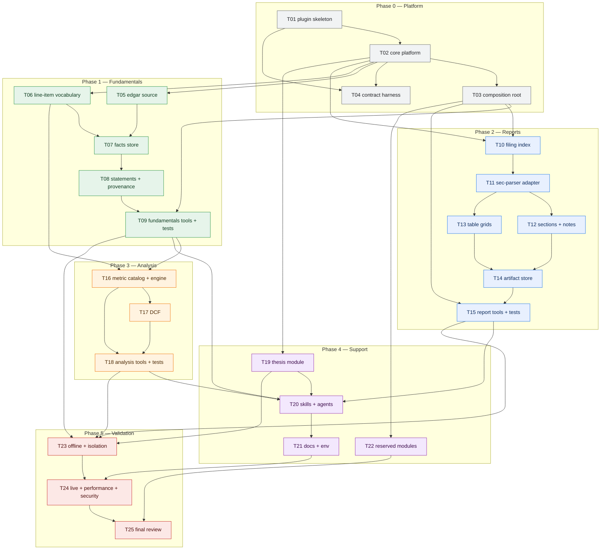

# valuebot v2 — Implementation Plan

> **Status:** Ready for execution
> **Date:** 2026-10-18
> **Design:** [design.md](./design.md)
> **Storage:** [db-mapping.md](./db-mapping.md)
> **Target:** `/Users/rkarumugam/LocalFiles/Projects/librechat-plugin/valuebot/`
> **Strategy:** copy and adapt proven code from the v1 plugin and the ValueWaffle terminal projects; write new code only where the data model is genuinely new.

---

## 1. Objective

Deliver the valuebot v2 plugin as four isolated modules plus two reserved protocols:

| Module | Deliverable |
|:---|:---|
| `fundamentals` | edgartools-backed XBRL facts, company profile, annual statements, line-item contract |
| `analysis` | 36 ratio/growth metrics and a parameter-optional DCF with echoed assumptions |
| `reports` | filing index, filing HTML, sec-parser sections/notes, table grids |
| `thesis` | read-only vault reader with a rebuildable index |
| `calendar`, `price_action` | protocol and directory only; no tools registered |

15 domain tools plus `ping`, all under `valuebot/mcp/`, with contract tests proving module isolation.

---

## 2. Reuse strategy

### 2.1 Source projects

| Alias | Path | What it gives us |
|:---|:---|:---|
| **v1 plugin** | `/Users/rkarumugam/LocalFiles/Projects/ValueWaffleTerminal/valuebot` | plugin manifests, launcher, config resolution, TTL cache, citations, envelope helpers, thesis reader, skills, agent exports, docs, stdio/conformance tests |
| **terminal** | `/Users/rkarumugam/LocalFiles/Projects/terminal-valuewaffle/server` | edgartools statement adapter, SEC identity, sec-parser toolbox, statement formatting/period logic, core models, TTL cache |
| **lite** | `/Users/rkarumugam/LocalFiles/Projects/ValueWaffleLite/server-mwe` | compact provider contracts and cache patterns |
| **fixtures** | `/Users/rkarumugam/LocalFiles/Projects/db` | real AAPL 10-K/10-Q HTML, company facts, submissions |

All four are first-party projects; reuse is direct copy or adaptation, with no third-party code.

### 2.2 Reuse matrix

| Source file | Destination | Action | Adaptation |
|:---|:---|:---|:---|
| `valuebot/plugin.json` | `valuebot/plugin.json` | copy | name/version/description for v2 |
| `valuebot/mcp.json` | `valuebot/mcp.json` | copy | new env block (`EDGAR_*`, module paths, caps) |
| `valuebot/mcp/run.sh` | `valuebot/mcp/run.sh` | copy | none |
| `valuebot/bootstrap.sh` | `valuebot/bootstrap.sh` | adapt | new dependency set; keep `--dry-run` and venv fallback |
| `valuebot/mcp/citations.py` | `mcp/core/citations.py` | copy | add `derived_from` passthrough for analysis |
| `valuebot/mcp/cache.py` | `mcp/core/ttl_cache.py` | adapt | configurable path per module; keep WAL, TTL, LRU, corrupt-file recovery |
| `valuebot/mcp/util.py` | `mcp/core/envelope.py` + `mcp/core/json.py` | split | `ok`/`err`/`cap_bytes`/`log`/`iso`/`to_number`; new `module` field |
| `valuebot/mcp/config.py` | `mcp/core/config.py` | adapt | drop statement-config and GCS; add module data roots, caps, `module_data_dir` |
| `valuebot/mcp/server.py` | `mcp/server.py` | adapt | replace monolithic tool list with module registry, guarded init and `ping` |
| `valuebot/mcp/tools/thesis.py` | `modules/thesis/service.py` | copy | add index DB; keep traversal checks and paging |
| `valuebot/mcp/tools/price.py` | `modules/price_action/` (parked) | data only | not registered; protocol stub instead |
| `valuebot/mcp/config/statements.json` | `modules/fundamentals/domain/concepts.py` | transform | concept fallback chains become line-item vocabulary |
| `valuebot/skills/grounded-citation/SKILL.md` | `valuebot/skills/grounded-citation/SKILL.md` | adapt | new source types; `derived_from` rule |
| `valuebot/skills/hypothesis-analysis/SKILL.md` | `valuebot/skills/hypothesis-analysis/SKILL.md` | adapt | new tool order and module names |
| `valuebot/agent-builder-exports/*.json` | `valuebot/agent-builder-exports/*.json` | adapt | six agents, new allowlists |
| `valuebot/docs/INSTALL-LIBRECHAT.md`, `ENDPOINTS.md` | `valuebot/docs/users/` | copy | restructured into numbered user docs (`06-librechat-deployment.md`, `07-model-endpoints.md`) |
| `valuebot/librechat.example.yaml`, `endpoints.example.yaml`, `.env.example` | `valuebot/` | copy | new variables |
| `valuebot/tests/support_stdio.py` | `valuebot/tests/support_stdio.py` | copy | none |
| `valuebot/tests/test_citations.py`, `test_cache.py`, `test_config.py` | `valuebot/tests/unit/core/` | adapt | new paths and module field |
| `valuebot/tests/test_thesis.py` | `valuebot/tests/unit/thesis/` | copy | index additions |
| `valuebot/tests/test_contract.py`, `test_plugin_wiring.py`, `test_plugin_conformance.py`, `test_stdio_smoke.py`, `test_agent_exports.py` | `valuebot/tests/contract/` | adapt | new tool names and module registry |
| `terminal/server/providers/edgar.py` | `modules/fundamentals/sources/edgar_source.py` | adapt | lazy import; add facts/profile; keep statement call |
| `terminal/server/providers/identity.py` | `modules/fundamentals/sources/identity.py` | adapt | env-first; optional file store; placeholder rejection |
| `terminal/server/toolboxes/financials.py` | `modules/fundamentals/domain/statements.py` + `modules/analysis/domain/format.py` | adapt | keep `period_columns`, `_period_sort_key`, `_format_number`, `_trend_summary`; replace table-shape code |
| `terminal/server/providers/sec.py` | `modules/reports/sources/edgar_source.py` | adapt | replace `requests`/`sec-downloader` with SEC submissions JSON index + `requests` Archives HTML (edgartools HTML fallback) |
| `terminal/server/toolboxes/filings.py` | `modules/reports/sources/secparser_source.py` | adapt | update to sec-parser 0.58 API; keep element loop; add warning capture; no HTML rendering |
| `terminal/server/api/sec_filings.py` | `modules/reports/domain/sections.py` | adapt | reuse `_section_text` span-slicing logic; replace FastAPI/caching |
| `terminal/server/core/models.py` | `mcp/core/models.py` | adapt | rename to v2 DTOs; drop UI fields |
| `terminal/server/core/cache.py` | `mcp/core/ttl_cache.py` | merge | consolidate with v1 cache; keep the richer API |
| `lite/server-mwe/providers/contracts.py` | `mcp/core/contracts.py` | adapt | protocol style; add `LineItemProvider`, reserved APIs |
| `db/filing/us/AAPL/10-K/*.htm`, `db/filing/us/AAPL/10-Q/*.htm`, `db/debug/jsonData/aapl/*.json` | `valuebot/tests/fixtures → ../db` | reference | fixtures stay outside the repo; use `VW_FIXTURE_DB` |

### 2.3 Expected reuse

| Category | Files | Share of effort |
|:---|:---|:---|
| Copy with no or cosmetic change | citations, launcher, stdio harness, thesis reader, skills text, docs templates, manifests | ~30% of total code |
| Adapt existing logic | config, cache, envelope, server registry, edgar statement adapter, identity, sec-parser adapter, statement formatting, contracts | ~35% |
| New code | facts SQLite store, provenance join, section/note heuristics, table grid extractor, artifact store, metric catalog/engine, DCF | ~35% |

### 2.4 Reuse rules

1. Copy a file only after its destination passes the isolation rules (`core` has no domain imports; a module imports only `core`).
2. Never copy `valuebot/mcp/tools/facts.py`, `filings.py`, `discovery.py`, `people.py`, `gcs_pull.py`, or `extract.py`: they encode the v1 file-tree contract that v2 replaces.
3. Do not copy v1 `mcp/config/statements.json` as runtime configuration. Transform its concept chains into a Python vocabulary owned by `fundamentals`.
4. Do not copy terminal FastAPI routers, Jinja templates, renderers or Plotly code. Only the provider/toolbox logic listed above.
5. Every copied test must be run and adapted to the new tool names before the phase gate; a copied test that cannot fail is deleted, not skipped.
6. Record the source path in the module docstring of every adapted file (`Adapted from <path>`), so provenance is visible.

---

## 3. Workstreams and sequencing

Three parallel streams start after the platform lands:

- **Stream A — Fundamentals → Analysis:** facts store, statements, line items, metrics, DCF.
- **Stream B — Reports:** filing index, parser, sections, tables, artifacts.
- **Stream C — Platform support:** thesis, packaging, reserved modules.

**Parallel start:** after T02 and T03, start T05/T06 (Stream A) and T10 (Stream B) on separate branches; T19 can start immediately after T02. T23 is the first point where all streams must be merged.

---

## 4. Task catalog

Each task is independently reviewable. "Reuse" names the exact source files.

### Phase 0 — Platform

#### T01 — Plugin skeleton in `valuebot/`

- **Description:** Replace the empty `valuebot/` submodule content with the v2 plugin scaffold. Copy the manifests, launchers, docs skeletons and ignore rules from v1; set name `valuebot`, version `0.2.0`, Python 3.12. Create the `mcp/core`, `mcp/modules` and `tests` directory skeleton from design §6.1. Do not copy v1 tool modules.
- **Reuse:** `plugin.json`, `mcp.json`, `mcp/run.sh`, `bootstrap.sh`, `.gitignore`, `README.md` (skeleton), `docs/*`, `librechat.example.yaml`, `endpoints.example.yaml`, `.env.example`.
- **Dependencies:** none.
- **Expected output:** `valuebot/` tree matches design §6.1; `plugin.json` validates against Agent Plugins 1.0.0; `mcp/pyproject.toml` pins `mcp>=2.2.0`, `edgartools>=5.58,<6`, `sec-parser>=0.58.1,<0.59`, `beautifulsoup4>=4.14,<5`; `.python-version` is `3.12`.

#### T02 — Core platform

- **Description:** Build `mcp/core/`: configuration with module data roots and caps, error taxonomy, frozen DTOs, contracts (`LineItemProvider`, `VaultReader`, reserved `CalendarAPI`/`PriceAPI`), envelope with byte caps, citations, JSON helpers, stderr logging, per-module TTL cache. Split v1 `util.py` into `envelope.py` and `json.py`; adapt `config.py` to add `module_data_dir` and drop GCS/statements config; copy `citations.py` with `derived_from` support.
- **Reuse:** v1 `mcp/citations.py` (copy), `mcp/cache.py` and terminal `core/cache.py` (merge), `mcp/util.py` (split), `mcp/config.py` (adapt), terminal `core/models.py` (adapt), lite `providers/contracts.py` (adapt).
- **Dependencies:** T01.
- **Expected output:** `core` imports no `modules.*`; unit tests adapted from `test_citations.py`, `test_cache.py`, `test_config.py` pass; `cap_bytes` enforces 2–8 KB caps; corrupt cache file is recreated.

#### T03 — Composition root and module registry

- **Description:** Replace the monolithic v1 server with a registry that builds each module behind a guard, validates `API_VERSION`, registers tools per module naming convention, and exposes `ping` with per-module state. Register `module_unavailable` stubs for failed modules so the tool list stays stable. All logging to stderr; no stdout writes.
- **Reuse:** v1 `mcp/server.py` (registration pattern, `INSTRUCTIONS`), v1 `tests/test_stdio_smoke.py` (harness).
- **Dependencies:** T02.
- **Expected output:** server boots without domain imports; `ping` returns four module states, versions, paths, identity status; stdout carries only JSON-RPC.

#### T04 — Contract harness

- **Description:** Stand up contract tests before feature work: import isolation (AST scan), schema isolation (no cross-module tables/ATTACH), protocol version validation, envelope/caps, stdio purity, plugin conformance and agent-export allowlists. Adapt v1 contract tests to the module registry.
- **Reuse:** v1 `tests/support_stdio.py`, `test_contract.py`, `test_plugin_wiring.py`, `test_plugin_conformance.py`, `test_agent_exports.py`.
- **Dependencies:** T01, T02.
- **Expected output:** `pytest tests/contract -q` runs and fails only on intentionally missing modules; the import and schema isolation tests are green on a stub tree.

### Phase 1 — Fundamentals

#### T05 — edgartools source adapter

- **Description:** Implement `sources/edgar_source.py` with lazy `import edgar`, identity from `SEC_USER_AGENT` (never `get_identity()`), rate/timeout/`EDGAR_LOCAL_DATA_DIR` from core config set before import, and methods `resolve`, `profile`, `company_facts`, `statement`, `filing_statement`. Raise typed errors for missing identity, unknown symbol and rate limits.
- **Reuse:** terminal `providers/edgar.py` (statement call), `providers/identity.py` (placeholder rejection, env precedence).
- **Dependencies:** T02.
- **Expected output:** offline monkeypatched tests resolve `AAPL` → CIK 320193; identity unset yields `identity_not_configured` without an interactive prompt.

#### T06 — Line-item vocabulary

- **Description:** Transform v1 `mcp/config/statements.json` concept chains into `domain/concepts.py`: a versioned map of line-item name → ordered concept fallbacks, including `total_debt` from short- and long-term debt, `cash`, `current_assets`, `current_liabilities`, `shares_diluted`, `da`, `capex`. Add unit expectations per line item.
- **Reuse:** v1 `mcp/config/statements.json` (data source only).
- **Dependencies:** T02.
- **Expected output:** ~40 line items with fallbacks and units; `concept_vocabulary()` exposes them read-only; unit tests cover fallback order and alias collisions.

#### T07 — Facts store

- **Description:** Create the fundamentals schema (`companies`, `facts`, `cache_entries`), ingest `EntityFacts` into SQLite, and implement `query`, `timeseries`, `provenance`, `evict_lru`, `clear_company`. Annual selection uses `duration_days BETWEEN 350 AND 380` and dedupes by `period_end`; `fiscal_year` is stored but never used for period matching. Clear the edgartools cache after ingest.
- **Reuse:** v1 `mcp/tools/facts.py` (row shape, period labeling, cap/paging ideas), v1 `cache.py` (schema style).
- **Dependencies:** T05, T06.
- **Expected output:** ingesting `db/debug/jsonData/aapl/companyFacts_0000320193.json` yields ~24.8k rows, 505 concepts; annual query returns 6 newest-first periods; memory drops after `clear_company_facts_cache()`.

#### T08 — Statement normalization and provenance

- **Description:** Normalize `MultiPeriodStatement.to_flat_list()` into `NormalizedStatement` (periods, rows, depth, parent, units, nulls), implement the filing basis from `Statement.to_dataframe()`, and attach period citations by resolving `period_end` from anchor line items and joining facts by value and `(concept, period_end)`. Reuse period parsing and number formatting from the terminal toolbox.
- **Reuse:** terminal `toolboxes/financials.py` (`period_columns`, `_period_sort_key`, `_format_number`), terminal `providers/edgar.py`.
- **Dependencies:** T07.
- **Expected output:** AAPL FY2025 revenue 416,161,000,000, net income 112,010,000,000, assets 359,241,000,000; every period carries an accession citation; `basis="filing"` returns 2–3 as-reported periods.

#### T09 — Fundamentals tools and tests

- **Description:** Register `symbol_resolve`, `company_profile`, `facts_query`, `facts_timeseries`, `statement_get`. Apply uniform envelopes, byte caps, paging and docstrings that state `period_end` semantics. Add unit and contract tests using local fixtures and offline adapters.
- **Reuse:** v1 tool docstring/envelope patterns, `cap_bytes`, `test_facts.py` structure.
- **Dependencies:** T03, T08.
- **Expected output:** five tools pass contract tests; `facts_query` and `statement_get` return citations; unknown symbols return typed errors; no network in tests.

### Phase 2 — Reports

#### T10 — Filing index and resolver

- **Description:** Implement `reports/sources/edgar_source.py` for ticker resolution, SEC submissions JSON indexing and filing HTML. Create `filings_index`, a 12-hour issuer cache and `FilingRef` mapping (accession, form, filed, period, primary document, URL). Reports must not depend on `fundamentals`.
- **Reuse:** terminal `providers/sec.py` (filing row mapping, period labels), terminal `providers/edgar.py` (edgartools call style).
- **Dependencies:** T02, T03.
- **Expected output:** AAPL returns 17 10-K filings from FY2009–FY2025; index sync is idempotent; a `fundamentals`-absent boot still serves `filing_list`.

#### T11 — sec-parser adapter

- **Description:** Port the terminal `SecParserToolbox` to sec-parser 0.58: parse HTML, walk elements in document order, capture `TopSectionTitle`/`TitleElement`/`TextElement`/`TableElement`, capture and deduplicate warnings, never call `TreeBuilder`, `table_to_markdown()` or any render method.
- **Reuse:** terminal `toolboxes/filings.py` (element loop and heading classification).
- **Dependencies:** T10.
- **Expected output:** AAPL FY2025 10-K parses in <1 s into ~460 elements with 8 `TopSectionTitle`s; Q2 FY2026 10-Q yields 13; warnings are stored, not raised.

#### T12 — Section and note index

- **Description:** Implement profiles and heuristics: accept parser top sections, add the canonical 10-K `Item N` heuristic (Items 1A, 7, 7A, 8, 9+), detect notes by heading regex inside Item 8 / Part I Item 1 with duplicate rejection and short-text fallback, compute coverage and `degraded`. Reuse the span-slicing logic from the terminal filing API for section text.
- **Reuse:** terminal `api/sec_filings.py` (`_section_text`).
- **Dependencies:** T11.
- **Expected output:** 10-K index contains Items 1A, 7, 7A and 8 with 13 notes; 10-Q index contains all Part I/II items and 10 notes; section IDs stable; `coverage.degraded=false` for both fixtures.

#### T13 — Table grids and GFM rendering

- **Description:** Implement `domain/tables.py`: read `html_tag.get_source_code()` before any other table call, parse with BeautifulSoup, expand `colspan`/`rowspan`, trim empty rows/columns, detect header rows, cap cells/columns/characters, and render GFM with a delimiter row. Skip `TableOfContentsElement`.
- **Reuse:** none directly; algorithm validated in the design probe. Use `BeautifulSoup` + `lxml`.
- **Dependencies:** T11.
- **Expected output:** 47 tables for the 10-K, all with delimiter rows and no merged-header loss; largest table 44 rows × 42 columns within caps; rendering the same table twice does not mutate the parse tree.

#### T14 — Artifact store

- **Description:** Implement `store/artifact_store.py`: manifest validity by schema/parser/rules/profile, per-accession `flock`, raw HTML gzip, semantic JSON gzip, atomic replace, LRU eviction, stale-build recovery, and an in-process artifact LRU. Persist `coverage` and `warnings`.
- **Reuse:** cache module patterns (WAL, atomic writes, corrupt-file recovery).
- **Dependencies:** T12, T13.
- **Expected output:** cold build <5 s excluding network; warm section read <100 ms; interrupted build leaves the previous valid artifact; deleting the artifact directory rebuilds on demand.

#### T15 — Report tools and tests

- **Description:** Register `filing_list`, `report_sections`, `report_section`, `report_search`, `report_table`; implement search over element text and table grids, section/table paging, and the coverage/warning metadata. Add unit and contract tests with local fixtures.
- **Reuse:** v1 tool envelope and paging patterns; v1 `test_filings.py` structure.
- **Dependencies:** T03, T14.
- **Expected output:** five tools pass contract tests; a fundamentals-free run succeeds; search finds MD&A phrases and table captions; every response carries citations or an explicit no-citation note for table-only slices.

### Phase 3 — Analysis

#### T16 — Metric catalog and engine

- **Description:** Implement the 36 declarative metrics (profitability, liquidity, leverage, efficiency, cash quality, per-share, growth, DuPont) with formula, required line items, unit, direction, window, clips and quality states. Resolve the union of line items once, compute with average/ending balance basis, and return inputs and citations per metric.
- **Reuse:** v1 `mcp/config/statements.json` line-item names; terminal `toolboxes/financials.py` (`_trend_summary`, `_format_number`) for display only.
- **Dependencies:** T06, T09.
- **Expected output:** each metric has a formula test; AAPL `gross_margin`, `roe`, `revenue_cagr` match hand-computed values; missing inputs yield `unavailable`; no `us-gaap:` literal outside `fundamentals`.

#### T17 — DCF model

- **Description:** Implement `domain/dcf.py`: assumption derivation and clips, policy defaults for WACC and terminal growth, user/derived/default provenance, FCFF projection, Gordon and exit-multiple terminal values, net-debt and share overrides, sensitivity grid, warnings and validation (`wacc - g >= 0.01`, rate ranges, decimals only).
- **Reuse:** none; pure arithmetic. Reuse `_format_number` for display strings.
- **Dependencies:** T16.
- **Expected output:** `dcf_compute("AAPL")` returns labeled assumptions, five forecast rows, value per share, sensitivity grid and warnings; `assumptions_only=true` returns no valuation; deterministic across repeated calls; negative EBIT and terminal-dominance cases covered by tests.

#### T18 — Analysis tools, cache and tests

- **Description:** Register `ratio_catalog`, `ratio_compute`, `dcf_compute`; add the derived metric cache keyed by CIK, metric, period, balance basis, formula version and facts fingerprint; add catalog availability snapshots. Write unit and contract tests.
- **Reuse:** v1 envelope/cap helpers; v1 cache tests as a template.
- **Dependencies:** T16, T17.
- **Expected output:** three tools pass contract tests; one `line_items` call per computation; cache invalidation covered for all key dimensions; DCF is not cached.

### Phase 4 — Support

#### T19 — Thesis module

- **Description:** Move the v1 thesis reader into `modules/thesis`, keep the traversal checks and paging, add the rebuildable `thesis_index` and `annotation_index` tables, and return `ok` with a note when the vault is absent.
- **Reuse:** v1 `mcp/tools/thesis.py` (near-verbatim), v1 `tests/test_thesis.py`.
- **Dependencies:** T02.
- **Expected output:** `thesis_read` and `thesis_annotations` pass copied tests; index avoids rescanning unchanged files; no other module is imported.

#### T20 — Skills and agent exports

- **Description:** Adapt the two v1 skills, add `ratio-analysis`, `dcf-valuation` and `semantic-report-reading`; update six agent exports with the new tool allowlists and module grouping.
- **Reuse:** v1 `skills/*`, `agent-builder-exports/*.json`, `INSTALL.md`.
- **Dependencies:** T09, T15, T18, T19.
- **Expected output:** five skills and six agents validate; every allowlisted tool exists; a DCF skill run shows assumptions before interpretation.

#### T21 — Documentation and environment

- **Description:** Adapt the README, install and endpoint docs, `.env.example`, `librechat.yaml` and endpoint examples for v2: module data contract, required SEC identity, tool list, caps, verification commands.
- **Reuse:** v1 `README.md`, `docs/INSTALL-LIBRECHAT.md`, `docs/ENDPOINTS.md`, `librechat.example.yaml`, `endpoints.example.yaml`, `.env.example` (v2 restructures docs as `docs/users/01…08` and `docs/dev/01…10`).
- **Dependencies:** T20.
- **Expected output:** a new deployment can install from the README alone; no stale v1 file-tree references; env table matches `core/config.py`.

#### T22 — Reserved modules

- **Description:** Create `modules/calendar` and `modules/price_action` with `api.py` protocols, placeholder config namespaces and READMEs. Register no tools. Add a contract test asserting neither module is imported by a v1 module.
- **Reuse:** lite `providers/contracts.py` style; v1 `tools/price.py` only as reference.
- **Dependencies:** T03.
- **Expected output:** both packages import cleanly; no tools appear in the registry; isolation test passes.

### Phase 5 — Validation

#### T23 — Offline integration and isolation

- **Description:** End-to-end tests with `VW_FIXTURE_DB`: fundamentals from local facts JSON, reports from local 10-K/10-Q HTML, analysis over a fixture line-item provider, thesis over a synthetic vault. Include failure injection: analysis with a failing fundamentals provider, reports with fundamentals absent, module registry with one module missing.
- **Reuse:** v1 `tests/support_tree.py`, `manual_probe.py` (adapted), local fixtures in `db/`.
- **Dependencies:** T09, T15, T18, T19.
- **Expected output:** full offline suite green; no network access; every tool covered at least once; isolation failures produce `module_unavailable`, not exceptions.

#### T24 — Live, performance and security checks

- **Description:** Opt-in live test: one ticker, one 10-K, one 10-Q, one statement set, one ratio set, one default DCF. Measure facts query, line-item batch, DCF, artifact build and warm section timings. Run security checks: traversal, SQL parameters, symbol/accession regex, oversized HTML/table, query length, stdout leakage.
- **Reuse:** v1 `manual_probe.py` and live-test patterns.
- **Dependencies:** T23, T21.
- **Expected output:** recorded timings within design budgets; security suite green; live run reproducible with a real identity; no credentials or SEC data committed.

#### T25 — Final review and cleanup

- **Description:** Run the full suite, re-validate architecture docs against the code, remove dead v1 files and unused dependencies, confirm the tool list and agent allowlists, and archive the implementation notes.
- **Reuse:** —.
- **Dependencies:** T22, T24.
- **Expected output:** `uv run --project mcp -m pytest tests -q` green; docs and code agree on tool names, paths and caps; `git status` contains no caches, artifacts or identity strings.

---

## 5. Phase gates

| Gate | Command | Pass condition |
|:---|:---|:---|
| G0 Platform | `uv run --project mcp -m pytest tests/contract -q` (stub modules) | isolation, envelope and stdio tests green |
| G1 Fundamentals | `pytest tests/unit/fundamentals tests/contract -q` | fact counts, statement goldens and citations pass |
| G2 Reports | `pytest tests/unit/reports tests/contract -q` | 10-K/10-Q coverage, notes, tables and degradation pass |
| G3 Analysis | `pytest tests/unit/analysis tests/contract -q` | all metric formulas and DCF cases pass |
| G4 Packaging | `pytest tests/contract/test_plugin_conformance.py tests/contract/test_agent_exports.py -q` | manifests, skills and allowlists valid |
| G5 Release | `VW_FIXTURE_DB=/Users/rkarumugam/LocalFiles/Projects/db pytest tests -q` | full offline suite green |
| G6 Live | `VW_LIVE=1 pytest tests/integration/test_live.py -q` | one real filing and one real DCF complete |

---

## 6. Risks and mitigations

| Risk | Mitigation |
|:---|:---|
| v1 code assumes a file tree | Copy only the files in §2.2; never copy the tool modules that read `VW_DB_ROOT` |
| sec-parser 0.58 differs from the terminal code | T11 is a dedicated port task; pin `>=0.58.1,<0.59`; tests assert element counts on real filings |
| edgartools 5.x API drift | Adapter boundary in `sources/edgar_source.py`; pin `<6`; tests monkeypatch the adapter, not edgartools |
| Analysis drifts from fundamentals concepts | Analysis imports no XBRL names; T16 test asserts no `us-gaap:` literal |
| DCF defaults mistaken for observations | `source` and `assumption_quality` on every assumption; skill and guardrail enforce presentation |
| Copied tests give false confidence | Each copied test must be shown to fail against a deliberate defect or be removed |
| SQLite corruption or locked files | WAL, `busy_timeout`, corrupt-file recreation, per-accession locks |
| Python 3.14 environment | `.python-version` 3.12; CI uses 3.12; `requires-python >=3.11,<3.14` |
| Scope creep into calendar/price | T22 creates protocols only; contract test forbids imports and registrations |

---

## 7. Definition of done

1. Four modules exist under `valuebot/mcp/modules/`, each with its own schema, data directory and tests.
2. One cross-module edge only (`analysis → fundamentals`), proven by the import-isolation test.
3. 15 domain tools plus `ping` are registered; every tool returns the uniform envelope with caps and paging.
4. Reports passes 10-K and 10-Q coverage checks with notes and 47+ tables.
5. Analysis computes all catalog metrics and a DCF that returns assumptions with provenance.
6. Thesis works with a missing vault and rejects traversal.
7. `calendar` and `price_action` exist as protocols only.
8. Full offline suite green; live smoke test documented; no secrets or data committed.
9. Docs, manifests, skills and agent allowlists match the implemented tool list.
