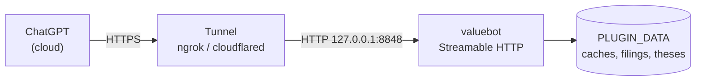

# valuebot on ChatGPT (Desktop and web)

ChatGPT **cannot launch a local process**. Its connectors reach an MCP server
only over a **public HTTPS URL**, so there is no `command` / `args` block to
fill in — unlike every other guide in this folder. You must instead run
valuebot as an **HTTP server** and give ChatGPT its public address.

That path now exists: the same server that speaks stdio can speak **Streamable
HTTP** on request, with no new files or dependencies.

See the [harness overview](../README.md) for the canonical launch contract and
the [multi-harness guide](../../docs/users/09-multi-harness.md) for
cross-harness details.

## Verification status

Be clear about what is proven and what is not:

| Layer | Status |
|:---|:---|
| Streamable HTTP transport in `mcp/server.py` | ✅ **Verified 2026-10-31** — `initialize`, `tools/list` (19 tools) and `tools/call ping` all succeeded over HTTP |
| stdio behaviour unchanged | ✅ **Verified** — `tests/contract` 34 passed, 2 skipped |
| End-to-end ChatGPT connector | ⚠️ **UNVERIFIED** — requires a ChatGPT account, a public tunnel and the connector UI; none were exercised for this page |

## How it works



Three points follow from that shape, and they drive every step below:

1. **The tunnel is mandatory.** OpenAI's servers cannot reach `localhost`.
2. **The server must be told to speak HTTP.** By default it speaks stdio.
3. **Whatever the tunnel exposes is public.** valuebot ships **no
   authentication** — read [Security](#security-read-this) before you start.

## Prerequisites

- ChatGPT with **connector / developer-mode** access (paid plans; the UI and
  its availability change between releases — this guide describes the flow
  rather than exact menu labels).
- A tunnel client: [`ngrok`](https://ngrok.com) or
  [`cloudflared`](https://developers.cloudflare.com/cloudflare-one/) (`brew
  install cloudflared`).
- `uv` on `PATH`, or Python 3.11–3.13 — the launcher falls back to a venv.
- The one-time SEC identity, run from the plugin root:

```bash
cd <PLUGIN_ROOT>/
./setup.sh example-user@gmail.com
```

## Step 1 — start the HTTP transport

Two variables control it. Everything else is unchanged.

| Variable | Default | Meaning |
|:---|:---|:---|
| `VW_MCP_TRANSPORT` | `stdio` | set to `streamable-http` (or `http`) to serve HTTP |
| `VW_MCP_HTTP_HOST` | `127.0.0.1` | bind address |
| `VW_MCP_HTTP_PORT` | `8848` | bind port; the MCP path is always `/mcp` |

With no tunnel yet, bind to loopback and confirm it serves:

```bash
cd <PLUGIN_ROOT>
PLUGIN_DATA=<PLUGIN_DATA> VW_MCP_TRANSPORT=streamable-http \
  VW_MCP_HTTP_PORT=8848 sh mcp/run.sh
```

stderr should show:

```text
INFO valuebot.mcp: transport: streamable-http on http://127.0.0.1:8848/mcp
INFO:     Uvicorn running on http://127.0.0.1:8848
```

The endpoint is `http://127.0.0.1:8848/mcp`. The `/mcp` path is not optional —
pointing at `:8848` alone returns nothing useful.

> **`VW_THESIS_ROOT` is a container path.** The launch contract's default
> `/vw-data/theses` made sense inside the LibreChat image and does not exist on
> a desktop. Export it to a real absolute folder, or leave the thesis module
> unused. Do not point it at a folder you are unwilling to expose.

> **Leave the process running.** It owns the MCP session. Stopping it removes
> every tool from ChatGPT mid-conversation.

## Step 2 — expose it over public HTTPS

In a second terminal:

```bash
cloudflared tunnel --url http://localhost:8848
# or
ngrok http 8848
```

Copy the `https://…` address the tunnel prints and append `/mcp`:

```text
https://<random>.trycloudflare.com/mcp
```

### The DNS-rebinding guard will block the tunnel

The MCP SDK automatically enables Host-header validation whenever the server
binds to a loopback address. A request arriving with
`Host: <random>.trycloudflare.com` is therefore rejected with
`Invalid Host header` / **HTTP 421** — verified.

Two ways out, both with a cost:

| Fix | Cost |
|:---|:---|
| Set `VW_MCP_HTTP_HOST=0.0.0.0` | **Disables the automatic guard** and binds every interface, so the port is reachable on your LAN too. Put a firewall rule in front of it. |
| Keep `127.0.0.1` and rewrite the Host header in a proxy (nginx `proxy_set_header Host localhost;`) | an extra moving part, but keeps the guard on and the port off the LAN |

If ChatGPT reports the connector is unreachable while a local `curl` works,
this guard is the first thing to check — it fails *only* through the tunnel.

## Step 3 — add the connector in ChatGPT

Do this once per account. Connectors are account-level, so the desktop app and
the web app see the same one.

1. **Settings → Connectors** (older builds: *Settings → Beta features*).
2. Enable **Developer mode** — without it the "create your own connector" flow
   is hidden.
3. **Create** a connector:
   - **Name:** `valuebot`
   - **MCP server URL:** the `https://…/mcp` address from step 2
   - **Authentication:** *No authentication* (valuebot has none — see the
     warning below)
4. Save, then enable the connector in a chat via the **tools / connectors**
   control in the composer.

> **Some builds refuse `localhost`/private URLs outright.** That is expected:
> ChatGPT fetches the server itself, from its own infrastructure. Only the
> public tunnel URL is usable.

## Step 4 — verify

Ask ChatGPT:

> Use ping and tell me the module statuses.

Expect the standard payload with four modules `ready`:

```json
{"ok": true, "module": "core", "tool": "ping",
 "data": {"server": "valuebot", "version": "0.2.0",
          "modules": {"fundamentals": {"status": "ready"},
                      "analysis": {"status": "ready"},
                      "reports": {"status": "ready"},
                      "thesis": {"status": "ready"}},
          "identity_configured": false}}
```

19 tools should be listed. `identity_configured: false` means step 0 (SEC
identity) has not been run; data tools then return
`identity_not_configured`, which means **the wiring is correct**.

Then ask a real question:

> What was Apple's revenue, net margin and diluted share count for the last
> three fiscal years? Cite each number.

## Security (read this)

There is **no authentication, no TLS and no CORS** in the server. Exposing it
means anyone holding the URL gets all 19 tools — including `thesis_read`, which
returns your private notes.

- Treat the tunnel URL as a **password**. Anyone who sees it can read your
  vault while the tunnel is up.
- **Shut the tunnel down** when you finish. Quick tunnels are transient and get
  a new URL on restart, which is a feature here.
- Do not use a long-lived named tunnel without putting auth in front of it
  (for example Cloudflare Access) and check that ChatGPT's connector flow can
  actually authenticate against it.
- If you only want filings and ratios, leave `VW_THESIS_ROOT` unset so the
  thesis module has nothing to serve.
- Prefer `VW_MCP_HTTP_HOST=127.0.0.1` plus a proxy that rewrites `Host` over
  binding `0.0.0.0`, which widens exposure to your local network.

## What does not carry over

ChatGPT is an MCP client, not an agent harness:

| Part | Status in ChatGPT |
|:---|:---|
| The 19 MCP tools | ✅ Available through the connector |
| The five `skills/` folders | ❌ Not loaded. ChatGPT has no `SKILL.md` support. |
| The six personas | ❌ No sub-agents; `vw-orchestrator` cannot dispatch, and there is no audit gate. |
| `plugin.json` / Agent Plugins package | ❌ Not consumed — ChatGPT has no "install from directory" flow. |

Approximate a persona by putting its text from
[`../../agent-builder-exports/`](../../agent-builder-exports/) into **Custom
instructions**, or into a **Project**. This is a prompt, not an enforced role.
The citation, ratio and DCF discipline also lives in the MCP tool
descriptions, so quality degrades gracefully.

## Additional info

- **Sessions are stateful.** The server issues an `mcp-session-id` header; two
  clients need two sessions. If ChatGPT appears to hang after a server restart,
  remove and re-add the connector.
- **Responses are SSE.** The endpoint replies `text/event-stream` with
  `data: {...}` frames. That is normal Streamable HTTP, not an error.
- **Shared data root.** Point `PLUGIN_DATA` at the same directory your other
  harnesses use; caches and downloaded filings are reused. See
  [Shared data root](../README.md#shared-data-root).
- **Prefer Codex CLI if you have a choice.** For local research,
  [Codex CLI](../codex/INSTALL.md) needs no tunnel and no public exposure.
  This route exists because ChatGPT has no stdio transport, not because it is
  the better option.

## Troubleshooting

| Symptom | Cause | Fix |
|:---|:---|:---|
| Connector saves but lists **zero tools** | URL is missing the `/mcp` path, or the server is not running | use `https://…/mcp`; confirm the local process is alive |
| **HTTP 421 / `Invalid Host header`** through the tunnel | SDK DNS-rebinding guard, active because the server bound to loopback | see [the guard](#the-dns-rebinding-guard-will-block-the-tunnel) |
| ChatGPT reachable, `curl` from your machine fails | you are testing a different host/port than the tunnel forwards | compare the tunnel target and `VW_MCP_HTTP_PORT` |
| Connector unreachable, local `curl` fine | tunnel down, or the request never left OpenAI's network | restart the tunnel; verify the URL in a browser returns an MCP error, not a 404 page |
| `identity_not_configured` | expected before setup | `./setup.sh example-user@gmail.com`, then restart the server |
| `VW_MCP_TRANSPORT=bogus` exits 2 | unknown transport value | use `streamable-http` or `http` |
| A module reads `unavailable` | dependency import failed, or a data path is unwritable | read `error_code` in the `ping` payload |
| Chat hangs after a restart | stale `mcp-session-id` on the client | remove and re-add the connector |

The canonical launch contract is in [`../README.md`](../README.md). For
cross-harness setup, see
[`../../docs/users/09-multi-harness.md`](../../docs/users/09-multi-harness.md).
